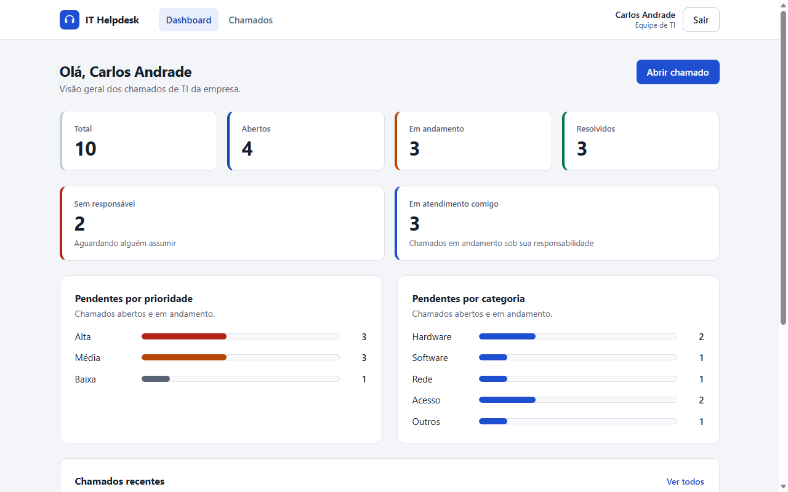
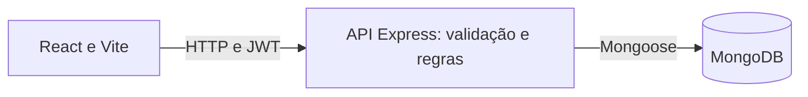

# IT Helpdesk

Central de chamados internos de TI com React, TypeScript, Node.js e MongoDB. Reúne abertura, atendimento e acompanhamento das solicitações, com autenticação, permissões por perfil e histórico persistido.

## Navegação rápida

- [Visão da solução](#visão-da-solução)
- [Demonstração visual](#demonstração-visual)
- [Funcionalidades e perfis](#funcionalidades-e-perfis)
- [Stack](#stack)
- [Como executar](#como-executar)
- [Variáveis de ambiente](#variáveis-de-ambiente)
- [Credenciais demonstrativas](#credenciais-demonstrativas)
- [Arquitetura](#arquitetura)
- [Decisões técnicas](#decisões-técnicas)
- [Testes](#testes)
- [Documentação complementar](#documentação-complementar)

## Visão da solução

O setor de TI recebe muitas solicitações internas, com dificuldade para organizar a fila e acompanhar cada atendimento. A solução centraliza os chamados, identifica solicitante e responsável, registra alterações e oferece uma visão do volume e da situação atual das demandas.

O solicitante acompanha seus pedidos; a TI classifica, atribui e atende; o gestor consulta o conjunto da operação e também pode executar o atendimento. O backend aplica as permissões independentemente dos controles exibidos na interface.

## Demonstração visual

Capturas reais da interface existente, com dados de demonstração:



[Lista de chamados](docs/screenshots/lista-chamados.png) · [Detalhe e histórico](docs/screenshots/detalhe-chamado.png)

O [checklist de apresentação](docs/05-demonstracao.md) orienta a demonstração dos três perfis, da persistência e da autorização.

## Funcionalidades e perfis

- **Solicitante:** abre chamados, consulta apenas os próprios e edita título/descrição enquanto estão abertos.
- **TI:** vê todos os chamados, atribui responsáveis da TI ou gestores ativos, faz triagem, inicia, resolve e reabre atendimentos.
- **Gestor:** acessa uma visão gerencial exclusiva com carga por operador, resoluções comprovadas por autor, solicitantes, alertas acionáveis, tendências em área, pizza de prioridades, barras de categorias e as 24 horas de criação; também assume, atribui, faz triagem, inicia, resolve e reabre chamados. A edição de título/descrição continua restrita aos próprios chamados abertos.

Todos utilizam login com e-mail/senha. O gestor entra em **Visão gerencial**; TI e solicitante entram no dashboard de seu perfil. A sessão é restaurada ao recarregar. Lista possui pesquisa por título, filtros e paginação, com filtros na URL e retorno do detalhe para a fila consultada. O detalhe apresenta histórico de autoria e alterações. A interface adapta o layout ao tamanho da tela e segue o tema claro/escuro do sistema.

**Estado atual:** o formulário solicita título, descrição, categoria e prioridade. Gestão possui períodos Hoje, Últimos sete dias, Mês atual e Ano atual; filtros de analista, solicitante e classificação. O seletor de origem é habilitado apenas por configuração demonstrativa. Impacto, SLA, tempo médio de atendimento e backlog histórico ainda não estão implementados. Consulte as [regras e o escopo](docs/01-produto-e-regras.md).

## Stack

- **Frontend:** React 19, Vite 8, TypeScript, React Router 8 e CSS próprio.
- **Backend:** Node.js, Express 5, TypeScript, Zod, JWT, bcryptjs e express-rate-limit.
- **Dados:** MongoDB 7 e Mongoose 9.
- **Infra local:** Docker Compose apenas para MongoDB; API e frontend executados com npm.
- **Validação:** node:test com Express/MongoDB reais, typecheck, oxlint, builds e E2E mínimo em Edge/Chrome headless.

## Como executar

### Pré-requisitos

Node.js **22.22 ou superior**, npm e Docker com Docker Compose. Docker é dispensável se houver MongoDB externo ou local disponível; configure MONGODB_URI. Para clonar o repositório privado, sua conta precisa de acesso no GitHub.

### Instalação

Os comandos usam `cp`, disponível no Git Bash/macOS/Linux e como alias no PowerShell; neste último também pode usar `Copy-Item`.

```bash
git clone https://github.com/FIDEL7Z/it-helpdesk.git
cd it-helpdesk
docker compose up -d --wait

cd backend
npm ci
cp .env.example .env
```

Preencha **JWT_SECRET** em `backend/.env` com um valor aleatório de pelo menos 32 caracteres. O exemplo vem vazio. Para gerar um valor local:

```bash
node -e "console.log(require('crypto').randomBytes(48).toString('hex'))"
```

Ainda em `backend`, crie os usuários e, opcionalmente, os chamados de demonstração:

```bash
npm run seed
npm run seed:demo

cd ../frontend
npm ci
cp .env.example .env
```

O seed cria TI e solicitante; com as duas variáveis SEED_GESTOR preenchidas, cria também o gestor. Usuários existentes são pulados, sem trocar senha ou papel. O seed demo insere até 10 chamados de exemplo; se já existir o mesmo título para o mesmo solicitante, pula. Os scripts encerram com código 1 em caso de erro.

### Execução

Abra dois terminais, ambos inicialmente na raiz do repositório:

```bash
# Terminal 1: API em http://localhost:3000
cd backend
npm run dev
```

```bash
# Terminal 2: interface em http://localhost:5173
cd frontend
npm run dev
```

Acesse **http://localhost:5173** e use uma das credenciais abaixo. A API só aceita requisições depois de conectar ao MongoDB; configuração inválida ou falha de conexão impede a inicialização.

Para parar o banco, execute `docker compose down` na raiz. O volume `mongo-data` preserva os dados. `docker compose down -v` remove o volume e seus dados; não é necessário para a execução ou demonstração.

### Build de produção local

Em terminais separados, a partir da raiz:

```bash
# API
cd backend
npm run build
npm start
```

```bash
# Interface: preview local em http://localhost:4173
cd frontend
npm run build
npm run preview
```

Para esse preview, inclua `http://localhost:4173` em CORS_ORIGIN e reinicie a API. Preview serve para conferir o build local; não define a hospedagem de produção.

## Variáveis de ambiente

Copie os exemplos para `.env`; arquivos de ambiente e variantes são ignorados pelo Git, preservando `.env.example`. Não use as credenciais demonstrativas em produção.

| Backend: variável | Configuração |
|---|---|
| `MONGODB_URI` | Obrigatória; exemplo `mongodb://localhost:27017/it-helpdesk` |
| `JWT_SECRET` | Obrigatória; aleatória, pelo menos 32 caracteres |
| `PORT` | Opcional; padrão `3000` |
| `DEMO_MODE` | Opcional; padrão `false`; `true` libera origens demo/legado nos indicadores somente fora de produção |
| `APP_TIMEZONE` | Opcional; fuso IANA válido, padrão `America/Fortaleza`; períodos e horários gerenciais |
| `JWT_EXPIRES_IN` | Opcional; padrão `8h`; inteiro positivo seguido de `s`, `m`, `h` ou `d` |
| `CORS_ORIGIN` | Opcional; padrão `http://localhost:5173`; origens separadas por vírgula |
| `SEED_TI_EMAIL` / `SEED_TI_PASSWORD` | Obrigatórias para seed; valores demonstrativos no exemplo; senha com pelo menos 8 caracteres |
| `SEED_SOLICITANTE_EMAIL` / `SEED_SOLICITANTE_PASSWORD` | Obrigatórias para seed; mesmos requisitos |
| `SEED_GESTOR_EMAIL` / `SEED_GESTOR_PASSWORD` | Opcionais para seed; preencher ambas ou nenhuma; senha com pelo menos 8 caracteres |

No frontend, **VITE_DEMO_MODE** tem padrão `false`; habilite `true` somente no ambiente local de demonstração para mostrar os seletores de origem. **VITE_API_URL** define a URL da API, incluindo `/api`: `http://localhost:3000/api`. Esse também é o fallback do cliente. Variáveis de configuração do backend são validadas com Zod; o seed valida suas próprias credenciais.

MongoDB no Compose roda sem autenticação e publica a porta apenas em `127.0.0.1`. Essa configuração é destinada ao desenvolvimento e à avaliação local. Um banco externo com credenciais exige uma MONGODB_URI adequada, mantida fora do Git.

### Dados gerenciais fictícios opcionais

O seed gerencial cria **24 novos chamados por mês**, com eventos v2, dois solicitantes, dois analistas, resoluções e reaberturas. Não transforma registros antigos em histórico comprovado, não altera contas e não gera credenciais.

Requer as cinco contas demonstrativas já existentes no ambiente de apresentação: os três perfis abaixo e as contas adicionais `demo.ti2@helpdesk.local` e `demo.solicitante2@helpdesk.local`. O seed inicial cria apenas os três perfis; sem as duas contas adicionais, o seed gerencial interrompe. Consulte as instruções e restrições no [roteiro local](docs/05-demonstracao.md#seed-gerencial-local).

Em PowerShell, a partir da raiz:

```powershell
cd backend
$env:LOCAL_DEMO_SEED = '1'
npm run seed:manager
Remove-Item Env:LOCAL_DEMO_SEED
```

O comando recusa produção, bancos remotos e bancos diferentes de `it-helpdesk`. Repetir no mesmo mês não duplica nem atualiza exemplos existentes. Para visualizar: `http://localhost:5173/manager?dataOrigin=demo`, com os seletores habilitados e login do gestor.

## Credenciais demonstrativas

Valores do `backend/.env.example`, usados por `npm run seed`:

| Perfil | Nome | E-mail | Senha |
|---|---|---|---|
| TI | Carlos Andrade | `ti@helpdesk.local` | `TiDemo@2026` |
| Solicitante | Mariana Souza | `solicitante@helpdesk.local` | `Solicitante@2026` |
| Gestor | Ana Ribeiro | `gestor@helpdesk.local` | `Gestor@2026` |

Se seu `.env` foi criado antes do gestor, acrescente as duas variáveis SEED_GESTOR do exemplo e execute o seed novamente. Contas já existentes mantêm suas credenciais anteriores. Não há cadastro público na aplicação.

## Arquitetura



Controllers validam a entrada; services aplicam escopo, propriedade e regras; models representam os documentos. Middlewares tratam autenticação, permissão e erros. O app Express é separado da inicialização do servidor para permitir testes de integração. Veja [arquitetura e modelo de dados](docs/02-arquitetura-e-dados.md).

## Decisões técnicas

Solicitante, responsável atribuído e autor da resolução são identidades distintas. Resolver um chamado de outro responsável exige justificativa; reabrir exige motivo e inicia um novo ciclo. A tabela e o histórico apresentam autoria explícita. Eventos legados permanecem preservados, sem reconstrução presumida de autores ou datas.

O dashboard começa com dados operacionais. Somente no ambiente local, configure `DEMO_MODE=true` no backend e `VITE_DEMO_MODE=true` no frontend e reinicie ambos. Use **Origem dos dados → Demonstração** na visão gerencial ou **Origem dos indicadores → Demonstração** no dashboard para os exemplos do seed; legado não classificado possui opção separada. Esses dados não entram nas contagens operacionais.

Na visão gerencial, criações usam `createdAt`; resoluções usam eventos v2 por autor e ciclo, preservados após reabertura. Carga usa a atribuição atual. Histórico legado sem evidência não gera produtividade presumida. Consulte as [definições exatas e limites](docs/04-metricas-decisoes-e-limites.md#visão-gerencial-exclusiva).

Permissões centralizadas no backend e usuário consultado a cada request mantêm o papel atual como autoridade. Validação Zod e rotas por ação restringem campos de escrita. Histórico e alterações são gravados juntos, com controle de concorrência pela revisão numérica consultada no frontend. Lista e dashboard compartilham os filtros de autorização, sem prometer um snapshot único durante alterações simultâneas.

JWT fica no localStorage, com risco de exposição por XSS e logout apenas local. Login limita 10 tentativas por IP em 15 minutos. Esses tradeoffs, o modelo local do MongoDB e os limites das métricas estão detalhados em [métricas, decisões e limites](docs/04-metricas-decisoes-e-limites.md).

## Testes

Com dependências dos dois projetos instaladas, `.env` do backend válido e MongoDB disponível, execute a partir da raiz:

```bash
cd backend
npm test
npm run test:typecheck
npm run build
npm run test:e2e

cd ../frontend
npm run lint -- --deny-warnings
npm run build
```

A integração cobre autenticação, isolamento, permissões dos três perfis, validação, transições, histórico, concorrência, dashboard e rate limit. Usa bancos separados `it-helpdesk-test*`, apagados ao final; não apaga o banco de desenvolvimento.

O E2E exige Edge/Chrome instalado e usa Node/WebSocket, sem biblioteca adicional. Inicia API e Vite em portas livres, cria usuários e banco temporários e encerra/remove esses recursos. Verifica login/logout, sessão após reload, dashboards dos três perfis, isolamento, operações do gestor, conflito por revisão, justificativa de resolução por outro operador e edição própria persistida. Recarrega o dashboard básico três vezes por perfil; verifica o dashboard gerencial exclusivo, filtros, origem, autoria real, ciclos, analistas com zero chamados, retorno à fila e layout em 390 px/desktop. O E2E também cria o seed estruturado no banco temporário, repete-o sem duplicações e percorre os alertas até a fila e o histórico. Verifica também busca, loading, erro HTTP simulado, repetição da consulta e estado vazio da fila/gestão. Capturas claro/escuro e contraste dos botões são conferidos.

Se o navegador não for encontrado, defina E2E_BROWSER_PATH com seu executável. Em falhas, os diagnósticos ficam em `backend/e2e-results/`, ignorado pelo Git, com tempos, URLs/status e captura quando disponível, sem senhas/tokens/headers. Esse E2E não substitui a revisão manual completa de acessibilidade nem identifica a causa do timeout antigo reportado. Consulte o [escopo das verificações](docs/05-demonstracao.md#o-que-os-testes-verificam).

## Documentação complementar

- [Produto, regras e raciocínio do autor](docs/01-produto-e-regras.md)
- [Arquitetura, coleções, referências e índices](docs/02-arquitetura-e-dados.md)
- [Jornadas, ciclo de vida e referência da API](docs/03-fluxos-e-api.md)
- [Definições das métricas, decisões técnicas e limitações](docs/04-metricas-decisoes-e-limites.md)
- [Auditoria estruturada, ciclos, compatibilidade e limitações](docs/06-integridade-e-auditoria.md)
- [Checklist de apresentação, acesso do avaliador e solução de problemas](docs/05-demonstracao.md)
