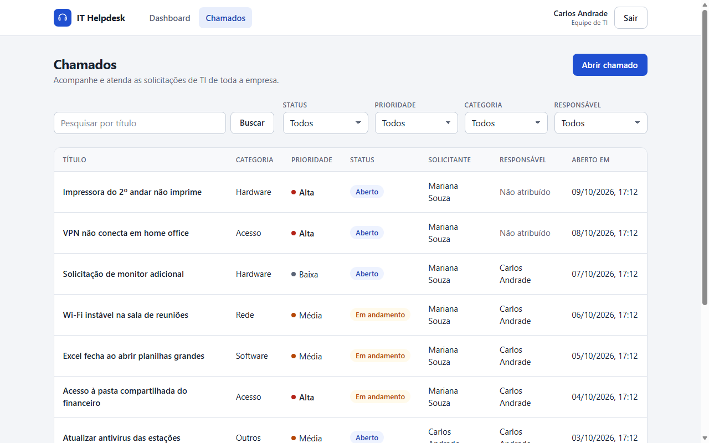
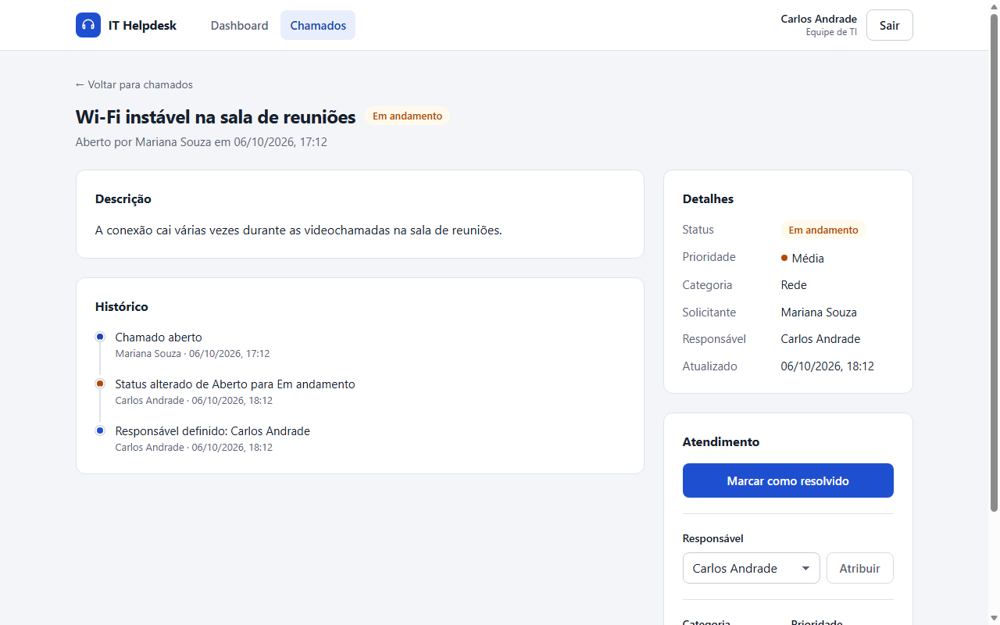

# IT Helpdesk

Sistema de chamados internos de TI. Os colaboradores abrem e acompanham as suas solicitações. A equipe de TI organiza a fila, assume, atualiza e resolve os chamados, e tem um dashboard com a visão geral.


## Sumário

- [Problema e solução](#problema-e-solução)
- [Funcionalidades](#funcionalidades)
- [Stack](#stack)
- [Requisitos](#requisitos)
- [Instalação](#instalação)
- [Execução](#execução)
- [Variáveis de ambiente](#variáveis-de-ambiente)
- [Usuários de teste](#usuários-de-teste)
- [Seeds](#seeds)
- [Testes e qualidade](#testes-e-qualidade)
- [Endpoints da API](#endpoints-da-api)
- [Regras de negócio](#regras-de-negócio)
- [Arquitetura](#arquitetura)
- [Decisões técnicas](#decisões-técnicas)
- [Segurança](#segurança)
- [Limitações conhecidas](#limitações-conhecidas)
- [Roteiro de demonstração (5 minutos)](#roteiro-de-demonstração-5-minutos)
- [Solução de problemas](#solução-de-problemas)

## Problema e solução

O setor de TI recebe muitas solicitações internas. Os principais problemas são a sobrecarga, a desorganização, a falta de visibilidade e a dificuldade de acompanhar cada pedido.

A solução é um **service desk interno enxuto**:

| Problema | Como o sistema resolve |
|---|---|
| Volume alto | Lista com filtros (status, prioridade, categoria e responsável), busca por título e paginação |
| Desorganização | Cada chamado tem categoria, prioridade, status e um responsável |
| Falta de visibilidade | Dashboard com contagens por status, pendentes por prioridade e categoria, e a fila da TI |
| Acompanhamento difícil | Fluxo de status explícito e histórico de cada chamado (quem fez o quê e quando) |

Existem três perfis:
- **Solicitante:** qualquer colaborador. Abre chamados e acompanha os seus.
- **TI:** a equipe de suporte. Vê todos os chamados, faz a triagem, atribui, atende e resolve.
- **Gestor (Gestão de TI):** supervisiona. Vê todos os chamados e o histórico em **modo leitura**. Pode abrir e editar os próprios chamados como qualquer colaborador, mas não faz triagem, atribuição nem mudança de status.

## Funcionalidades

- **Login** com e-mail e senha (JWT), sessão restaurada ao recarregar a página, rotas protegidas e logout.
- **Abertura de chamado** com título, descrição, categoria e prioridade.
- **Lista de chamados** com filtros, busca e paginação. Os filtros ficam na URL, então sobrevivem ao recarregar e funcionam com o botão voltar.
- **Detalhes do chamado** com histórico em ordem cronológica.
- **Ações da TI:** iniciar o atendimento (assumindo o chamado, se ele não tiver responsável), resolver, reabrir, atribuir um responsável e reclassificar a categoria e a prioridade.
- **Ações do solicitante:** editar o título e a descrição enquanto o chamado estiver aberto.
- **Dashboard** com números que **batem com a lista**: cada cartão abre a lista com o filtro equivalente.
- **Interface:** responsiva (celular, tablet e desktop), tema claro e escuro seguindo o sistema, e navegação por teclado com foco visível.

| Lista de chamados | Detalhe do chamado |
|---|---|
|  |  |

## Stack

| Camada | Tecnologias |
|---|---|
| Frontend | React 19, Vite 8, TypeScript, React Router 8 e CSS próprio (sem biblioteca de UI) |
| Backend | Node.js, Express 5, TypeScript, Zod (validação), jsonwebtoken, bcryptjs e express-rate-limit |
| Banco | MongoDB 7 com Mongoose 9 |
| Testes | `node:test` (já vem no Node) com o app Express real e um MongoDB real |
| Infra local | Docker Compose, só para o MongoDB |

O repositório é um monorepo com duas aplicações independentes: `backend/` e `frontend/`.

## Requisitos

- **Node.js 22.22 ou mais recente.** Esse mínimo vem do React Router 8 (o backend sozinho funciona a partir do Node 20.19, exigido pelo Mongoose 9). Os `package.json` declaram `engines`, então o npm avisa se a versão for menor.
- **npm** (vem com o Node).
- **Docker com Docker Compose,** para subir o MongoDB. É opcional se você já tiver um MongoDB (local ou Atlas). Veja [Variáveis de ambiente](#variáveis-de-ambiente).

## Instalação

Os comandos abaixo funcionam no Git Bash, no macOS e no Linux. No PowerShell, troque `cp` por `Copy-Item`.

```bash
git clone https://github.com/FIDEL7Z/it-helpdesk.git
cd it-helpdesk

# 1. MongoDB (porta 27017, só em 127.0.0.1)
docker compose up -d --wait

# 2. Backend
cd backend
npm ci
cp .env.example .env
```

Abra o `backend/.env` e preencha o `JWT_SECRET` com um valor aleatório de **pelo menos 32 caracteres**. Para gerar um:

```bash
node -e "console.log(require('crypto').randomBytes(48).toString('hex'))"
```

Depois, ainda em `backend/`:

```bash
npm run seed        # cria os 2 usuários de teste (pode rodar de novo sem duplicar)
npm run seed:demo   # opcional: 10 chamados de exemplo para a demonstração

# 3. Frontend
cd ../frontend
npm ci
cp .env.example .env
```

## Execução

Use dois terminais:

```bash
# Terminal 1: API em http://localhost:3000
cd backend
npm run dev

# Terminal 2: interface em http://localhost:5173
cd frontend
npm run dev
```

Acesse **http://localhost:5173** e entre com um dos [usuários de teste](#usuários-de-teste).

O backend só começa a aceitar requisições depois de conectar ao MongoDB. Se a configuração estiver errada (por exemplo, `JWT_SECRET` curto ou MongoDB fora do ar), ele encerra com uma mensagem clara.

**Build de produção (opcional):**

```bash
cd backend && npm run build && npm start      # executa dist/server.js
cd frontend && npm run build && npm run preview   # serve o build em http://localhost:4173
```

Para usar o `preview`, inclua `http://localhost:4173` no `CORS_ORIGIN` do backend.

**Parar o MongoDB:** `docker compose down`. Os dados ficam no volume `mongo-data` (no Docker, ele aparece como `it-helpdesk_mongo-data`). Para apagar tudo, use `docker compose down -v`.

## Variáveis de ambiente

Os arquivos `.env` **não são versionados**. Copie de `.env.example`.

### `backend/.env`

| Variável | Obrigatória | Exemplo | Descrição |
|---|---|---|---|
| `PORT` | não | `3000` | Porta da API |
| `MONGODB_URI` | sim | `mongodb://localhost:27017/it-helpdesk` | Conexão com o MongoDB. Pode ser um Atlas (`mongodb+srv://...`) |
| `JWT_SECRET` | sim | (aleatório) | Segredo para assinar o token. Precisa ter **pelo menos 32 caracteres** |
| `JWT_EXPIRES_IN` | não | `8h` | Validade do token: número seguido de `s`, `m`, `h` ou `d` |
| `CORS_ORIGIN` | não | `http://localhost:5173` | Origens do frontend que podem chamar a API, separadas por vírgula |
| `SEED_TI_EMAIL` / `SEED_TI_PASSWORD` | para o seed | ver `.env.example` | Usuário de TI criado pelo `npm run seed` |
| `SEED_SOLICITANTE_EMAIL` / `SEED_SOLICITANTE_PASSWORD` | para o seed | ver `.env.example` | Usuário solicitante criado pelo `npm run seed` |
| `SEED_GESTOR_EMAIL` / `SEED_GESTOR_PASSWORD` | não | ver `.env.example` | Gestor de demonstração. **Preencha as duas ou nenhuma**: sem nenhuma, o seed não cria o gestor; com só uma, falha com erro claro |

As variáveis são validadas com Zod na inicialização, e um valor inválido impede a API de subir.

### `frontend/.env`

| Variável | Exemplo | Descrição |
|---|---|---|
| `VITE_API_URL` | `http://localhost:3000/api` | URL base da API, **já com o `/api`** |

## Usuários de teste

Criados pelo `npm run seed` com os valores do `backend/.env.example`. São **credenciais de demonstração**, sem uso real.

| Perfil | Nome | E-mail | Senha |
|---|---|---|---|
| TI | Carlos Andrade | `ti@helpdesk.local` | `TiDemo@2026` |
| Solicitante | Mariana Souza | `solicitante@helpdesk.local` | `Solicitante@2026` |
| Gestor | Ana Ribeiro | `gestor@helpdesk.local` | `Gestor@2026` |

Se você criou o `backend/.env` antes da existência do gestor, acrescente as duas variáveis `SEED_GESTOR_*` do `.env.example` e rode o `npm run seed` de novo. Os usuários existentes são pulados.

Não existe cadastro público: num sistema interno, os usuários são criados pela empresa (aqui, pelo seed).

## Seeds

| Comando | O que faz | Garantias |
|---|---|---|
| `npm run seed` | Cria os usuários de teste (TI, solicitante e, se configurado, gestor) | É idempotente: se o e-mail já existir, pula. **Nunca troca a senha nem o papel** de um usuário existente. Não imprime senhas |
| `npm run seed:demo` | Cria 10 chamados de exemplo, com status, histórico e datas variados | **Só insere**: não altera nem apaga nada. É idempotente: um chamado demo existente (mesmo solicitante e mesmo título) é pulado. Exige que o `npm run seed` tenha rodado antes |

Os dois scripts encerram com código 1 em caso de erro (variável inválida, banco fora do ar ou usuários ausentes).

## Testes e qualidade

```bash
cd backend
npm test        # testes de integração: precisam do MongoDB rodando (docker compose up -d)
npm run test:typecheck # checagem de tipos do backend e dos testes de integração
npm run build   # checagem de tipos e compilação
npm run test:e2e # regressão mínima no navegador: MongoDB + dependências dos dois projetos + Edge/Chrome

cd ../frontend
npm run lint    # oxlint
npm run build   # checagem de tipos e build de produção
```

Os testes do backend usam o `node:test`, que já vem no Node. Cada teste sobe o app Express real e usa um MongoDB real, num banco separado (`it-helpdesk-test*`), que é apagado ao final. Os bancos de desenvolvimento não são tocados.

O E2E mínimo (`backend/tests/e2e.mjs`) utiliza o Edge/Chrome headless instalado, o WebSocket nativo do Node e as dependências existentes, sem bibliotecas adicionais. Execute `npm run test:e2e` em `backend`, com o MongoDB acessível pela configuração local e as dependências de `frontend` instaladas. Não é necessário iniciar a API ou o Vite manualmente: o teste inicia ambos em portas locais livres, gera credenciais temporárias e usa um banco com nome exclusivo por execução. Ao terminar, encerra os serviços e remove esse banco e o perfil temporário do navegador. Não altera os arquivos `.env` nem os usuários de demonstração.

No Windows, o teste procura Edge ou Chrome nos caminhos padrão; em outro ambiente, defina `E2E_BROWSER_PATH` com o caminho do executável, caso não seja encontrado automaticamente. O teste verifica redirecionamento de rota protegida, senha incorreta, login/logout, persistência da sessão após recarregar, isolamento da lista e do detalhe, dashboard dos três perfis e restrições do gestor na interface e na API. Para investigar instabilidade, recarrega o dashboard três vezes por perfil e registra os tempos de espera. Inclui uma verificação de largura do dashboard gerencial em 390 px; não substitui uma revisão visual completa de responsividade.

As esperas verificam estados do DOM, com prazo de 15 segundos, e as chamadas auxiliares à API têm limite de 10 segundos. Se houver falha, salva `backend/e2e-results/diagnostics.json` com tempos e URLs/status das requisições, além de uma captura `failure.png` quando o navegador estiver acessível. Não registra senhas, tokens ou headers de autenticação. Esses artefatos são locais e ignorados pelo Git. Um resultado aprovado não determina a causa do timeout reportado anteriormente, cujos scripts e registros não estão disponíveis neste repositório.

| Arquivo | O que cobre |
|---|---|
| `tests/auth.test.ts` | Login (válido, senha errada, usuário inexistente, validação, papel enviado pelo cliente sendo ignorado), `/auth/me` (sem token, inválido, assinado com outro segredo, expirado, usuário apagado), `requireRole` (200/401/403) e e-mail único |
| `tests/tickets.test.ts` | Criação (dono vindo do token, campos proibidos), listagem por papel, filtros (incluindo `assignee`), busca, paginação, detalhe (404 para chamado de outra pessoa), edição, transições de status, reabertura, atribuição, histórico e concorrência |
| `tests/dashboard.test.ts` | Contagens por papel, pendentes por prioridade e categoria, zeros preenchidos, recentes e **igualdade de cada número com o total da lista equivalente** |
| `tests/permissions.test.ts` | Mapa de permissões (cada papel × cada permissão; papel desconhecido nega tudo), matriz das rotas para solicitante, TI e gestor, regras do gestor (edita os próprios chamados, não opera, não pode ser responsável), dashboard do gestor e papel lido sempre do banco |
| `tests/security.test.ts` | Rate limit do login (429 depois de 10 tentativas, headers padrão, isolamento dos outros endpoints), ausência do `X-Powered-By` e limite do corpo JSON (413) |

## Endpoints da API

Base: `http://localhost:3000/api`. Todas as respostas são JSON. Os erros seguem o formato `{ "message": "..." }`, e os erros de validação trazem também `errors` (por campo) e `formErrors`.

| Método | Rota | Acesso | Descrição |
|---|---|---|---|
| GET | `/health` | público | `{ "status": "ok" }` |
| POST | `/auth/login` | público, **com rate limit** | `{ email, password }` → `{ token, user }` |
| GET | `/auth/me` | logado | `{ user }` |
| POST | `/tickets` | logado | Abre um chamado: `{ title, description, category, priority? }` |
| GET | `/tickets` | logado | Lista os chamados que o usuário pode ver. Query: `status`, `priority`, `category`, `assignee` (`none` ou `me`), `search`, `page`, `limit` (máx. 50) |
| GET | `/tickets/:id` | dono, TI ou gestor | Detalhe com histórico |
| PATCH | `/tickets/:id` | dono ou TI | O dono edita `title` e `description` (só com o chamado `aberto`). A TI edita `category` e `priority` (se não estiver `resolvido`) |
| PATCH | `/tickets/:id/status` | TI | `{ status }`, seguindo as transições permitidas |
| PATCH | `/tickets/:id/assignee` | TI | `{ assigneeId }`. O responsável precisa ser da TI |
| GET | `/users/it-staff` | TI ou gestor | Lista a equipe de TI, ou seja, quem pode ser responsável (o gestor não entra) |
| GET | `/dashboard/summary` | logado | Indicadores no escopo do usuário (ver [Dashboard](#dashboard)) |

**Códigos HTTP:**
- `400`: dados inválidos ou campo não permitido.
- `401`: não autenticado, token inválido ou expirado.
- `403`: autenticado, mas sem permissão.
- `404`: não encontrado, ou chamado de outra pessoa para o solicitante.
- `409`: transição inválida, ação incompatível com o status atual ou edição simultânea.
- `413`: corpo grande demais.
- `429`: excesso de tentativas de login.
- `500`: erro inesperado, sem detalhes internos na resposta.

## Regras de negócio

As regras são aplicadas **no backend**. O frontend só esconde as ações que a pessoa não pode executar.

### Permissões

| Ação | Solicitante | TI | Gestor |
|---|---|---|---|
| Abrir chamado | ✅ (como solicitante) | ✅ | ✅ |
| Ver chamados e histórico | só os próprios | todos | todos (leitura) |
| Editar título e descrição | só os próprios e só com status `aberto` | só os próprios e só com status `aberto` | só os próprios e só com status `aberto` |
| Alterar categoria e prioridade (triagem) | ❌ | ✅ se não estiver `resolvido` | ❌ |
| Mudar status | ❌ | ✅ | ❌ |
| Atribuir responsável | ❌ | ✅ (só para usuários da TI, e se não estiver `resolvido`) | ❌ |
| Ser responsável por um chamado | ❌ | ✅ | ❌ |
| Listar a equipe de TI | ❌ | ✅ | ✅ |

As permissões ficam **num único lugar**: `backend/src/auth/permissions.ts`, um mapa de permissão → papéis. Exemplos: `tickets:view-all`, `tickets:operate`, `tickets:be-assigned` e `users:list-it-staff`. Rotas e services perguntam "este papel **pode** fazer X?" com `can()` ou `requirePermission()`, em vez de comparar nomes de papel. Um papel novo começa **sem nenhuma permissão** até ser incluído no mapa.

O frontend tem uma cópia desse mapa (`frontend/src/auth/permissions.ts`) **só para mostrar ou esconder botões**. Quem decide é sempre a API: chamar a rota diretamente sem permissão resulta em 403.

- O papel **não fica no token**. Ele é lido do banco a cada requisição, então uma mudança de papel vale na próxima requisição, sem novo login.
- O **solicitante** de um chamado vem sempre do token, nunca do corpo da requisição.
- Mandar campos como `requester`, `status`, `assignee` ou `history` onde não são permitidos dá **400**.

### Fluxo de status

```
aberto ──► em_andamento ──► resolvido
                ▲                │
                └──── reabrir ───┘
```

- Só a TI muda o status. Qualquer outra transição dá **409**.
- **Ao iniciar o atendimento** de um chamado sem responsável, quem iniciou vira o responsável.

### Histórico

Cada chamado guarda eventos com **tipo, autor, data e uma descrição objetiva**. Os tipos são: criação, edição, mudança de status, reabertura e atribuição. O histórico é escrito só pelo servidor, e uma edição que não muda nada não gera evento.

### Dashboard

Os números são calculados **no escopo do usuário**: o solicitante vê só os próprios chamados; a TI e o gestor veem todos. Os cartões "Sem responsável" e "Em atendimento comigo" aparecem só para a TI. Por enquanto, o gestor usa este dashboard com escopo global, até existir uma visão gerencial própria. Cada número é igual ao total da lista com o filtro equivalente:

| Cartão | Lista equivalente |
|---|---|
| Total | `/tickets` |
| Abertos / Em andamento / Resolvidos | `/tickets?status=...` |
| Sem responsável (TI) | `/tickets?assignee=none` |
| Em atendimento comigo (TI) | `/tickets?assignee=me&status=em_andamento` |

"Pendentes por prioridade" e "Pendentes por categoria" consideram só os chamados `aberto` e `em_andamento`.

## Arquitetura

```
it-helpdesk/
├── docker-compose.yml        MongoDB local (volume persistente, healthcheck)
├── docs/screenshots/         Imagens usadas neste README
├── backend/
│   ├── src/
│   │   ├── auth/             permissions.ts: mapa único de permissões por papel
│   │   ├── config/           env.ts (validação das variáveis com Zod) e db.ts
│   │   ├── models/           User e Ticket (schemas Mongoose, enums e transições)
│   │   ├── routes/           Rotas por recurso e middlewares de acesso
│   │   ├── controllers/      Validação da entrada (Zod) e montagem da resposta HTTP
│   │   ├── services/         Regras de negócio e acesso ao banco
│   │   ├── middlewares/      Autenticação/papel, tratamento de erros e rate limit
│   │   ├── utils/            JWT e hash de senha
│   │   ├── scripts/          seed.ts e seed-demo.ts
│   │   ├── app.ts            Montagem do Express (sem abrir porta, facilita os testes)
│   │   └── server.ts         Conecta no MongoDB e só depois abre a porta
│   └── tests/                Testes de integração (node:test)
└── frontend/
    └── src/
        ├── services/         Cliente HTTP único (api.ts) e funções por recurso
        ├── auth/             AuthContext, AuthProvider (sessão), useAuth e a cópia do mapa de permissões (só para a interface)
        ├── components/       Layout, rota protegida, badges e loaders
        ├── pages/            Login, Dashboard, Chamados, Novo chamado e Detalhe
        ├── hooks/            useDocumentTitle
        └── utils/            Formatação de data e mensagens de erro
```

**Caminho de uma requisição autenticada:** `route` → `requireAuth` (valida o JWT e carrega o usuário do banco) → `requirePermission` (quando a ação exige uma permissão específica, como as exclusivas da TI) → `controller` (Zod) → `service` (regras e escopo) → Mongoose. Os erros sobem para o middleware central, que responde em JSON sem detalhes internos.

## Decisões técnicas

| Decisão | Motivo | Trade-off |
|---|---|---|
| **Vite + React**, sem Next.js | O sistema não precisa de SSR nem de SEO. É mais simples e rápido para o prazo | Não tem renderização no servidor |
| **JWT no `localStorage`** | Simples, sem precisar de CORS com credenciais nem proteção contra CSRF | Se houver uma falha de XSS, um script consegue ler o token. Um cookie `httpOnly` seria mais seguro |
| **`requireAuth` busca o usuário no banco** a cada requisição | Um usuário apagado perde o acesso na hora, e o papel vem sempre do banco | Uma consulta por id a cada requisição (irrelevante neste porte) |
| **JWT HS256 com algoritmo fixado** e payload só com `sub` | Bloqueia o ataque `alg=none` e não expõe dados no token | Não há revogação de token antes de expirar |
| **Mensagem genérica no login** e comparação com um hash fictício | Nem a mensagem nem o tempo de resposta revelam se o e-mail existe | Nenhum relevante |
| **404 (e não 403)** para chamado de outra pessoa | A API não confirma que aquele id existe | Nenhum relevante |
| **Permissões centralizadas** (mapa permissão → papéis, negado por padrão) | Um único lugar para revisar quem pode fazer o quê; um papel novo não herda permissões por engano | Precisa manter a cópia do frontend sincronizada (ela só controla a interface) |
| **Uma rota por ação** (`/status`, `/assignee`) e **schemas estritos** | Não existe um "update genérico" que permita burlar as regras | Mais rotas |
| **Bloqueio otimista** pelo `updatedAt` | Duas pessoas da TI alterando ao mesmo tempo: uma recebe 409 em vez de sobrescrever a outra | A pessoa precisa repetir a ação depois que os dados são recarregados |
| **`buildTicketFilter` compartilhado** pela lista e pelo dashboard | Os números do dashboard e da lista não têm como divergir | Nenhum |
| **Uma agregação com `$facet`** no dashboard | Todas as contagens numa única consulta, depois do `$match` de autorização | Não usa cache (desnecessário neste porte) |
| **Busca com regex escapada** | O texto digitado é tratado literalmente, então não quebra a consulta | Sem índice de texto, o que pesa com volume muito alto |
| **bcryptjs** | JS puro: nada para compilar no Windows ou no CI | Um pouco mais lento que o `bcrypt` nativo |
| **Testes com `node:test`** + MongoDB real | Nenhuma dependência de testes, e os testes exercitam o caminho real | Exigem o MongoDB rodando |
| **CSS próprio** com tokens | Sem biblioteca de UI. Tema claro e escuro e responsividade sob controle | Mais CSS escrito à mão |
| **Docker só para o MongoDB** | Setup rápido e fácil de entender, já que front e back rodam com npm | Não é um ambiente 100% em contêineres |

## Segurança

- **Senhas:** guardadas só como hash (bcrypt) e nunca retornadas pela API.
- **Variáveis de ambiente:** validadas na partida. O `JWT_SECRET` precisa ter pelo menos 32 caracteres.
- **Login:** limite de **10 tentativas por IP a cada 15 minutos** (`express-rate-limit`), respondendo 429. As tentativas bem-sucedidas também contam. Só o login tem limite.
- **CORS:** restrito às origens em `CORS_ORIGIN`.
- **Express:** o `X-Powered-By` está desligado e o corpo JSON é limitado a 100 KB (acima disso, 413).
- **Erros:** respostas sem stack trace nem detalhes internos.
- **Arquivos:** os `.env` não são versionados, e os `.env.example` só têm valores de demonstração (o `JWT_SECRET` vem vazio).
- **`npm audit`:** 0 vulnerabilidades conhecidas no backend e no frontend em 09/10/2026, tanto em todas as dependências quanto só nas de produção.

## Limitações conhecidas

- **MongoDB local sem autenticação.** O compose publica a porta só em `127.0.0.1`, então o banco não fica acessível pela rede, mas qualquer processo da própria máquina consegue conectar. **Não use essa configuração em produção.** Lá, use um MongoDB com usuário e senha (por exemplo, o Atlas) num `MONGODB_URI` com credenciais.
- **Rate limit em memória:** os contadores zeram quando a API reinicia e não são compartilhados entre instâncias. Atrás de um proxy reverso, seria preciso configurar o `trust proxy` do Express para enxergar o IP real. Numa rede em que todos saem pelo mesmo IP, as 10 tentativas valem para o grupo.
- **Logout só no navegador:** um token copiado continua válido até expirar (8h por padrão).
- **Sem reset de senha, cadastro de usuários ou gestão de perfis pela interface.** Os usuários vêm do seed.
- **Não dá para remover o responsável,** só trocá-lo. O histórico guarda o nome do responsável no momento do evento.
- **"Em atendimento comigo" conta só os chamados em andamento.** Os chamados abertos já atribuídos aparecem na lista com o filtro "Atribuídos a mim".
- **Dashboard:** sem atualização em tempo real, sem filtro por período e sem métricas de tempo (como o tempo médio de resolução).
- **Sem comentários, anexos ou notificações** (fora do escopo).

## Roteiro de demonstração (5 minutos)

Antes de começar: rode `npm run seed` e `npm run seed:demo` no backend e suba os dois servidores.

1. **Login e segurança (30 s):** abra http://localhost:5173. Tente uma senha errada e veja a mensagem genérica. Depois entre como **solicitante** (`solicitante@helpdesk.local`).
2. **Visão do solicitante (1 min):** no dashboard, só aparecem os números dele. Clique em "Abertos" e mostre que a lista abre com o mesmo filtro e o mesmo total.
3. **Abrir chamado (1 min):** clique em "Abrir chamado" e envie vazio para mostrar a validação. Preencha (por exemplo, "Projetor da sala 3 sem imagem", categoria Hardware, prioridade Alta) e envie. O chamado aparece no topo da lista com uma mensagem de sucesso. Abra o chamado, edite o título e veja o evento no histórico.
4. **Visão da TI (2 min):** saia e entre como **TI** (`ti@helpdesk.local`).
   - No dashboard, mostre "Sem responsável" e "Em atendimento comigo". Clique em "Sem responsável".
   - Abra o chamado do projetor e clique em **Iniciar atendimento**. Ele passa a "Em andamento", você vira o responsável e o histórico ganha 2 eventos.
   - Mude a prioridade (triagem) e clique em **Marcar como resolvido**. Depois clique em **Reabrir chamado** e mostre o evento de reabertura.
5. **Supervisão (opcional, 30 s):** entre como **gestor** (`gestor@helpdesk.local`). Ele vê todos os chamados e o histórico, mas o detalhe não tem ações de atendimento: o gestor só lê.
6. **Fechamento (30 s):** volte ao dashboard, que já mostra os números atualizados. Se houver tempo, mostre a lista no celular (DevTools, 375 px) e o tema escuro.

## Solução de problemas

| Sintoma | Causa provável e solução |
|---|---|
| `docker compose up` falha com a porta 27017 em uso | Já existe um MongoDB rodando. Pare esse MongoDB ou use-o direto, ajustando o `MONGODB_URI` |
| A API encerra com `Invalid environment variables` | `JWT_SECRET` vazio ou com menos de 32 caracteres, ou `MONGODB_URI` ausente. Revise o `backend/.env` |
| A API encerra com `Failed to start server` (conexão) | O MongoDB não está rodando. Veja `docker compose ps` |
| `npm warn EBADENGINE` | O Node está abaixo de 22.22. Atualize o Node |
| Login retorna "Muitas tentativas de login" | O rate limit (10 tentativas em 15 min por IP) foi atingido. Espere ou reinicie a API, porque os contadores ficam em memória |
| Erro de CORS no navegador | O endereço do frontend não está em `CORS_ORIGIN` |
| `seed:demo` falha com "Run npm run seed first" | Rode `npm run seed` antes, com o mesmo `backend/.env` |
