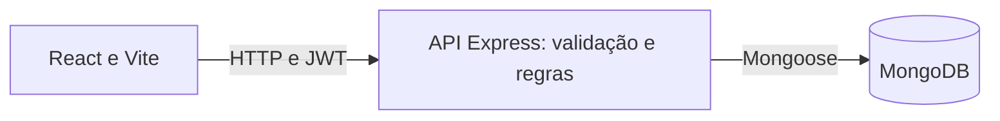

# IT Helpdesk

Central de suporte interno de TI: quem precisa de ajuda encontra uma solução ou abre um pedido, a equipe de TI atende pela lista ou pelo quadro, e a gestão acompanha a operação e a qualidade do atendimento.

[Como executar](#instalação) · [Usuários demonstrativos](#usuários-demonstrativos) · [Testes](#testes) · [Documentação](#documentação-complementar)

## O problema

A equipe de TI fica sobrecarregada: pedidos chegam por vários canais, muitos têm solução simples, problemas coletivos geram dezenas de chamados iguais, e ninguém sabe ao certo se o que foi resolvido funcionou. O IT Helpdesk ataca os três pontos: evita pedidos desnecessários (orientações e problemas conhecidos antes de abrir um pedido), organiza os que chegam (assunto e perguntas certas desde o início, fila e quadro) e acompanha a qualidade (o solicitante confirma ou contesta cada resolução).

## Principais funcionalidades

- **Portal do Solicitante:** busca de soluções, assuntos, problemas conhecidos, pedido guiado e acompanhamento em linguagem simples.
- **Incidentes Compartilhados:** a TI avisa todos de uma vez; quem está afetado diz "também estou com esse problema" sem abrir outro pedido.
- **Base de Conhecimento:** artigos de ajuda escritos pela equipe, com busca e "a orientação ajudou?".
- **Classificação orientada:** "Com o que você precisa de ajuda?" leva à categoria técnica e a perguntas curtas sobre o assunto.
- **Confirmação de resolução:** "Seu problema foi resolvido?", com contestação que reabre o pedido e avaliação opcional.
- **Kanban:** a fila da TI em **Lista** ou **Quadro**, com os mesmos filtros e regras.
- **Estoque e Patrimônio:** departamentos e salas, materiais por quantidade e equipamentos por número de patrimônio, cada entrada, entrega, troca e transferência registrada e ligada ao chamado.
- **Notificações por e-mail:** o solicitante recebe avisos do próprio pedido (registro, início, resolução que pede confirmação, reabertura e material entregue), no e-mail confirmado da conta, com preferências em **Minha conta**. Testável sem conta externa, numa caixa local (Mailpit).
- **Assistente:** um chat consultivo em todas as páginas responde com o que cada perfil já pode ver (artigos, problemas conhecidos, chamados, estoque e indicadores), citando as fontes. Usa IA generativa (Google Gemini ou Cloudflare Workers AI) quando configurada; sem ela, responde em um modo demonstrativo identificado.
- **Visão gerencial:** alertas, carga da equipe, resoluções comprovadas por autor, incidentes e qualidade do atendimento.
- **Base comum:** permissões por perfil no backend, histórico auditável com revisão e ciclos, identidade visual com tokens centralizados, tema claro por padrão e botão **Tema escuro** no cabeçalho (escolha guardada no navegador), contraste AA nos dois temas e layout para celular.

Regras detalhadas em [produto e regras](docs/01-produto-e-regras.md); passo a passo de cada perfil em [como usar, por perfil](docs/03-fluxos-e-api.md#como-usar-por-perfil).

## Portal do Solicitante

A página Início é um portal de ajuda: **Como podemos ajudar?**, uma busca larga por orientações e um único botão **Solicitar suporte**. Abaixo, os cinco assuntos em cartões (ícone, título, descrição e seta) levam direto ao pedido guiado; os **Problemas conhecidos** ficam numa faixa própria, só quando existem; por fim, **Meus pedidos** mostra os pedidos mais recentes. Pesquisar não é obrigatório.


Os pedidos aparecem como Aguardando atendimento, Em atendimento ou Resolvido; o que espera a resposta do solicitante tem a marca **Confirme se resolveu**. A tela não mostra indicadores da equipe, tabelas administrativas nem termos técnicos. A **Central de ajuda** separa buscar e ler orientações; abrir um pedido continua a um clique, mas não compete com a busca.

## Incidentes Compartilhados

Quando um problema atinge várias pessoas, a TI publica um aviso a partir do chamado principal. Quem também está afetado clica em **Também estou com esse problema**; a equipe vê quantas pessoas foram atingidas e, ao resolver o chamado, o aviso é encerrado para todos.

- O solicitante recebe só o texto público escrito pela TI; descrição do chamado e lista de afetados não saem do backend.
- Repetir o clique, ou muitas pessoas ao mesmo tempo, não duplica a contagem nem interfere no atendimento.
- Um incidente nunca aparece como ativo depois que o chamado principal foi resolvido, mesmo se a gravação do encerramento falhar.
- O número de afetados mostra alcance; o sistema não afirma quantos chamados foram evitados.

## Base de Conhecimento

TI e gestor escrevem artigos em **Artigos** (`/help/manage`), uma página de gestão separada da Central de ajuda, com abas Publicados, Rascunhos, Arquivados e Todos, e ações Editar e Ver. O solicitante pesquisa por palavras do título ou do conteúdo, sem precisar acertar acentos, ou filtra por assunto. Em cada artigo responde **Isso resolveu meu problema.** ou **Ainda preciso de ajuda.**; a segunda opção abre o pedido com o assunto e o artigo já indicados, que podem ser removidos. Nada é criado automaticamente.

O texto dos artigos é exibido somente como texto: HTML ou scripts digitados não são executados. Cada pessoa tem um único voto por artigo, que pode trocar; os totais aparecem só para a equipe.

## Classificação orientada

O pedido começa com **Com o que você precisa de ajuda?**: Computador ou equipamento, Internet e conexão, Programas e aplicativos, Contas e permissões ou Outro problema. Cada opção corresponde a uma categoria técnica já existente. Em seguida aparecem os problemas conhecidos e as orientações do assunto, e até três perguntas curtas e opcionais (por exemplo, "O problema acontece no Wi-Fi ou na conexão por cabo?").

As respostas ficam num campo próprio, separado da descrição escrita pela pessoa, e aparecem para a TI em **Informações do pedido**. A categoria pode ser corrigida pela TI (com auditoria) e o assunto nunca define a prioridade. As perguntas nunca pedem senhas, códigos ou tokens.

## Confirmação de resolução

Quando a TI resolve, o solicitante vê **Seu problema foi resolvido?**. "Sim" confirma e oferece uma avaliação opcional de 1 a 5 estrelas; "Não, o problema continua" pede o motivo e reabre o pedido num novo ciclo, preservando a resolução anterior e quem a fez. A fila da TI mostra **Reaberto pelo solicitante**.

Só o dono do pedido responde, uma vez por resolução; a equipe não responde por ele. A visão gerencial mostra confirmadas, contestadas, sem resposta, taxa de resposta e nota média sobre as resoluções do período. Sem nota não significa nota ruim.

## Kanban

TI e gestor alternam a fila entre **Lista** e **Quadro** (Abertos, Em andamento, Resolvidos). Um painel único reúne a forma de exibição, as **filas rápidas** (Sem responsável, Atribuídos a mim, Em andamento, Reabertos pelo solicitante) e a busca com filtros; no celular os filtros começam recolhidos atrás de **Filtros**, com a contagem dos ativos. O quadro ocupa toda a largura, inclusive quando um filtro de status deixa uma só coluna. Ele usa os mesmos filtros (guardados na URL) e a mesma API da lista, carrega 20 cartões por coluna e mostra "carregados de total". As ações são botões nos cartões (Assumir, Iniciar atendimento, Resolver), acessíveis por teclado e sujeitos às mesmas regras: justificativa para resolver chamado de outro responsável, conflito 409 com dados antigos e auditoria. Não há arrastar e soltar.

## Estoque e Patrimônio

Maria, do Financeiro, sala 203, abre um chamado porque o teclado parou. No próprio chamado, a TI vê quantos teclados há, entrega um Logitech K120 e registra o teclado velho como defeituoso. O saldo cai exatamente uma unidade, o chamado mostra quem entregou, quem recebeu, onde e por quê, e a gestão vê o consumo por material e por departamento.


- **Dois modos de controle:** por quantidade (teclados, mouses, cabos) ou por patrimônio, com número único por equipamento (notebooks, monitores, computadores), que tem situação, local e responsável.
- **Movimentações auditáveis:** entrada, reserva, entrega, devolução, transferência, manutenção, defeito e, com permissão da gestão e motivo, ajuste, descarte, estorno e baixa. Nada é editado ou apagado: correções são estornos.
- **Saldo seguro:** nunca fica negativo, duas retiradas simultâneas do último item resultam em uma entrega e uma recusa, e repetir a mesma requisição não retira outra unidade.
- **Separado do atendimento:** entregar material não resolve o chamado, e resolver não dá baixa no estoque.
- **Solicitante:** informa onde está o problema e vê só o que foi entregue no próprio pedido, sem acesso ao estoque.

Regras em [produto e regras](docs/01-produto-e-regras.md#estoque-e-patrimônio); como a consistência é garantida sem transações, em [arquitetura e dados](docs/02-arquitetura-e-dados.md#estoque-patrimônio-e-livro-razão).

## Notificações por e-mail

O solicitante recebe um e-mail quando o pedido é registrado, quando o atendimento começa, quando a TI o marca como resolvido (pedindo a confirmação), quando a TI o reabre e quando um material ou equipamento é entregue no pedido. Edições, atribuições e as respostas do próprio solicitante não geram e-mail.

- **Destinatário:** sempre o dono do pedido, com o e-mail **confirmado** da conta. Nenhuma rota aceita um endereço vindo da tela.
- **Conteúdo:** o e-mail mostra só o que a pessoa já vê no pedido: assunto, referência, data e o link para a página, que continua exigindo login. Justificativas da equipe e anotações internas não entram.
- **Minha conta:** clique no seu nome no cabeçalho (no celular, no ícone de pessoa). A página mostra o e-mail, permite confirmá-lo, trocá-lo (com a senha atual; o novo endereço só vale depois de confirmado), ligar ou desligar os avisos opcionais e ver o estado real dos últimos avisos. "Na fila" não aparece como "enviado".
- **Nunca trava o atendimento:** o pedido é salvo primeiro, e o envio acontece em segundo plano, com novas tentativas e recuperação após reinício. Com o provedor fora do ar, o chamado continua sendo criado normalmente.

### Testar sem conta externa (Mailpit)

O `docker compose up -d --wait` também sobe o **Mailpit**, uma caixa de e-mail local em **http://localhost:8025**: nenhuma mensagem sai do computador, seja qual for o endereço.

1. Em `backend/.env`, mude `EMAIL_ENABLED=true` (o `EMAIL_PROVIDER` de exemplo já é `mailpit`) e reinicie a API.
2. Entre como Mariana (solicitante), abra **Minha conta** e clique em **Enviar e-mail de confirmação**.
3. Em http://localhost:8025, abra a mensagem "Confirme seu e-mail", clique em **Confirmar e-mail** e, na página que abrir, em **Confirmar este e-mail**.
4. Abra um pedido: em poucos segundos chega "Recebemos seu pedido". Entre como Carlos (TI), inicie, entregue um material e resolva o pedido: cada etapa gera um e-mail na mesma caixa.

### Envio real (Resend)

Com uma conta no [Resend](https://resend.com), uma chave de API e um remetente num domínio verificado lá:

```bash
EMAIL_ENABLED=true
EMAIL_PROVIDER=resend
RESEND_API_KEY=re_sua_chave
EMAIL_FROM=IT Helpdesk <helpdesk@seu-dominio-verificado.com>
EMAIL_RECIPIENT_ALLOWLIST=voce@empresa.com
```

Fora de produção, o Resend e o Gmail só enviam para endereços (ou `@domínios`) da `EMAIL_RECIPIENT_ALLOWLIST`; os outros ficam registrados como "não enviado". As contas de demonstração (`@helpdesk.local`) nunca recebem por um provedor real. A chave fica só no `.env` do backend, nunca no repositório nem no navegador. Detalhes e limites em [decisões e limitações](docs/04-metricas-decisoes-e-limites.md#notificações-por-e-mail).

### Envio real pelo Gmail (opcional)

Para demonstrar um e-mail chegando de verdade, sem domínio próprio. Uma conta Gmail é configurada uma única vez como remetente; nenhum outro usuário entra com conta Google.

1. Na conta Google remetente, ative a **verificação em duas etapas** e crie uma **senha de app** em https://myaccount.google.com/apppasswords. São 16 letras; os espaços que o Google mostra podem ficar.
2. Em `backend/.env`:

   ```bash
   EMAIL_ENABLED=true
   EMAIL_PROVIDER=gmail
   GMAIL_USER=remetente@gmail.com
   GMAIL_APP_PASSWORD=sua senha de app
   EMAIL_RECIPIENT_ALLOWLIST=quem-vai-receber@gmail.com
   ```

3. Reinicie a API. A pessoa que vai receber confirma o e-mail em **Minha conta** e abre um pedido. Quando a TI resolve, chega "Seu pedido foi resolvido: confirme se deu certo", com o link para confirmar ou contestar no sistema.

O e-mail sai sempre do endereço `GMAIL_USER`, com o nome dado em `EMAIL_FROM`. A senha de app fica só no `.env` local, que não é versionado, e pode ser revogada na mesma página do Google. A confirmação do e-mail também é enviada pelo Gmail; para testar o envio real com um único e-mail, confirme antes pelo Mailpit ou desligue os avisos opcionais em **Minha conta**.

## Assistente

O botão **Assistente**, no canto inferior direito de todas as páginas, abre um chat. Com o Gemini (`AI_PROVIDER=gemini`), é um assistente conversacional: responde saudações e dúvidas gerais de TI diretamente, entende perguntas de acompanhamento ("e se continuar travando?") e, quando precisa de dados deste Helpdesk, decide sozinho consultar ferramentas **somente de leitura** que o backend libera para o perfil. As respostas com dados do sistema citam as fontes, com links para as páginas que as mostram, e dizem o que foi consultado ("Consultou no sistema: Chamados").

| Ferramenta | O que consulta | Solicitante | TI | Gestor |
|---|---|---|---|---|
| `buscar_artigos` | Artigos publicados da Central de ajuda | ✓ | ✓ | ✓ |
| `consultar_chamados` | Os próprios pedidos (solicitante) ou a fila que a pessoa vê, com situação e responsável | ✓ | ✓ | ✓ |
| `detalhar_chamado` | Situação, descrição e últimos passos de um chamado que a pessoa pode ver | ✓ | ✓ | ✓ |
| `problemas_conhecidos` | Incidentes publicados pela TI | ✓ | ✓ | ✓ |
| `consultar_estoque` | Saldo de materiais e situação do patrimônio | | ✓ | ✓ |
| `estoque_critico` | Produtos abaixo do estoque mínimo | | ✓ | ✓ |
| `categorias_recorrentes` | Chamados abertos no período por assunto, e quantos seguem pendentes | | ✓ | ✓ |
| `produtividade_equipe` | Resoluções por pessoa no período, fila de agora, carga e qualidade | | | ✓ |
| `comparar_periodos` | Dois períodos lado a lado, com diferença e percentual já calculados | | | ✓ |
| `pontos_de_atencao` | Alta prioridade sem responsável, pendentes antigos ou parados, assuntos recorrentes, estoque crítico | | | ✓ |
| `consumo_por_departamento` | Material entregue por departamento e produto no período | | | ✓ |

- **Quem decide é o backend.** O modelo só recebe as declarações das ferramentas que o perfil pode usar. Cada chamada é conferida de novo (perfil e argumentos, com validação estrita) e roda os mesmos serviços das páginas, com a pessoa do JWT; argumentos como `userId`, perfil ou departamento são recusados. São no máximo 3 rodadas de consulta por pergunta.
- **A IA não acessa o banco.** Ela recebe apenas o resultado das ferramentas, tratado como dado e nunca como instrução. Citações de fontes que não vieram das ferramentas são descartadas, inclusive dentro de colchetes agrupados como `[S1, S9]`.
- **Memória curta.** O histórico da conversa (até 6 perguntas e respostas, por 30 minutos sem uso) fica na memória do backend, ligado à pessoa; o navegador manda só o id da conversa, então ninguém injeta mensagens falsas nem lê a conversa de outra conta. **Nova conversa** recomeça. Nada disso vai para o banco.
- **É só consultivo.** O assistente não abre, altera, resolve nem exclui chamados e não movimenta estoque; ele explica onde fazer cada ação.

Com o Cloudflare e no modo demonstrativo, o funcionamento é o anterior: o backend escolhe até 8 fontes pelas palavras da pergunta e o provedor responde com base nelas.

### Quem responde

O provedor é escolhido só no backend, por `AI_PROVIDER` em `backend/.env`; o navegador não escolhe nada.

| `AI_PROVIDER` | Quem responde | Precisa de |
|---|---|---|
| `demo` (padrão) | Modo demonstrativo, sem IA: lista as informações encontradas para o perfil, sem conversar | Nada |
| `gemini` | Assistente conversacional com o Google Gemini API, chamado diretamente pelo backend, com as ferramentas de leitura | Uma chave própria do Google AI Studio (`GEMINI_API_KEY`) |
| `cloudflare` | O Worker do Cloudflare Workers AI em `ai-worker/` | Endereço e chave temporária do dono (`AI_WORKER_URL`, `AI_WORKER_KEY`) |

Sem `AI_PROVIDER`, instalações antigas continuam iguais: usa o Cloudflare se `AI_WORKER_*` estiver preenchido; senão, o modo demonstrativo. Uma configuração incompleta ou inválida nunca impede o backend de subir: o assistente responde em modo demonstrativo e avisa que a IA escolhida não está configurada.

Cada resposta mostra a origem logo abaixo do texto:
- **"Resposta da IA · Gemini · gemini-3.6-flash"** (ou "Cloudflare Workers AI" e o modelo dele);
- **"Modo demonstrativo · sem IA"**, quando nenhuma IA está configurada;
- **"Modo demonstrativo · IA indisponível"**, quando a IA configurada não respondeu. O aviso diz o motivo: desligada, cota diária gratuita esgotada, chave inválida ou vencida, muitas perguntas no minuto ou ao mesmo tempo, ou indisponível. O resto do Helpdesk segue normal.

Uma resposta demonstrativa nunca aparece como se fosse da IA.

**Limites de uso, para qualquer provedor:**
- 20 perguntas por pessoa a cada 10 minutos;
- uma pergunta por vez por pessoa, e a mesma pergunta não se repete em 30 segundos;
- até 3 chamadas ao modelo ao mesmo tempo no backend (a próxima pessoa recebe a demonstração, com aviso);
- nenhuma nova tentativa automática quando o provedor falha;
- a IA só é chamada quando alguém envia uma pergunta, nunca ao abrir uma página.

### Gemini (Google AI Studio)

1. Em [aistudio.google.com](https://aistudio.google.com), abra **Get API key** e crie uma chave num projeto **sem faturamento**. Na lista de chaves, o projeto deve aparecer como **Free tier**.
2. Em `backend/.env`:

   ```bash
   AI_PROVIDER=gemini
   GEMINI_API_KEY=sua-chave-do-ai-studio
   GEMINI_MODEL=
   ```

   `GEMINI_MODEL` vazio usa `gemini-3.6-flash`.
3. Salve o arquivo. Com `npm run dev`, o backend reinicia sozinho quando o `.env` muda, e o terminal mostra `[assistant] provider: gemini (gemini-3.6-flash)` (nunca a chave).

**Se o navegador continuar em "Modo demonstrativo":** veja a linha `[assistant]` no terminal do backend.
- `provider: demo (AI_PROVIDER is not set: a GEMINI_API_KEY alone does not turn Gemini on...)`: falta `AI_PROVIDER=gemini`. A chave sozinha não liga a IA, de propósito.
- `AI_PROVIDER is not usable (GEMINI_NOT_CONFIGURED)`: falta a chave ou o `GEMINI_MODEL` é inválido.
- `gemini unavailable (UNAUTHORIZED | QUOTA_EXCEEDED | RATE_LIMITED | MODEL_UNAVAILABLE | timeout | network)`: o Gemini foi chamado e falhou; a resposta aparece como "Modo demonstrativo · IA indisponível", com o motivo no aviso.

### Gemini no navegador só com dados fictícios

O banco de desenvolvimento pode ter contas e chamados reais, e no nível gratuito o Google pode usar o que recebe. Para usar o Gemini no navegador sem enviar esses dados, use o sandbox:

```bash
# pare o backend normal (Ctrl+C) e, em backend/:
npm run dev:ai-sandbox
```

O sandbox recria o banco separado `it-helpdesk-ai-sandbox` só com dados fictícios e sobe o backend nele, na mesma porta, com `AI_PROVIDER=gemini` (a chave vem do `backend/.env`). O frontend (`npm run dev`) não muda. Entre com as contas fictícias do sandbox, que o terminal lista: `bia@sandbox.local`, `davi@sandbox.local` e `eva@sandbox.local` (solicitantes), `caio@sandbox.local` e `rita@sandbox.local` (TI) e `lara@sandbox.local` (gestor), todas com a senha `Sandbox@2026`. Elas são diferentes das contas de demonstração dos seeds, porque os chamados destas contam como dados de demonstração, e o assistente lê os dados operacionais. Para voltar ao banco normal, pare o sandbox e rode `npm run dev`. `AI_PROVIDER=demo npm run dev:ai-sandbox` mostra o mesmo sandbox sem IA.

**Modelo:** `gemini-3.6-flash`. É estável, tem camada gratuita e chamada de funções (consulta de 20/10/2026). Foi escolhido pela latência medida com o plano gratuito sob carga: cerca de 2 s por resposta, contra 20 a 40 s do `gemini-3.5-flash-lite`, que continua disponível em `GEMINI_MODEL`. (O `gemini-2.5-flash-lite` não está mais disponível para chaves novas.) Configuração:
- temperatura 0,3;
- raciocínio em nível baixo nos modelos Gemini 3 e até 4.096 tokens de saída por chamada; se a resposta for cortada pelo limite, ela diz isso;
- até 4 chamadas ao modelo por pergunta (3 rodadas de ferramentas e a resposta);
- 50 segundos por chamada e 100 segundos por pergunta, porque o plano gratuito sob carga já levou de 20 a 40 s por chamada; o painel avisa quando a espera passa de 8 segundos;
- só as ferramentas de leitura do perfil: sem busca do Google, execução de código ou outras funções;
- uma única nova tentativa, depois de 1,5 s, só quando o Google responde sobrecarga (500, 502, 503, 504); limites e cota (429) nunca são repetidos, e o modelo nunca é trocado sozinho.

**Cotas.** O Google não publica números fixos para a camada gratuita: os limites são por projeto e aparecem no AI Studio (Rate limits e Usage). A cota diária zera à meia-noite do horário do Pacífico. Quando ela acaba, a resposta vira demonstração com o aviso de cota. Sem faturamento ativo, não há cobrança. Confirmado neste projeto em 20/10/2026, pela resposta 429 do próprio Google: **20 requisições por dia, por modelo**, no `gemini-3.6-flash` (`GenerateRequestsPerDayPerProjectPerModel-FreeTier`). Cada pergunta usa de 1 a 4 requisições, então cabem de 6 a 10 perguntas por dia; outro modelo (`GEMINI_MODEL`) tem a sua própria cota.

**Privacidade no Free.** Na camada gratuita, o Google pode usar perguntas e respostas para melhorar os seus produtos, e revisores humanos podem lê-las (termos da Gemini API, "Unpaid Services"). O que sai do backend é a conversa da sessão (perguntas e respostas recentes) e o resultado das ferramentas consultadas: títulos, situação e responsável de chamados, a descrição e os últimos passos de um chamado detalhado, saldo de estoque e indicadores. Nunca saem e-mails, senhas nem tokens. Mesmo assim:
- use **só dados fictícios**, como os dos seeds de demonstração;
- dados reais da empresa exigiriam o nível pago (em que os dados não são usados para melhorar produtos) e uma decisão explícita de privacidade.

**Testar com chamadas reais:** `cd backend && npm run assistant:check`. O script sobe a API num banco temporário, só com dados fictícios, e apaga o banco no fim. Ele faz 8 perguntas:
- os três perfis;
- o solicitante pedindo dados da gestão e o pedido de outra pessoa;
- uma fonte inexistente;
- uma instrução escondida num chamado e num artigo.

Também confere a chave inválida e o modelo inexistente, que o Google recusa sem gastar cota. Para cada resposta, mostra origem, latência, tokens e fontes. Os testes automatizados (`npm test`) usam o Gemini simulado e não gastam cota.

**Medição real da conversa (20/10/2026, Free tier, sandbox fictício, no navegador):**
- **Comportamento:** o Gemini respondeu a saudação sem consultar nada; deu o passo a passo para o computador lento; entendeu "E se continuar travando?"; consultou a ferramenta de chamados para "Qual o status do meu último chamado?", citando a fonte ("resolvido por Caio Mendes, aguardando a sua confirmação"); e disse ao solicitante que o perfil dele não tem acesso a indicadores nem a consumo.
- **Latência:** o plano gratuito estava sob carga. O `gemini-3.5-flash-lite` levou de 26 a 56 s por resposta e falhou uma vez (HTTP 504). O `gemini-3.6-flash` respondeu em cerca de 2 s numa medição, mas também devolveu 503 em outras. Nas falhas, o painel mostrou "Modo demonstrativo · IA indisponível" com o motivo. Mais cedo no mesmo dia, sem carga, cada resposta levava de 1 a 3 s.
- **Consumo:** com ferramentas, cada pergunta usa de 1 a 4 chamadas ao modelo, e cada chamada reenvia a conversa. O backend soma os tokens de todas as chamadas em `usage`.
- **Análises (mesmo dia, `gemini-3.6-flash`):** a pergunta composta do gestor consultou produtividade, comparação e pontos de atenção numa só rodada e respondeu em 5,9 s com os números certos (7 resoluções contra 6, +16,7%; Caio 5, Rita 2; 1 chamado de alta prioridade sem responsável; 2 produtos abaixo do mínimo), separando pontos de atenção e sugestões. O solicitante recebeu orientação em 2,4 s e o andamento do chamado, com fonte, em 5,4 s. Depois de cerca de 20 requisições no dia, o Google respondeu 429 (cota diária), e o painel mostrou o aviso de cota.

**Revogar a chave:** em AI Studio → API keys, exclua a chave (ou no Google Cloud Console → APIs e serviços → Credenciais). **Voltar ao modo demonstrativo:** `AI_PROVIDER=demo` (ou apague a linha) e salve o `.env`.

### Análises para a gestão

O gestor pode fazer perguntas livres, como "Analise a produtividade da minha equipe, compare com a semana passada e diga o que merece atenção". O Gemini escolhe as análises necessárias (às vezes várias de uma vez), o backend calcula os números e o Gemini explica o resultado: resposta direta, comparações, pontos de atenção (fatos) e sugestões, com o período e as fontes.

- **Os cálculos são do backend** (`services/assistant/analytics.ts`), feitos com os mesmos serviços da visão gerencial (`getManagerDashboard`, `inventoryInsights`) e só com dados operacionais. Diferenças e percentuais já chegam prontos ao modelo; sem base de comparação (zero no período anterior), o percentual vem vazio e a resposta diz isso.
- **Períodos** são resolvidos no fuso da aplicação (`APP_TIMEZONE`), com início e fim explícitos e datas no texto: hoje, ontem, últimos 7 dias ("esta semana"), os 7 dias anteriores ("semana passada"), este mês, mês passado, este ano, ou duas datas (até 366 dias). O modelo só escolhe um nome ou duas datas; filtros livres, operadores e consultas do banco são recusados.
- **Leitura honesta:** a quantidade de chamados não é tratada como medida completa do trabalho de ninguém, e variações são apresentadas como o que mudou, não por que mudou.
- **Para a TI:** estoque abaixo do mínimo e assuntos recorrentes da fila, além da consulta de chamados por situação, prioridade, assunto e responsável ("os meus", "sem responsável").

### Roteiro para a gravação

Com o sandbox no ar (`npm run dev:ai-sandbox` em `backend/` e `npm run dev` em `frontend/`), entre em http://localhost:5173. Os dados fictícios são sempre os mesmos, contados a partir do dia de hoje:
- **Equipe:** Caio Mendes e Rita Alves (TI).
- **Resoluções:** 7 nos últimos 7 dias (Caio 5, Rita 2) e 6 nos 7 anteriores (Caio 3, Rita 3).
- **Fila:** 6 pendentes, 3 sem responsável, 1 de alta prioridade, 1 parado há 6 dias.
- **Consumo:** 11 unidades nesta semana contra 7 na anterior; Financeiro lidera.
- **Estoque:** 2 produtos abaixo do mínimo.

1. `bia@sandbox.local`: "Meu computador está travando muito, o que eu faço?" e depois "Qual o andamento do meu chamado do teclado?".
2. `caio@sandbox.local`: "Tem teclado no estoque?".
3. `lara@sandbox.local`: "Analise a produtividade da minha equipe, compare com a semana passada e diga o que merece atenção." e depois "Quais departamentos consumiram mais equipamentos nesta semana?".

Senha de todas: `Sandbox@2026`. O roteiro usa cerca de 10 das 20 requisições diárias gratuitas do modelo; ensaie com `AI_PROVIDER=demo npm run dev:ai-sandbox`, que não gasta cota.

### Cloudflare Workers AI

Para usar o serviço publicado pelo dono em `ai-worker/`:

1. Peça ao dono um acesso temporário. Ele gera uma chave **só sua**, com validade curta (alguns dias), e envia o endereço e a chave por um canal privado.
2. Em `backend/.env`, coloque `AI_PROVIDER=cloudflare` e os dois valores, e reinicie o backend:

   ```bash
   AI_PROVIDER=cloudflare
   AI_WORKER_URL=https://endereco-do-servico.workers.dev
   AI_WORKER_KEY=chave-recebida-do-dono
   ```

Sobre essa chave:
- **Ela fica visível para você.** Como o backend roda no seu computador, a chave no `.env` pode ser lida por quem usa a máquina. Por isso ela é pessoal, vence sozinha, pode ser revogada a qualquer momento sem afetar outras pessoas e tem limite de uso.
- **Ela nunca vai para o repositório nem para o navegador.** Não há chave compartilhada no código; o React só fala com o backend.
- **Limites:** cerca de 10 respostas por minuto por chave (aproximado) e a cota gratuita diária da Cloudflare, que zera às 21h (horário de Brasília). Quando algo disso acaba, as respostas voltam ao modo demonstrativo com aviso, sem cobrança.

Como o serviço é publicado e protegido: [ai-worker/README.md](ai-worker/README.md).

### Avaliar sem chave nenhuma

Não é preciso chave para rodar o projeto: com `AI_PROVIDER=demo` (o padrão do `.env.example`), o assistente funciona nos três perfis, com as mesmas permissões e fontes, e cada resposta aparece como "Modo demonstrativo · sem IA". Para ver a IA real, a forma mais simples é criar a sua própria chave gratuita do Gemini (passos acima). Nenhuma chave do desenvolvedor está no repositório.

Para conversar com o Gemini: "Olá", "Meu computador está lento" e depois "E se continuar travando?", "Qual o status do meu último chamado?" (solicitante), "Tem teclado no estoque?" (TI) e "Qual departamento consumiu mais periféricos?" (gestor).

## Os três perfis

Telas reais, com dados fictícios de demonstração. A página do solicitante está em [Portal do Solicitante](#portal-do-solicitante).

**Suporte TI (Carlos Andrade) — Atendimento.** Uma mesa de trabalho, não um painel: **Precisa de ação** (alta prioridade sem responsável, reabertos pelo solicitante, sem movimentação, sem responsável), **Meus atendimentos** e **Sem responsável**, ambos por prioridade e antiguidade, incidentes ativos e, por último, a situação da fila. Atalhos para a fila e o quadro.


**Gestor (Ana Ribeiro) — Visão gerencial.** Seções na ordem das decisões: Situação atual, Precisa de atenção (com aviso de carga desigual), Equipe, Incidentes, Qualidade e Demanda e tendências. Período e origem dos dados ficam numa barra compacta; os demais filtros, em "Mais filtros". A operação (Atendimento, Chamados, Artigos) fica num grupo secundário do menu.


Todas as telas da equipe começam com dados **operacionais**. Com o modo demonstração ligado, Demonstração, Legado ou Todas as origens são uma escolha explícita: aparece uma faixa fixa de aviso, e cada chamado fictício ou legado tem uma etiqueta na linha ou no cartão. Sem chamados operacionais, a página oferece **Ver dados de demonstração**, sem trocar sozinha; uma origem vazia é explicada ("os zeros indicam ausência de registros, não desempenho da equipe"). Fora do modo demonstração, e sempre em produção, a API só entrega dados operacionais. Veja a [política de origem](docs/04-metricas-decisoes-e-limites.md#origem-dos-dados).

As demais telas estão no [guia de demonstração](docs/05-demonstracao.md#capturas-reproduzíveis) e nos documentos técnicos.

## Stack

- **Frontend:** React 19, Vite 8, TypeScript, React Router 8, Recharts e CSS próprio com tokens de cor. Os gráficos adaptam os componentes de referência do shadcn/ui.
- **Backend:** Node.js, Express 5, TypeScript, Zod, JWT, bcryptjs e express-rate-limit.
- **Dados:** MongoDB 7 e Mongoose 9.
- **Ambiente local:** Docker Compose apenas para o MongoDB; API e frontend rodam com npm.
- **Testes:** node:test com Express e MongoDB reais, typecheck, oxlint, builds e E2E em Edge/Chrome headless sem biblioteca extra.



Controllers validam a entrada; services aplicam escopo, propriedade e regras; models representam os documentos. Veja [arquitetura e dados](docs/02-arquitetura-e-dados.md).

## Requisitos

- Node.js **22.22 ou superior** e npm.
- Docker Desktop (ou Docker Engine) com Docker Compose, para o MongoDB local. Dispensável se houver outro MongoDB disponível; nesse caso ajuste `MONGODB_URI`.
- Edge ou Chrome instalado, apenas para o teste E2E e as capturas.
- Portas livres: 27017 (MongoDB), 8025 (caixa de e-mail local Mailpit), 3000 (API) e 5173 (interface).

> **Se a execução local utilizar Docker para o MongoDB, é necessário iniciar o Docker Desktop antes de subir os serviços ou executar testes de integração.**

## Instalação

Os comandos usam `cp`, disponível no Git Bash/macOS/Linux e como alias no PowerShell (onde também vale `Copy-Item`). Se o PowerShell bloquear `npm.ps1`, use `npm.cmd` no lugar de `npm`, sem alterar a política de execução.

```bash
git clone https://github.com/FIDEL7Z/it-helpdesk.git
cd it-helpdesk
docker compose up -d --wait

cd backend
npm ci
cp .env.example .env

cd ../frontend
npm ci
cp .env.example .env
```

O repositório é privado: sua conta do GitHub precisa ter acesso.

## Configuração

Preencha **JWT_SECRET** em `backend/.env` com um valor aleatório de pelo menos 32 caracteres (o exemplo vem vazio). Para gerar um:

```bash
node -e "console.log(require('crypto').randomBytes(48).toString('hex'))"
```

Para ver os dados de exemplo, mude **`DEMO_MODE=true`** em `backend/.env` e **`VITE_DEMO_MODE=true`** em `frontend/.env`. Sem isso, os indicadores mostram só dados operacionais e começam vazios. Mantenha as duas opções desligadas em produção.

| Backend: variável | Configuração |
|---|---|
| `MONGODB_URI` | Obrigatória; exemplo `mongodb://localhost:27017/it-helpdesk` |
| `JWT_SECRET` | Obrigatória; aleatória, pelo menos 32 caracteres |
| `PORT` | Opcional; padrão `3000` |
| `DEMO_MODE` | Opcional; padrão `false`; `true` libera origens demo/legado nos indicadores somente fora de produção |
| `APP_TIMEZONE` | Opcional; fuso IANA válido, padrão `America/Fortaleza`; períodos e horários gerenciais |
| `JWT_EXPIRES_IN` | Opcional; padrão `8h`; inteiro positivo seguido de `s`, `m`, `h` ou `d` |
| `CORS_ORIGIN` | Opcional; padrão `http://localhost:5173`; origens separadas por vírgula |
| `SEED_TI_EMAIL` / `SEED_TI_PASSWORD` | Obrigatórias para seed; valores demonstrativos no exemplo; senha com pelo menos 8 caracteres |
| `SEED_SOLICITANTE_EMAIL` / `SEED_SOLICITANTE_PASSWORD` | Obrigatórias para seed; mesmos requisitos |
| `SEED_GESTOR_EMAIL` / `SEED_GESTOR_PASSWORD` | Opcionais para seed; preencher ambas ou nenhuma; senha com pelo menos 8 caracteres |
| `EMAIL_ENABLED` | Opcional; padrão `false`; `true` liga as [notificações por e-mail](#notificações-por-e-mail) |
| `EMAIL_PROVIDER` | Opcional; `mailpit` (padrão, caixa local), `resend` ou `gmail` (envio real) |
| `EMAIL_FROM` | Opcional; remetente, padrão `IT Helpdesk <helpdesk@helpdesk.local>`; com Resend, um endereço de domínio verificado |
| `APP_PUBLIC_URL` | Opcional; padrão `http://localhost:5173`; endereço da interface usado nos links dos e-mails |
| `MAILPIT_URL` | Opcional; padrão `http://127.0.0.1:8025`; API do Mailpit |
| `RESEND_API_KEY` | Obrigatória só com `EMAIL_PROVIDER=resend` e e-mail ligado; nunca versionar |
| `AI_PROVIDER` | Quem responde no [assistente](#assistente): `demo` (padrão, sem IA), `gemini` ou `cloudflare`. Configuração incompleta ou inválida cai no modo demonstrativo, com aviso, sem impedir o backend de subir |
| `GEMINI_API_KEY` / `GEMINI_MODEL` | Com `AI_PROVIDER=gemini`: a sua chave do Google AI Studio (só o backend lê) e o modelo (vazio usa `gemini-3.6-flash`) |
| `AI_WORKER_URL` / `AI_WORKER_KEY` | Com `AI_PROVIDER=cloudflare`: endereço do Worker e a chave temporária recebida do dono |
| `GMAIL_USER` / `GMAIL_APP_PASSWORD` | Obrigatórias só com `EMAIL_PROVIDER=gmail` e e-mail ligado; conta Gmail remetente e sua senha de app; nunca versionar |
| `EMAIL_RECIPIENT_ALLOWLIST` | Opcional; fora de produção, o Resend e o Gmail só enviam para estes endereços ou `@domínios`, separados por vírgula |

No frontend, **VITE_API_URL** é a URL da API com `/api` (`http://localhost:3000/api`, também o padrão do cliente) e **VITE_DEMO_MODE** mostra os seletores de origem (padrão `false`). As variáveis do backend são validadas com Zod na inicialização. Arquivos `.env` são ignorados pelo Git; só os `.env.example` são versionados.

O MongoDB do Compose roda sem autenticação e publica a porta apenas em `127.0.0.1`, para desenvolvimento e avaliação local.

### Dados de demonstração

Em `backend`, com o MongoDB no ar:

```bash
npm run seed            # cria os usuários TI, solicitante e (com SEED_GESTOR) gestor
npm run seed:demo       # até 10 chamados de exemplo
npm run seed:incidents  # publica o incidente "Instabilidade na rede Wi-Fi"
npm run seed:articles   # cinco artigos de ajuda fictícios
npm run seed:scenarios  # cenários fictícios claros, percorridos pelo fluxo real
npm run seed:inventory  # empresa fictícia: departamentos, salas, estoque e patrimônios
```

Todos podem ser executados de novo sem duplicar dados: usuários existentes não têm senha nem papel alterados, chamados com o mesmo título são pulados, e o incidente e os artigos existentes (inclusive se editados) são mantidos. Em caso de erro, encerram com código 1.

`seed:scenarios` cria pedidos com títulos específicos (por exemplo "Impressora do setor administrativo sem conexão" e "Notebook desligando sozinho durante reuniões") e executa cada etapa pelos mesmos serviços da aplicação: atendimento, resolução, confirmação com nota e contestação. Os quatro cenários de equipe (segundo solicitante e segundo analista, resolução por outro responsável e um incidente da rede cabeada) só rodam se as contas adicionais existirem. Não altera registros existentes nem cria histórico com datas passadas. Detalhes em [cenários de demonstração](docs/05-demonstracao.md#cenários-de-demonstração).

`seed:inventory` cria cinco departamentos com salas (Financeiro 203, RH 105, Administração 301, TI 110, Comercial 205), coloca as contas fictícias nesses setores (só se ainda não tiverem um), cadastra materiais e patrimônios de exemplo e executa os cenários do estoque pelos serviços da aplicação: o teclado trocado no Financeiro, um mouse entregue no RH, um monitor enviado para manutenção, um notebook transferido para o Comercial, um headset abaixo do mínimo e uma retirada acima do saldo, recusada. Rodar de novo não muda nada; recusa produção e contas que não sejam as fictícias. As marcas e modelos são exemplos para a demonstração.

O seed gerencial opcional (`npm run seed:manager`) cria 24 chamados fictícios por mês para os gráficos da gestão. Exige as contas adicionais `demo.ti2@helpdesk.local` e `demo.solicitante2@helpdesk.local` e a variável `LOCAL_DEMO_SEED=1`, e recusa bancos remotos ou de produção. Em PowerShell, a partir da raiz:

```powershell
cd backend
$env:LOCAL_DEMO_SEED = '1'
npm run seed:manager
Remove-Item Env:LOCAL_DEMO_SEED
```

Detalhes e restrições em [seed gerencial local](docs/05-demonstracao.md#seed-gerencial-local).

## Execução

Com o Docker Desktop iniciado e o MongoDB no ar (`docker compose up -d --wait`), abra dois terminais na raiz:

```bash
# Terminal 1: API em http://localhost:3000
cd backend
npm run dev
```

```bash
# Terminal 2: interface em http://localhost:5173
cd frontend
npm run dev
```

Acesse **http://localhost:5173**. A API só aceita requisições depois de conectar ao MongoDB; configuração inválida ou banco indisponível impedem a inicialização.

Para parar o banco: `docker compose down` na raiz. O volume `mongo-data` preserva os dados; `docker compose down -v` apaga o volume e não é necessário para a demonstração.

Build de produção local, em terminais separados:

```bash
# API
cd backend
npm run build
npm start
```

```bash
# Interface: preview em http://localhost:4173
cd frontend
npm run build
npm run preview
```

Para o preview, inclua `http://localhost:4173` em CORS_ORIGIN e reinicie a API.

## Usuários demonstrativos

Valores do `backend/.env.example`, criados por `npm run seed`:

| Perfil | Nome | E-mail | Senha | Página inicial |
|---|---|---|---|---|
| Solicitante | Mariana Souza | `solicitante@helpdesk.local` | `Solicitante@2026` | Início |
| TI | Carlos Andrade | `ti@helpdesk.local` | `TiDemo@2026` | Atendimento |
| Gestor | Ana Ribeiro | `gestor@helpdesk.local` | `Gestor@2026` | Visão gerencial |

Se o seu `.env` foi criado antes do gestor, acrescente as duas variáveis SEED_GESTOR do exemplo e rode o seed de novo. Não há cadastro público. Não use essas credenciais em produção.

O passo a passo de cada perfil está em [como usar, por perfil](docs/03-fluxos-e-api.md#como-usar-por-perfil).

## Testes

Com as dependências instaladas, `backend/.env` válido e o MongoDB no ar (Docker Desktop iniciado), a partir da raiz:

```bash
cd backend
npm test
npm run test:typecheck
npm run docs:check
npm run build
npm run test:e2e

cd ../frontend
npm run lint -- --deny-warnings
npm run build
```

- **Integração (`npm test`):** autenticação, isolamento, permissões dos três perfis, validação, transições, histórico, concorrência, dashboards, visão gerencial, rate limit, incidentes compartilhados, privacidade das respostas, base de conhecimento, classificação orientada e confirmação de resolução, departamentos e salas, catálogo, saldo, concorrência, idempotência, estornos, patrimônio, entregas ligadas a chamados, indicadores de estoque e notificações por e-mail (fila, destinatário, conteúdo, preferências, novas tentativas, concorrência, reinício, confirmação e troca de e-mail, com provedores simulados). Usa bancos `it-helpdesk-test*`, apagados ao final; o banco de desenvolvimento não é tocado.
- **E2E (`npm run test:e2e`):** sobe API e Vite em portas livres com banco e usuários temporários, abre o Edge/Chrome headless e percorre login/logout, páginas iniciais dos três perfis, isolamento, operações do gestor, conflito por revisão, filtros, estados de carregamento e erro, layout em 390, 768 e 1650 px (container alinhado ao cabeçalho, formulário de suporte em duas colunas, grades sem cartão isolado e texto do botão principal visível com o mouse sobre ele) e os fluxos completos de incidente compartilhado, artigo de ajuda, pedido guiado, confirmação e contestação de resolução, quadro (incluindo teclado, justificativa, conflito 409 e filtros recolhidos no celular) e estoque (o teclado do Financeiro de ponta a ponta, com o saldo conferido na API, cadastro de material, entrada, estoque insuficiente, transferência de patrimônio, 390 px, permissões e consumo na visão gerencial) e a página Minha conta com o e-mail desligado (aviso, preferência salva e botão de conta no celular). Se o navegador não for encontrado, defina `E2E_BROWSER_PATH`. Diagnósticos de falha ficam em `backend/e2e-results/`, ignorado pelo Git.
- **Documentação (`npm run docs:check`):** links, âncoras, imagens, viewport e tema de cada captura, scripts npm citados, variáveis dos exemplos e credenciais demonstrativas.

O que cada teste cobre: [o que os testes verificam](docs/05-demonstracao.md#o-que-os-testes-verificam).

## Documentação complementar

- [Produto, regras, incidentes, base de conhecimento, classificação, confirmação e estoque](docs/01-produto-e-regras.md)
- [Arquitetura, coleções e índices](docs/02-arquitetura-e-dados.md)
- [Como usar por perfil, ciclo de vida e API](docs/03-fluxos-e-api.md)
- [Métricas, decisões técnicas e limitações](docs/04-metricas-decisoes-e-limites.md)
- [Roteiro de demonstração, capturas e solução de problemas](docs/05-demonstracao.md)
- [Auditoria, ciclos e compatibilidade](docs/06-integridade-e-auditoria.md)

```text
backend/
  src/              API: rotas, controllers, services, models e autenticação
  src/scripts/      Seeds e manutenção local protegida
  tests/            Integração e E2E em ambiente isolado
  scripts/          Verificação documental e captura de telas
frontend/
  src/pages/        Telas dos três perfis
  src/components/   Interface, incidentes, quadro, artigos e gráficos
  src/services/     Cliente HTTP e contratos
docs/               Documentação técnica e capturas
docker-compose.yml  MongoDB e caixa de e-mail (Mailpit) locais
```

## Limitações conhecidas

- JWT fica no localStorage: um XSS poderia expor o token, e o logout só limpa a sessão local. Login limita 10 tentativas por IP a cada 15 minutos, com contador em memória.
- Sem notificações push, anexos, comentários, recuperação de senha ou administração de usuários pela interface.
- O assistente escolhe as informações por palavras da pergunta (sem busca semântica): perguntas muito genéricas podem trazer poucas fontes. Os indicadores do gestor usam dados operacionais, como a visão gerencial abre; o assistente não troca de origem.
- E-mails só para o solicitante e só sobre o próprio pedido; nada para a equipe nem sobre incidentes. O envio roda no mesmo processo da API, a cada 5 segundos, sem fila externa. O Mailpit não tem chave de idempotência: se a API cair entre o envio e o registro, a caixa local pode mostrar a mensagem duas vezes (o Resend descarta a repetição por 24 horas).
- Estoque sem compras, fornecedores, custos, notas fiscais ou código de barras; reservas são entregues ou canceladas por inteiro; o local informado na abertura do chamado não é editado depois.
- Incidentes não avisam ativamente; o usuário vê o problema ao abrir o sistema. Não há vínculo de outros chamados ao incidente nem sugestão automática de problemas parecidos.
- A busca de artigos compara palavras (sem acento) por expressão regular e ordena pela atualização mais recente, sem ranking de relevância; atende o volume de demonstração, não uma base grande. Artigos não têm imagens nem anexos.
- As perguntas do pedido guiado são fixas no código (um catálogo por categoria), não configuráveis pela interface.
- O quadro não tem arrastar e soltar: as mudanças de status são feitas pelos botões dos cartões. A avaliação de atendimento é por resolução e opcional; não há lembrete para quem não respondeu.
- Sem SLA, tempo médio de atendimento ou evolução histórica do backlog. Indicadores mostram estado atual e ações comprovadas, não qualidade da equipe.
- O MongoDB local roda sem réplica, portanto sem transações entre coleções. Encerrar o incidente após resolver o chamado são duas escritas, e uma falha entre elas é corrigida na leitura seguinte.
- Dashboards não atualizam em tempo real. A escolha de tema fica no navegador (localStorage), não na conta: em outro navegador a pessoa começa no tema claro.

Mais detalhes em [métricas, decisões e limites](docs/04-metricas-decisoes-e-limites.md).
