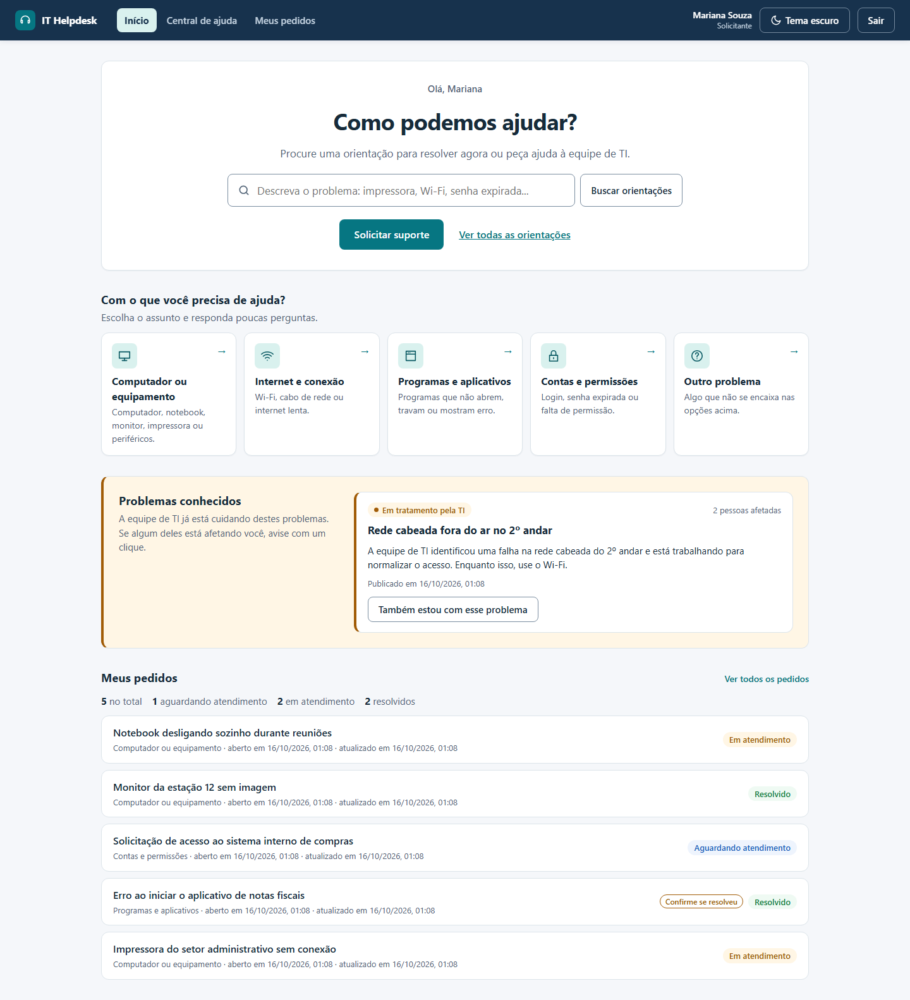
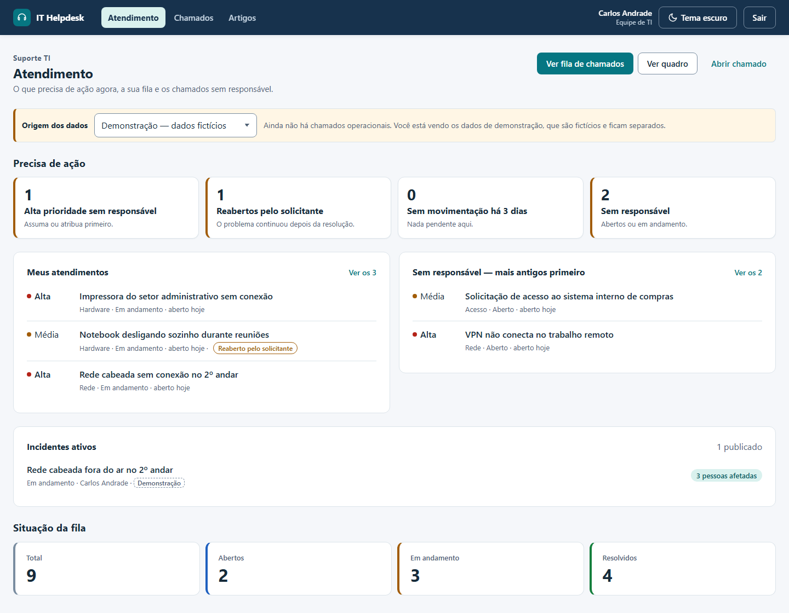
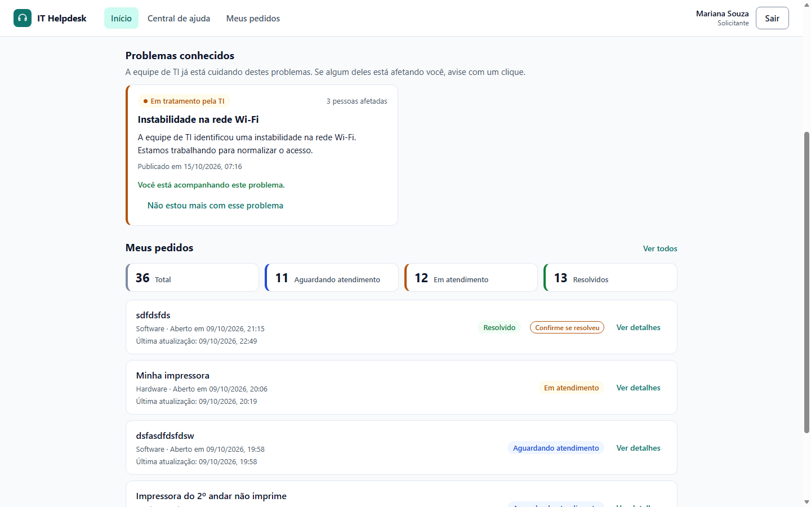
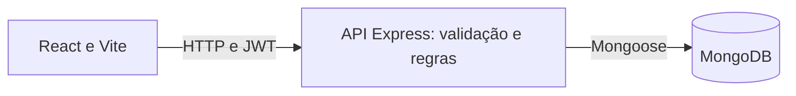

# IT Helpdesk

Central de chamados internos de TI: quem precisa de ajuda pede e acompanha, a equipe de TI atende, e a gestão acompanha a operação. Permissões por perfil, histórico auditável e indicadores gerenciais.

[Como executar](#instalação) · [Usuários demonstrativos](#usuários-demonstrativos) · [Testes](#testes) · [Documentação](#documentação-complementar)

## O problema

O setor de TI recebe pedidos por vários canais, sem fila organizada nem registro de quem fez o quê. Quando um problema atinge muita gente, como o Wi-Fi caindo, chegam dezenas de chamados iguais e ninguém sabe se a TI já está cuidando. O IT Helpdesk centraliza os pedidos, registra cada ação com autor e data e permite que a TI avise todos de uma vez.

## Principais funcionalidades

- **Solicitante:** página Início com o botão **Solicitar suporte**, problemas já conhecidos e seus pedidos em linguagem simples (Aguardando atendimento, Em atendimento, Resolvido). Edita o texto enquanto o pedido não foi iniciado.
- **Suporte TI:** fila com busca, filtros e atalhos; atribuição, classificação, início, resolução e reabertura, com motivo quando a regra exige; publicação de incidentes compartilhados.
- **Gestor:** visão gerencial exclusiva com alertas, carga da equipe, resoluções comprovadas por autor, solicitantes, gráficos e incidentes; também opera chamados como a TI.
- **Para todos:** login com e-mail e senha, sessão restaurada ao recarregar, histórico de cada chamado, tema claro/escuro conforme o sistema e layout para celular.

Regras detalhadas em [produto e regras](docs/01-produto-e-regras.md).

## Os três perfis

Telas reais da aplicação, com dados fictícios de demonstração.

**Solicitante (Mariana Souza) — Início.** Um pedido de ajuda a um clique, problemas conhecidos e os próprios pedidos.



**Suporte TI (Carlos Andrade) — Atendimento.** Incidentes ativos com afetados, fila sem responsável, atendimentos próprios e chamados recentes.



**Gestor (Ana Ribeiro) — Visão gerencial.** Alertas que abrem a fila, incidentes, carga por analista e gráficos de demanda.


Outras telas (formulário, lista, histórico, celular) estão em [fluxos e API](docs/03-fluxos-e-api.md#capturas-por-perfil), [métricas](docs/04-metricas-decisoes-e-limites.md#evidências-visuais) e [auditoria](docs/06-integridade-e-auditoria.md#evidência-visual-da-autoria).

## Incidentes compartilhados

Quando a TI identifica um problema que atinge várias pessoas, publica um aviso a partir do chamado principal. Quem também está afetado clica em **Também estou com esse problema**, sem abrir outro chamado. A equipe vê quantas pessoas foram atingidas; ao resolver o chamado, o aviso é encerrado para todos.



- O solicitante recebe só o texto público escrito pela TI; a descrição do chamado e a lista de afetados não saem do backend. O mesmo vale para os próprios chamados: o solicitante não recebe justificativas internas, metadados de auditoria nem e-mails da equipe.
- Clicar duas vezes, ou várias pessoas ao mesmo tempo, não duplica a contagem.
- Um incidente nunca aparece como ativo depois que o chamado principal foi resolvido, mesmo se a gravação do encerramento falhar.
- Participar não interfere no atendimento do chamado.
- Publicação, edição, encerramento e republicação ficam no histórico do incidente, com autor.
- O número de afetados mostra alcance. O sistema não afirma quantos chamados foram evitados.

Regras completas em [produto e regras](docs/01-produto-e-regras.md#incidentes-compartilhados) e roteiro de demonstração em [demonstração](docs/05-demonstracao.md#roteiro-do-incidente-compartilhado--cerca-de-3-minutos).

## Stack

- **Frontend:** React 19, Vite 8, TypeScript, React Router 8, Recharts e CSS próprio com tokens de cor. Os gráficos adaptam os componentes de referência do shadcn/ui.
- **Backend:** Node.js, Express 5, TypeScript, Zod, JWT, bcryptjs e express-rate-limit.
- **Dados:** MongoDB 7 e Mongoose 9.
- **Ambiente local:** Docker Compose apenas para o MongoDB; API e frontend rodam com npm.
- **Testes:** node:test com Express e MongoDB reais, typecheck, oxlint, builds e E2E em Edge/Chrome headless sem biblioteca extra.



Controllers validam a entrada; services aplicam escopo, propriedade e regras; models representam os documentos. Veja [arquitetura e dados](docs/02-arquitetura-e-dados.md).

## Requisitos

- Node.js **22.22 ou superior** e npm.
- Docker Desktop (ou Docker Engine) com Docker Compose, para o MongoDB local. Dispensável se houver outro MongoDB disponível; nesse caso ajuste `MONGODB_URI`.
- Edge ou Chrome instalado, apenas para o teste E2E e as capturas.
- Portas livres: 27017 (MongoDB), 3000 (API) e 5173 (interface).

> **Se a execução local utilizar Docker para o MongoDB, é necessário iniciar o Docker Desktop antes de subir os serviços ou executar testes de integração.**

## Instalação

Os comandos usam `cp`, disponível no Git Bash/macOS/Linux e como alias no PowerShell (onde também vale `Copy-Item`). Se o PowerShell bloquear `npm.ps1`, use `npm.cmd` no lugar de `npm`, sem alterar a política de execução.

```bash
git clone https://github.com/FIDEL7Z/it-helpdesk.git
cd it-helpdesk
docker compose up -d --wait

cd backend
npm ci
cp .env.example .env

cd ../frontend
npm ci
cp .env.example .env
```

O repositório é privado: sua conta do GitHub precisa ter acesso.

## Configuração

Preencha **JWT_SECRET** em `backend/.env` com um valor aleatório de pelo menos 32 caracteres (o exemplo vem vazio). Para gerar um:

```bash
node -e "console.log(require('crypto').randomBytes(48).toString('hex'))"
```

Para ver os dados de exemplo, mude **`DEMO_MODE=true`** em `backend/.env` e **`VITE_DEMO_MODE=true`** em `frontend/.env`. Sem isso, os indicadores mostram só dados operacionais e começam vazios. Mantenha as duas opções desligadas em produção.

| Backend: variável | Configuração |
|---|---|
| `MONGODB_URI` | Obrigatória; exemplo `mongodb://localhost:27017/it-helpdesk` |
| `JWT_SECRET` | Obrigatória; aleatória, pelo menos 32 caracteres |
| `PORT` | Opcional; padrão `3000` |
| `DEMO_MODE` | Opcional; padrão `false`; `true` libera origens demo/legado nos indicadores somente fora de produção |
| `APP_TIMEZONE` | Opcional; fuso IANA válido, padrão `America/Fortaleza`; períodos e horários gerenciais |
| `JWT_EXPIRES_IN` | Opcional; padrão `8h`; inteiro positivo seguido de `s`, `m`, `h` ou `d` |
| `CORS_ORIGIN` | Opcional; padrão `http://localhost:5173`; origens separadas por vírgula |
| `SEED_TI_EMAIL` / `SEED_TI_PASSWORD` | Obrigatórias para seed; valores demonstrativos no exemplo; senha com pelo menos 8 caracteres |
| `SEED_SOLICITANTE_EMAIL` / `SEED_SOLICITANTE_PASSWORD` | Obrigatórias para seed; mesmos requisitos |
| `SEED_GESTOR_EMAIL` / `SEED_GESTOR_PASSWORD` | Opcionais para seed; preencher ambas ou nenhuma; senha com pelo menos 8 caracteres |

No frontend, **VITE_API_URL** é a URL da API com `/api` (`http://localhost:3000/api`, também o padrão do cliente) e **VITE_DEMO_MODE** mostra os seletores de origem (padrão `false`). As variáveis do backend são validadas com Zod na inicialização. Arquivos `.env` são ignorados pelo Git; só os `.env.example` são versionados.

O MongoDB do Compose roda sem autenticação e publica a porta apenas em `127.0.0.1`, para desenvolvimento e avaliação local.

### Dados de demonstração

Em `backend`, com o MongoDB no ar:

```bash
npm run seed            # cria os usuários TI, solicitante e (com SEED_GESTOR) gestor
npm run seed:demo       # até 10 chamados de exemplo
npm run seed:incidents  # publica o incidente "Instabilidade na rede Wi-Fi"
```

Os três podem ser executados de novo sem duplicar dados: usuários existentes não têm senha nem papel alterados, chamados com o mesmo título são pulados e o incidente existente é mantido. Em caso de erro, encerram com código 1.

O seed gerencial opcional (`npm run seed:manager`) cria 24 chamados fictícios por mês para os gráficos da gestão. Exige as contas adicionais `demo.ti2@helpdesk.local` e `demo.solicitante2@helpdesk.local` e a variável `LOCAL_DEMO_SEED=1`, e recusa bancos remotos ou de produção. Em PowerShell, a partir da raiz:

```powershell
cd backend
$env:LOCAL_DEMO_SEED = '1'
npm run seed:manager
Remove-Item Env:LOCAL_DEMO_SEED
```

Detalhes e restrições em [seed gerencial local](docs/05-demonstracao.md#seed-gerencial-local).

## Execução

Com o Docker Desktop iniciado e o MongoDB no ar (`docker compose up -d --wait`), abra dois terminais na raiz:

```bash
# Terminal 1: API em http://localhost:3000
cd backend
npm run dev
```

```bash
# Terminal 2: interface em http://localhost:5173
cd frontend
npm run dev
```

Acesse **http://localhost:5173**. A API só aceita requisições depois de conectar ao MongoDB; configuração inválida ou banco indisponível impedem a inicialização.

Para parar o banco: `docker compose down` na raiz. O volume `mongo-data` preserva os dados; `docker compose down -v` apaga o volume e não é necessário para a demonstração.

Build de produção local, em terminais separados:

```bash
# API
cd backend
npm run build
npm start
```

```bash
# Interface: preview em http://localhost:4173
cd frontend
npm run build
npm run preview
```

Para o preview, inclua `http://localhost:4173` em CORS_ORIGIN e reinicie a API.

## Usuários demonstrativos

Valores do `backend/.env.example`, criados por `npm run seed`:

| Perfil | Nome | E-mail | Senha | Página inicial |
|---|---|---|---|---|
| Solicitante | Mariana Souza | `solicitante@helpdesk.local` | `Solicitante@2026` | Início |
| TI | Carlos Andrade | `ti@helpdesk.local` | `TiDemo@2026` | Atendimento |
| Gestor | Ana Ribeiro | `gestor@helpdesk.local` | `Gestor@2026` | Visão gerencial |

Se o seu `.env` foi criado antes do gestor, acrescente as duas variáveis SEED_GESTOR do exemplo e rode o seed de novo. Não há cadastro público. Não use essas credenciais em produção.

O passo a passo de cada perfil está em [como usar, por perfil](docs/03-fluxos-e-api.md#como-usar-por-perfil).

## Testes

Com as dependências instaladas, `backend/.env` válido e o MongoDB no ar (Docker Desktop iniciado), a partir da raiz:

```bash
cd backend
npm test
npm run test:typecheck
npm run docs:check
npm run build
npm run test:e2e

cd ../frontend
npm run lint -- --deny-warnings
npm run build
```

- **Integração (`npm test`):** autenticação, isolamento, permissões dos três perfis, validação, transições, histórico, concorrência, dashboards, visão gerencial, rate limit e incidentes compartilhados. Usa bancos `it-helpdesk-test*`, apagados ao final; o banco de desenvolvimento não é tocado.
- **E2E (`npm run test:e2e`):** sobe API e Vite em portas livres com banco e usuários temporários, abre o Edge/Chrome headless e percorre login/logout, páginas iniciais dos três perfis, isolamento, operações do gestor, conflito por revisão, filtros, estados de carregamento e erro, layout em 390 px e o fluxo completo de um incidente compartilhado. Se o navegador não for encontrado, defina `E2E_BROWSER_PATH`. Diagnósticos de falha ficam em `backend/e2e-results/`, ignorado pelo Git.
- **Documentação (`npm run docs:check`):** links, âncoras, imagens, scripts npm citados, variáveis dos exemplos e credenciais demonstrativas.

O que cada teste cobre: [o que os testes verificam](docs/05-demonstracao.md#o-que-os-testes-verificam).

## Documentação complementar

- [Produto, regras e incidentes compartilhados](docs/01-produto-e-regras.md)
- [Arquitetura, coleções e índices](docs/02-arquitetura-e-dados.md)
- [Como usar por perfil, ciclo de vida e API](docs/03-fluxos-e-api.md)
- [Métricas, decisões técnicas e limitações](docs/04-metricas-decisoes-e-limites.md)
- [Roteiro de demonstração, capturas e solução de problemas](docs/05-demonstracao.md)
- [Auditoria, ciclos e compatibilidade](docs/06-integridade-e-auditoria.md)

```text
backend/
  src/              API: rotas, controllers, services, models e autenticação
  src/scripts/      Seeds e manutenção local protegida
  tests/            Integração e E2E em ambiente isolado
  scripts/          Verificação documental e captura de telas
frontend/
  src/pages/        Telas dos três perfis
  src/components/   Interface, incidentes e gráficos
  src/services/     Cliente HTTP e contratos
docs/               Documentação técnica e capturas
docker-compose.yml  MongoDB local
```

## Limitações conhecidas

- JWT fica no localStorage: um XSS poderia expor o token, e o logout só limpa a sessão local. Login limita 10 tentativas por IP a cada 15 minutos, com contador em memória.
- Sem notificações (e-mail, push), anexos, comentários, recuperação de senha ou administração de usuários pela interface.
- Incidentes não avisam ativamente; o usuário vê o problema ao abrir o sistema. Não há vínculo de outros chamados ao incidente nem sugestão automática de problemas parecidos.
- Sem SLA, tempo médio de atendimento ou evolução histórica do backlog. Indicadores mostram estado atual e ações comprovadas, não qualidade da equipe.
- O MongoDB local roda sem réplica, portanto sem transações entre coleções. Encerrar o incidente após resolver o chamado são duas escritas, e uma falha entre elas é corrigida na leitura seguinte.
- Dashboards não atualizam em tempo real. O tema segue o sistema operacional; não há seletor manual.

Mais detalhes em [métricas, decisões e limites](docs/04-metricas-decisoes-e-limites.md).
