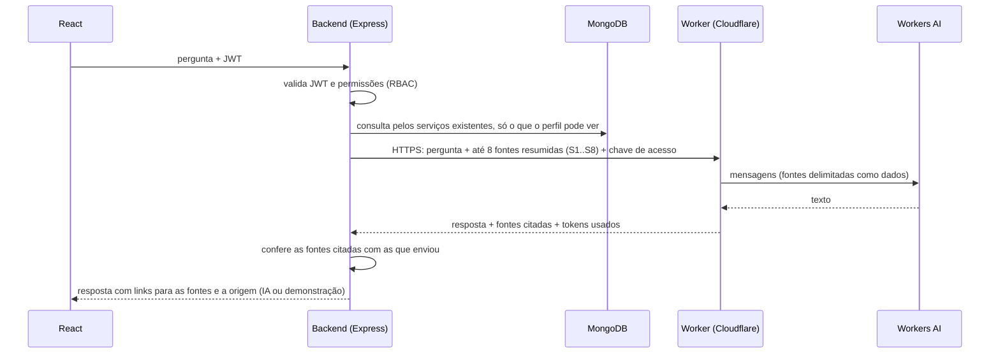

# Serviço de respostas do assistente (Cloudflare Workers AI)

Um Worker pequeno da Cloudflare recebe do backend do IT Helpdesk uma pergunta e um contexto já autorizado. Ele devolve uma resposta curta, gerada por um modelo do Workers AI.

O avaliador não instala modelo nenhum nem conhece as credenciais da Cloudflare. Ele recebe só uma chave de acesso temporária, que vai no `.env` do backend.

> **Estado:** pronto para publicar, ainda não publicado. O código e os testes locais estão prontos. A configuração publica o serviço **desligado** e no plano Free. A primeira resposta real do modelo só acontece na janela de testes descrita em [Publicação e testes reais](#publicação-e-testes-reais), com autorização do dono.

## Como os dados passam



- **Quem decide permissões:** o backend, antes de escolher as fontes. O prompt nunca decide quem pode ver o quê.
- **O que o Worker não tem:** acesso ao MongoDB, ao repositório, ao terminal ou às credenciais do avaliador. Ele não altera chamados, estoque nem patrimônio.
- **O que o Worker não guarda:** perguntas, contextos e respostas. Os logs e traces estão desligados (`observability.enabled: false`).
- **O que o assistente não faz:** é consultivo. Não abre nem resolve chamados e não movimenta estoque; quando pedem isso, explica onde fazer a ação no sistema.

## Contrato

`POST /v1/answer`, com `Authorization: Bearer <chave>`:

```json
{
  "question": "Meu teclado parou de funcionar. Como solicito suporte?",
  "profile": "solicitante",
  "sources": [{ "id": "S1", "kind": "guide", "title": "Como pedir suporte no IT Helpdesk", "text": "Na página Início, clique em Solicitar suporte..." }]
}
```

Resposta `200`:

```json
{ "answer": "... [S1]", "citedSources": ["S1"], "model": "@cf/meta/llama-3.3-70b-instruct-fp8-fast", "latencyMs": 1234, "usage": { "inputTokens": 812, "outputTokens": 96 } }
```

`usage` traz só as contagens de tokens informadas pelo modelo (ou `null`). Com elas, o backend e os scripts estimam os Neurons gastos.

Erros e limites:

| Código HTTP | Erro | Quando |
|---|---|---|
| 400 | `INVALID_INPUT` | Corpo inválido |
| 401 | `UNAUTHORIZED` | Chave ausente, desconhecida ou vencida (antes de qualquer inferência) |
| 413 | `TOO_LARGE` | Corpo acima de 16 KB |
| 429 | `RATE_LIMITED` | Limite por chave estourado |
| 429 | `QUOTA_EXCEEDED` | A cota diária gratuita do Workers AI acabou (erro 3036 da Cloudflare) |
| 502 | `MODEL_UNAVAILABLE` ou `EMPTY_ANSWER` | O modelo falhou ou não respondeu, sem detalhes |
| 503 | `AI_DISABLED` | Serviço desligado (`DEMO_ENABLED` diferente de `"true"`) |
| 503 | `MODEL_REQUIRES_PAID_PLAN` | O modelo configurado exige o plano pago (erro 5035) |
| 503 | `MODEL_BUSY` | O modelo está sem capacidade no momento (erro 3040) |

Nenhum erro repassa o texto da Cloudflare. No backend, cada código vira um aviso próprio e a resposta cai no modo demonstrativo identificado (veja o [README principal](../README.md#assistente)).

`GET /health` responde `{ ok, enabled }` sem chamar o modelo.

**Limites do corpo:**
- pergunta com até 500 caracteres;
- até 8 fontes, dos tipos `article`, `guide`, `incident`, `ticket`, `stock` e `metric` (e `asset`, `movement` e `organization`, reservados);
- título com até 120 caracteres e texto com até 1.200 caracteres por fonte;
- 6.000 caracteres no total das fontes;
- resposta com até 400 tokens;
- campos desconhecidos são recusados, não cortados.

## Proteção contra abuso

- **Publicado desligado.** `wrangler.jsonc` traz `DEMO_ENABLED: "false"`. Um `wrangler deploy` comum publica o serviço respondendo 503 `AI_DISABLED` antes de conferir a chave, sem chamar o modelo. Ele só liga com `--var DEMO_ENABLED:true`, numa janela de testes, e desliga de novo com outro `wrangler deploy` comum.
- **Um endereço só.** `preview_urls: false`: não há endereços extras por versão.
- **Chaves por pessoa, com validade.** O segredo `ACCESS_KEYS` fica só na Cloudflare, no formato `rotulo:chave:validade`. Cada avaliador recebe a sua chave por um canal privado. Ela vence sozinha e pode ser revogada sem afetar as outras. As chaves são comparadas em tempo constante. Nenhuma chave entra no repositório nem no React: um token distribuído no código não seria segredo.
- **Sem chave, sem inferência.** Pedidos sem chave válida recebem 401 antes de qualquer chamada ao modelo.
- **Limite por chave.** O binding de rate limiting permite cerca de 10 respostas por minuto por chave. A contagem é feita em cada local da Cloudflare e é eventualmente consistente; por isso é um freio contra abuso, **não um limite global exato**. O backend soma o seu próprio limite: 20 perguntas por pessoa a cada 10 minutos.
- **Teto diário.** No plano Free, o Workers AI tem **10.000 Neurons por dia** (zera às 00:00 UTC, 21h em Brasília). Acima disso, as chamadas falham com `QUOTA_EXCEEDED` em vez de gerar cobrança. Esse é o teto que não depende de contagem local.
- **Botão de desligar.** Além do `DEMO_ENABLED`, dá para apagar o segredo `ACCESS_KEYS` (todas as chaves param) ou remover o Worker.
- **Fontes cercadas.** As fontes vão ao modelo entre `<fontes>` e `</fontes>`, como dados. Um texto que tente fechar esse bloco é neutralizado, e o prompt manda ignorar instruções escritas nas fontes.
- **Sem CORS.** Navegadores não conseguem chamar o serviço direto; só o backend chama.
- **Só dados fictícios.** As contas e os dados são os do seed de demonstração.

Se um dia for preciso uma cota diária exata por chave, o caminho é um Durable Object por chave (contagem persistente e única). Para alguns testes controlados, os limites acima bastam.

## Modelo e cota

O modelo padrão é `@cf/meta/llama-3.3-70b-instruct-fp8-fast`, um modelo de instruções com suporte oficial ao português. Ele não está na lista de modelos cobrados só no plano pago. A variável `MODEL` aceita só os modelos da lista em `src/index.js`. Respostas típicas por dia dentro dos 10.000 Neurons (estimativa com cerca de 1.000 tokens de entrada e 250 de saída):

| Modelo | Neurons por milhão de tokens (entrada / saída) | Respostas por dia, aproximadamente |
|---|---|---|
| llama-3.3-70b-instruct-fp8-fast | 26.668 / 204.805 | 120 |
| llama-3.1-8b-instruct-fp8 | 13.778 / 26.128 | 500 |
| qwen3-30b-a3b-fp8 | 4.625 / 30.475 | 800, mas o raciocínio pode gastar tokens de saída |

Os números vêm da [tabela de preços do Workers AI](https://developers.cloudflare.com/workers-ai/platform/pricing/). Estar no catálogo não prova acesso no Free: isso só se confirma com a primeira inferência real. Se o modelo exigir o plano pago, o serviço responde `MODEL_REQUIRES_PAID_PLAN` e basta trocar `MODEL` por outro da lista.

## Testes locais (sem Cloudflare)

```bash
cd ai-worker
npm test
```

Os testes rodam o handler do Worker no Node com o binding de IA simulado. Eles cobrem:
- chaves (ausente, errada, vencida), sempre recusadas antes da inferência;
- configuração publicada desligada, sem endereços de versão e sem conta no arquivo;
- botão de desligar e limite por chave;
- limites de corpo, campos desconhecidos e fontes inválidas;
- fontes delimitadas no prompt, inclusive contra quem tenta fechar o bloco;
- erros de cota, de plano pago e de capacidade, sem repassar o texto da Cloudflare;
- escolha do modelo, contagem de tokens e descarte de citações de fontes que não foram enviadas;
- ausência de CORS.

## Publicação e testes reais

Tudo abaixo exige a conta do dono e a sua autorização. Os comandos são para o Git Bash, a partir da raiz do repositório. Prefixo usado em todos os comandos do Wrangler: `npx wrangler@4`. Se o terminal tiver `NODE_TLS_REJECT_UNAUTHORIZED=0`, rode com `env -u NODE_TLS_REJECT_UNAUTHORIZED` antes: o Wrangler não deve falar com a Cloudflare sem verificar o certificado.

**0. Confirmar o plano Free (no painel).** Em *Workers & Pages → Plans*, o plano deve ser **Free**. Sem o plano pago, o Workers AI não cobra: acima da cota ele falha. Não cadastre forma de pagamento para este teste.

**1. Publicar desligado.**

```bash
cd ai-worker
npx wrangler@4 whoami        # confere a conta; não compartilhe a saída
npx wrangler@4 deploy        # DEMO_ENABLED "false": responde 503 AI_DISABLED
curl -s https://it-helpdesk-ai.<subdominio>.workers.dev/health   # {"ok":true,"enabled":false}
```

Na primeira publicação, a Cloudflare pode pedir para registrar um subdomínio `workers.dev`. O endereço final aparece na saída do deploy.

**2. Criar uma chave temporária sem exibi-la** (aqui, válida por 3 dias):

```bash
KEY=$(node -e "process.stdout.write(require('crypto').randomBytes(24).toString('base64url'))")
EXP=$(node -e "process.stdout.write(new Date(Date.now() + 3 * 86400e3).toISOString())")
printf 'dono-teste:%s:%s' "$KEY" "$EXP" | npx wrangler@4 secret put ACCESS_KEYS
printf '\nAI_WORKER_URL=https://it-helpdesk-ai.<subdominio>.workers.dev\nAI_WORKER_KEY=%s\n' "$KEY" >> ../backend/.env
unset KEY EXP
```

O segredo é substituído inteiro a cada `secret put`. Para várias pessoas, envie todas as linhas que devem continuar valendo (uma por linha). Cada chave nova, só a quem vai usá-la, por canal privado.

**3. Abrir a janela de testes.**

```bash
npx wrangler@4 deploy --var DEMO_ENABLED:true
curl -s https://it-helpdesk-ai.<subdominio>.workers.dev/health   # {"ok":true,"enabled":true}
```

**4. Medir.** Com `AI_PROVIDER=cloudflare` em `backend/.env` (o backend lê a configuração ao subir):

```bash
node --env-file=../backend/.env scripts/poc.mjs            # direto no Worker: chave inválida, 5 respostas
cd ../backend && npm run assistant:check   # pelo backend, 3 perfis, banco temporário fictício: 8 respostas
```

Os dois scripts mostram a origem de cada resposta (IA real ou demonstração), a latência e os tokens, e conferem as fontes; o `poc.mjs` também estima os Neurons. Juntos, gastam cerca de 13 respostas, bem abaixo de 10% da cota diária.

Falhas, sem gastar cota:
- **chave inválida:** o `poc.mjs` já testa (401). Pelo backend: `AI_WORKER_KEY=chave-invalida-000000000000000000 npm run assistant:check` mostra todas as respostas em modo demonstrativo, com o aviso de chave inválida;
- **serviço fora do ar:** `AI_WORKER_URL=http://127.0.0.1:9 npm run assistant:check`; o aviso é "IA indisponível";
- **serviço desligado:** depois do passo 5, a mesma medição mostra o aviso "A IA está desligada";
- **cota esgotada:** não é provocada de propósito, porque isso gastaria a cota do dia inteiro. O mapeamento do erro 3036 está coberto nos testes do Worker e do backend.

**5. Fechar a janela e revogar.**

```bash
npx wrangler@4 deploy                         # volta a DEMO_ENABLED "false"
npx wrangler@4 secret delete ACCESS_KEYS      # revoga todas as chaves
```

Depois, apague `AI_WORKER_URL` e `AI_WORKER_KEY` de `backend/.env`. Para revogar uma chave só, envie de novo o segredo sem a linha dela.
