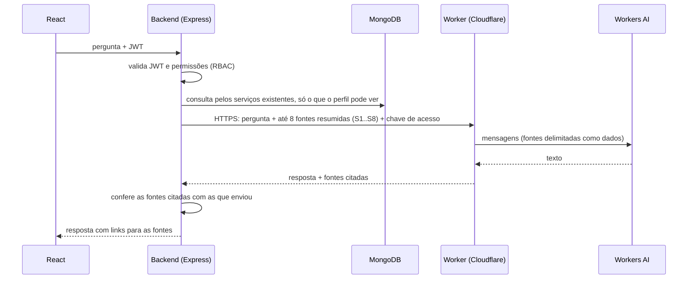

# Serviço de respostas do assistente (Cloudflare Workers AI)

Um Worker pequeno da Cloudflare recebe do backend do IT Helpdesk uma pergunta e um contexto já autorizado. Ele devolve uma resposta curta, gerada por um modelo do Workers AI.

O avaliador não instala modelo nenhum nem conhece as credenciais da Cloudflare. Ele recebe só uma chave de acesso temporária, que vai no `.env` do backend.

> **Estado:** prova de conceito. O código e os testes locais estão prontos. O Worker **ainda não foi publicado** e ainda não foi testado contra o Workers AI de verdade: isso depende do login do dono na Cloudflare.

## Como os dados passam



- **Quem decide permissões:** o backend, antes de escolher as fontes. O prompt nunca decide quem pode ver o quê.
- **O que o Worker não tem:** acesso ao MongoDB, ao repositório, ao terminal ou às credenciais do avaliador.
- **O que o Worker não guarda:** perguntas, contextos e respostas. Os logs e traces estão desligados (`observability.enabled: false`).
- **O que o assistente não faz:** é consultivo. Não abre nem resolve chamados e não movimenta estoque; quando pedem isso, explica onde fazer a ação no sistema.

## Contrato

`POST /v1/answer`, com `Authorization: Bearer <chave>`:

```json
{
  "question": "Meu teclado parou de funcionar. O que eu faço?",
  "profile": "solicitante",
  "sources": [{ "id": "S1", "kind": "article", "title": "Teclado sem resposta", "text": "Troque a porta USB..." }]
}
```

Resposta `200`:

```json
{ "answer": "... [S1]", "citedSources": ["S1"], "model": "@cf/meta/llama-3.3-70b-instruct-fp8-fast", "latencyMs": 1234 }
```

Erros e limites:

| Código HTTP | Erro | Quando |
|---|---|---|
| 400 | `INVALID_INPUT` | Corpo inválido |
| 401 | `UNAUTHORIZED` | Chave ausente, desconhecida ou vencida |
| 413 | `TOO_LARGE` | Corpo acima de 16 KB |
| 429 | `RATE_LIMITED` | Limite por chave estourado |
| 502 | `MODEL_UNAVAILABLE` ou `EMPTY_ANSWER` | O modelo falhou ou não respondeu, sem detalhes |
| 503 | `AI_DISABLED` | Demonstração desligada |

`GET /health` responde `{ ok, enabled }` sem chamar o modelo.

**Limites do corpo:**
- pergunta com até 500 caracteres;
- até 8 fontes;
- título com até 120 caracteres e texto com até 1.200 caracteres por fonte;
- 6.000 caracteres no total das fontes;
- resposta com até 400 tokens;
- campos desconhecidos são recusados, não cortados.

## Proteção contra abuso

- **Chaves por pessoa, com validade.** O segredo `ACCESS_KEYS` fica só na Cloudflare, no formato `rotulo:chave:validade`. Cada avaliador recebe a sua chave por um canal privado. Ela vence sozinha e pode ser revogada sem afetar as outras. Nenhuma chave entra no repositório: um token distribuído no código não seria segredo.
- **Limite por chave.** O binding de rate limiting permite 10 respostas por minuto por chave, em cada local da Cloudflare (o limite é aproximado, por definição do serviço).
- **Teto diário.** No plano Free, o Workers AI tem **10.000 Neurons por dia** (zera às 00:00 UTC). Acima disso, as chamadas falham em vez de gerar cobrança.
- **Botão de desligar.** Com `DEMO_ENABLED` diferente de `"true"`, o serviço responde 503 a todos. Também dá para apagar o segredo `ACCESS_KEYS` ou remover o Worker.
- **Sem CORS.** Navegadores não conseguem chamar o serviço direto; só o backend chama.
- **Só dados fictícios no piloto.** As contas e os dados são os do seed de demonstração. A origem (operacional ou demonstração) é separada no backend, antes de montar as fontes.

## Modelo e cota

O modelo padrão é `@cf/meta/llama-3.3-70b-instruct-fp8-fast`, um modelo de instruções com suporte oficial ao português. A variável `MODEL` aceita só os modelos da lista em `src/index.js`. Respostas típicas por dia dentro dos 10.000 Neurons (estimativa com cerca de 1.000 tokens de entrada e 250 de saída):

| Modelo | Neurons por milhão de tokens (entrada / saída) | Respostas por dia, aproximadamente |
|---|---|---|
| llama-3.3-70b-instruct-fp8-fast | 26.668 / 204.805 | 120 |
| llama-3.1-8b-instruct-fp8 | 13.778 / 26.128 | 500 |
| qwen3-30b-a3b-fp8 | 4.625 / 30.475 | 800, mas o raciocínio pode gastar tokens de saída |

Os números vêm da [tabela de preços do Workers AI](https://developers.cloudflare.com/workers-ai/platform/pricing/). O modelo final será escolhido depois de medir a qualidade em português e a latência reais.

## Testes locais (sem Cloudflare)

```bash
cd ai-worker
npm test
```

Os testes rodam o handler do Worker no Node com o binding de IA simulado. Eles cobrem:
- chaves (ausente, errada, vencida);
- botão de desligar e limite por chave;
- limites de corpo, campos desconhecidos e fontes inválidas;
- fontes delimitadas no prompt e escolha do modelo;
- descarte de citações de fontes que não foram enviadas;
- erros genéricos e ausência de CORS.

## Publicação (passos do dono, com login na Cloudflare)

Exigem a conta do dono e a sua autorização:

```bash
cd ai-worker
npx wrangler@4 login
npx wrangler@4 secret put ACCESS_KEYS   # rotulo:chave:validade, uma por linha
npx wrangler@4 deploy
AI_WORKER_URL=https://<worker>.workers.dev AI_WORKER_KEY=<chave> npm run poc
```

Gere cada chave com:

```bash
node -e "console.log(require('crypto').randomBytes(24).toString('base64url'))"
```
