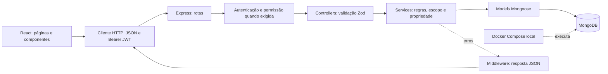
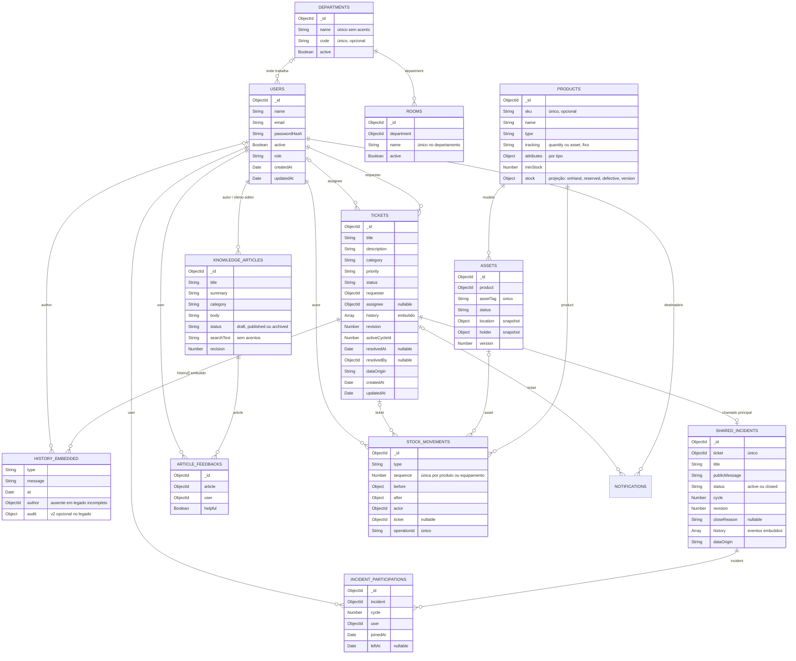

# Arquitetura e modelo de dados

[Voltar ao README](../README.md) · [Regras](01-produto-e-regras.md) · [Fluxos](03-fluxos-e-api.md)

## Organização real

O monorepo contém aplicações independentes em `frontend/` e `backend/`. React cuida da interface, sessão e navegação; um cliente `fetch` envia JSON e o token Bearer para a API. Express organiza rotas, middlewares, controllers e services. Mongoose valida e persiste documentos no MongoDB. Docker Compose executa somente o banco local.

- `backend/src/app.ts` monta o Express sem abrir uma porta; os testes importam esse app real.
- `backend/src/server.ts` conecta ao MongoDB antes de aceitar requisições.
- `routes/` associa endpoints a autenticação e permissões. Login e health são públicos.
- `controllers/` valida entradas com Zod e monta as respostas HTTP.
- `services/` aplica as regras e consulta os models. `buildTicketFilter` compartilha escopo entre lista e dashboard. `demo-scenarios.ts` e `demo-articles.ts` guardam os dados fictícios usados pelos seeds e pela captura isolada da documentação.
- `middlewares/` trata JWT/usuário atual, permissões, rate limit e erros.
- `frontend/src/auth/` restaura a sessão usando `/auth/me`; `components/ProtectedRoute.tsx` protege a navegação. A proteção definitiva continua no backend.

No login, bcryptjs compara a senha com o hash armazenado. O JWT usa HS256 e contém `sub` como identificação do usuário, além das claims temporais da biblioteca. `requireAuth` verifica assinatura/expiração e carrega o usuário atual do banco. O papel não fica no token. Uma resposta 401 em requisição autenticada encerra a sessão do frontend; 403 mantém a sessão.

Erros de validação, permissão, estado e concorrência são convertidos pelo middleware em JSON com códigos HTTP próprios; falhas inesperadas retornam 500 sem stack ou detalhes internos. O registro de erro no servidor é diagnóstico operacional, não saída de depuração da interface. O cliente trata falhas de rede, encerra a sessão em 401 e mantém autenticação em 403. No detalhe, 409 informa que a revisão mudou e recarrega o estado antes de outra ação.

Referências: [app](../backend/src/app.ts), [autenticação](../backend/src/middlewares/auth.middleware.ts), [permissões](../backend/src/auth/permissions.ts), [cliente HTTP](../frontend/src/services/api.ts).

## Coleções e referências

`HISTORY_EMBEDDED` representa subdocumentos dentro de `tickets`, **não uma terceira coleção**. O diagrama mostra cardinalidades da aplicação, não foreign keys impostas pelo MongoDB. Um usuário pode abrir vários chamados, ser responsável por vários ou ser autor de vários eventos. Cada chamado referencia um solicitante e, opcionalmente, um responsável.

Os schemas incluem ainda campos internos gerenciados pelo Mongoose, como `__v`; o diagrama mostra os campos de negócio principais. Referências podem apontar para usuários posteriormente removidos: a API preserva IDs e apresenta snapshots disponíveis ou usuário indisponível. Eventos antigos não recebem snapshots retrospectivos.

### Users

`name`, `email`, `passwordHash` e `role` são obrigatórios. E-mail é normalizado para minúsculas e sem espaços nas extremidades; nome também é aparado. Papéis aceitos: `solicitante`, `ti`, `gestor`. `passwordHash` fica excluído das consultas comuns e nunca integra a representação pública. `active` tem padrão true; desativados não autenticam nem recebem atribuições. `createdAt` e `updatedAt` são timestamps do Mongoose. Para os e-mails, há quatro campos:
- `emailVerifiedAt`: confirmação do endereço atual;
- `pendingEmail`: troca aguardando confirmação;
- `emailVerification`: hash do token, endereço e validade, fora das consultas comuns, como a senha;
- `notificationPreferences`: quatro avisos opcionais, todos ligados por padrão.

### Tickets e histórico

Título, descrição, categoria e solicitante são obrigatórios. Prioridade tem default `media`; status, `aberto`; responsável, null; histórico, array vazio. O service de criação acrescenta o primeiro evento. Os enums e limites estão em [ticket.model.ts](../backend/src/models/ticket.model.ts).

Eventos mantêm `type`, `message`, `author` e `at` para compatibilidade. Novos eventos possuem `audit` estruturado, com `eventId`, `operationId`, autor/snapshot, responsável/snapshot, `from`, `to`, revisão, ordem, ciclo e origem. Tipos: `created`, `updated`, `status_changed`, `assigned`, `reopened`, `resolved`, `resolution_confirmed` e `resolution_rated`. Os dois últimos, e a reabertura por contestação (`reopened` com `to.contestedCycle`), são escritos pelo solicitante dono do chamado; ficam no mesmo histórico para herdar a escrita atômica, a revisão e o ciclo.

O chamado possui `revision`, `activeCycleId`, `resolvedAt`, `resolvedBy`, `dataOrigin` e, quando aberto pelo formulário guiado, `intake`: assunto escolhido, respostas (`key`, texto da pergunta, resposta) e o artigo consultado (`id`, título). É um subdocumento opcional: chamados antigos simplesmente não o têm, e a descrição continua sendo só o texto da pessoa. Documentos legados sem revisão são tratados como revisão zero na primeira escrita, sem regravar eventos antigos. Autores e datas legados ausentes retornam null. Não existem `impact`, `startedAt`, SLA ou coleção de equipe.

Detalhes do contrato e limites: [integridade e auditoria](06-integridade-e-auditoria.md).

### Incidentes e participações

Os incidentes compartilhados ficam fora do documento do chamado. Assim, a revisão do chamado continua protegendo só o atendimento: publicar, editar ou participar de um incidente não gera conflito 409 para quem está atendendo.

`sharedincidents` guarda o texto público, o status, quem publicou/encerrou, o motivo do encerramento (`ticket_resolved` ou `manual`), a revisão própria e o histórico de eventos (`published`, `updated`, `closed`, `republished`). `dataOrigin` é herdado do chamado principal. `cycle` começa em 1 e aumenta a cada republicação.

`incidentparticipations` tem um documento por incidente, ciclo e usuário. Sair preenche `leftAt`; voltar limpa o campo no mesmo documento. Afetados = participações do ciclo atual com `leftAt` nulo, contadas por agregação. Um contador salvo no incidente poderia divergir após cliques simultâneos.

O MongoDB do Compose roda sem réplica, portanto sem transações entre coleções. Resolver o chamado e encerrar o incidente são duas escritas. Se a segunda falhar, a leitura seguinte de qualquer tela de incidentes encontra a resolução (pelo status atual ou por um evento de resolução posterior à publicação, caso o chamado já tenha sido reaberto) e conclui o encerramento. Se esse reparo também falhar, a resposta mostra o incidente como encerrado sem gravar nada, e a leitura seguinte tenta de novo. Publicação, republicação e participação reconciliam o resultado logo após gravar, o que cobre uma resolução que chegue entre a verificação e a escrita. Regras completas em [produto e regras](01-produto-e-regras.md#incidentes-compartilhados).

### Departamentos e salas

`departments` e `rooms` guardam a estrutura da empresa; a unicidade usa o nome normalizado (sem acento e sem diferença de maiúsculas). Uma sala nunca muda de departamento. `users` ganhou `department`, `room` e `jobTitle` opcionais. Chamados, equipamentos e movimentações guardam o local como snapshot (id e nome do momento), não só a referência.

### Estoque, patrimônio e livro-razão

`products` é o catálogo; `attributes` só aceita as características do tipo, validadas pelo backend. `assets` é um documento por equipamento com número de patrimônio. `stockmovements` é o livro-razão, só de inclusão: o model recusa qualquer atualização ou exclusão.

Cada movimentação leva o estado anterior e o posterior, o autor e seu snapshot, a data do servidor, o motivo, o chamado, quem recebeu, os locais, a reserva que encerra (`closes`), o registro que estorna (`reverses`), a chave de idempotência (`operationId`) e a origem.

**Consistência sem transações.** O MongoDB local roda sem réplica e, portanto, sem transações entre documentos; o módulo não depende delas.

- **A movimentação é o ponto de gravação.** Cada movimentação pega a próxima `sequence` do seu produto (ou do seu equipamento), e o par (produto, sequência) é único. Duas operações simultâneas leem a mesma sequência N e tentam gravar N+1; só uma consegue. A outra relê o saldo e decide de novo: se não houver unidades, recebe "estoque insuficiente". O saldo nunca é lido, subtraído em JavaScript e salvo sem essa garantia.
- **`products.stock` e o estado de `assets` são projeções.** Se a projeção ficar atrás do livro-razão (escrita interrompida), a próxima operação ou leitura a refaz a partir da última movimentação.
- **Idempotência.** Repetir uma requisição com a mesma chave devolve a mesma movimentação; a mesma chave com outro autor ou outro conteúdo é recusada (o hash do pedido fica gravado).
- **Unicidade.** `closes` e `reverses` são únicos: uma reserva fecha e um registro é estornado no máximo uma vez.
- **Cadastro de equipamento.** São duas escritas; a chave do cadastro fica no equipamento, e repetir a requisição conclui um cadastro interrompido em vez de duplicá-lo.

Se o ambiente tiver réplica, transações poderiam substituir a projeção reparada, mas não são necessárias para estas garantias.

### Notificações

`notifications` é a fila dos e-mails (outbox), com uma linha por evento e destinatário. Campos:
- `key`, única: `ticket-event:<eventId>:<destinatário>`, `stock-movement:<movimentação>:<destinatário>` ou `email-verification:<pessoa>:<uuid>`;
- `type`, `recipient`, `ticket`, `source` e `occurredAt`;
- `status`: `pending`, `sending`, `sent`, `failed` ou `skipped`;
- `attempts` e `nextAttemptAt`;
- a trava: `lockedUntil` e `lockedBy`;
- o resultado: `provider`, `providerMessageId`, `sentTo` e `sentAt`;
- o motivo curto: `lastError` ou `skipReason`.

O texto do e-mail não é guardado: é montado na hora do envio. `notificationstates` guarda só a data em que os e-mails foram ligados pela primeira vez, que é o limite da reconciliação. Fluxo e garantias em [notificações por e-mail](04-metricas-decisoes-e-limites.md#notificações-por-e-mail).

### Índices explícitos

- `users`: `{ email: 1 }`, único; `{ 'emailVerification.tokenHash': 1 }`, esparso, para o link de confirmação.
- `notifications`: `{ key: 1 }`, único (idempotência por evento e destinatário); `{ status: 1, nextAttemptAt: 1 }` e `{ status: 1, lockedUntil: 1 }` para o processador; `{ recipient: 1, createdAt: -1 }` para os últimos avisos da conta.
- `tickets`: `{ requester: 1, createdAt: -1 }` para consulta por solicitante.
- `tickets`: `{ status: 1, createdAt: -1 }` para consulta por status.
- `tickets`: `{ dataOrigin: 1, createdAt: -1 }` para consultas gerenciais por origem e criação.
- `tickets`: `{ dataOrigin: 1, assignee: 1, status: 1 }` para carga atual por origem/operador.
- `sharedincidents`: `{ ticket: 1 }`, único (um incidente por chamado, inclusive com duas publicações simultâneas); `{ status: 1, publishedAt: -1 }` para a lista de ativos.
- `incidentparticipations`: `{ incident: 1, cycle: 1, user: 1 }`, único (participação idempotente); `{ user: 1, leftAt: 1 }` para "problemas que você acompanhou".
- `knowledgearticles`: `{ status: 1, category: 1, updatedAt: -1 }` para a lista pública por assunto; `{ demoKey: 1 }`, único e parcial, para o seed idempotente.
- `articlefeedbacks`: `{ article: 1, user: 1 }`, único (um voto por pessoa e artigo).
- `departments`: `{ nameKey: 1 }`, único; `{ code: 1 }`, único e parcial. `rooms`: `{ department: 1, nameKey: 1 }`, único.
- `products`: `{ sku: 1 }`, único e parcial; `{ type: 1, active: 1 }`.
- `assets`: `{ assetTag: 1 }`, único; `{ product: 1, serialNumber: 1 }`, único e parcial; `{ registrationOperationId: 1 }`, único; `{ status: 1, 'location.departmentId': 1 }`; `{ 'holder.id': 1 }`.
- `stockmovements`: `{ operationId: 1 }`, único; `{ product: 1, sequence: 1 }` e `{ asset: 1, sequence: 1 }`, únicos e parciais por modo; `{ closes: 1 }` e `{ reverses: 1 }`, únicos e parciais; `{ ticket: 1, occurredAt: -1 }`, `{ occurredAt: -1 }`, `{ product: 1, occurredAt: -1 }`.
- Cada coleção possui também o índice padrão de `_id`.

Por padrão, a lista ordena por `createdAt` e `_id`, ambos descendentes. O alerta `attention=oldest` usa ordem crescente para trazer as pendências mais antigas primeiro. Busca usa regex escapada sobre título, sem índice de texto. Referências de usuários são carregadas em lote, evitando uma consulta por chamado/evento.

### Base de conhecimento

`knowledgearticles` guarda os artigos com autor (`createdBy`), último editor (`updatedBy`), `publishedAt` da primeira publicação e revisão própria. `searchText` é título, resumo e corpo em minúsculas e sem acentos, recalculado a cada edição. A busca exige cada palavra digitada nesse campo com uma expressão regular escapada; o filtro inicial usa o índice de status e categoria. É simples e suficiente para dezenas de artigos; não ordena por relevância e, com milhares de artigos, um índice de texto ou mecanismo de busca seria mais adequado.

`articlefeedbacks` tem um documento por pessoa e artigo (`upsert`), o que torna o voto substituível e impede inflar a contagem. Os totais são calculados por agregação. Artigos de demonstração têm `dataOrigin: demo` e `demoKey`.

## Agregações gerenciais

`GET /dashboard/manager` exige gestor antes de validar a consulta. O [manager.service.ts](../backend/src/services/manager.service.ts) resolve limites de calendário com `APP_TIMEZONE` e consulta MongoDB; não agrega mensagens livres no frontend.

Uma agregação com `$facet` calcula estado atual, carga, criações, solicitantes, categorias e horários. Outra filtra os eventos v2 consistentes, agrupa resoluções por chamado/ciclo e participação por chamado/autor. Autores contraditórios no mesmo ciclo são excluídos. Identidades são consultadas em lote; usuários sem carga entram com zero e referências removidas preservam ID/snapshot.

O ranking agrupa por solicitante/categoria antes de limitar aos dez maiores volumes, evitando transportar todos os documentos à interface. Históricos continuam embutidos: sua análise exige percorrer os eventos dos documentos filtrados por origem/classificação. Os índices ajudam o filtro inicial; não tornam toda agregação coberta por índice. Em volumes elevados, medir `explain` e avaliar projeções ou coleção de eventos separada.

As consultas compartilham um instante de corte para períodos, mas não uma transação de leitura entre estado, eventos e usuários. Não se promete snapshot único durante alterações concorrentes. Definições e filtros: [métricas](04-metricas-decisoes-e-limites.md#visão-gerencial-exclusiva).

## Persistência e ambiente

O Compose publica MongoDB 7 em `127.0.0.1:27017` e usa o volume nomeado `mongo-data`. `docker compose down` preserva esse volume. O ambiente local não utiliza autenticação no banco; produção precisa de configuração própria, credenciais e gestão de segredos.

Os testes usam bancos separados `it-helpdesk-test*`, apagados ao final. O E2E e a captura da documentação criam cada um um banco exclusivo por execução (`it-helpdesk-test-e2e-*`, `it-helpdesk-docs-*`) e processos locais em portas livres. Os seeds de demonstração usam datas e histórico de exemplo, exceto `seed:scenarios`, que percorre o fluxo real no momento da execução: nenhum desses dados representa uma operação real.
