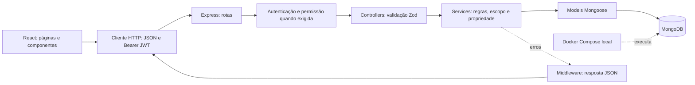
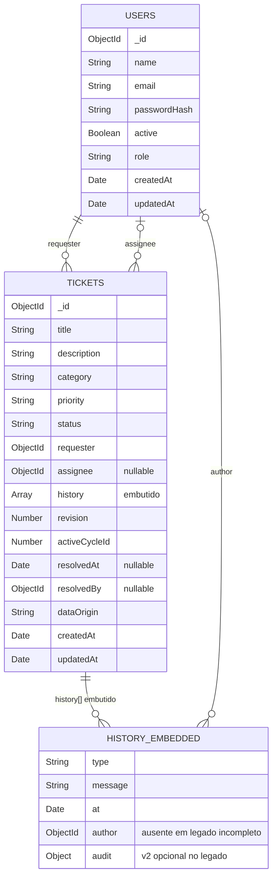

# Arquitetura e modelo de dados

[Voltar ao README](../README.md) · [Regras](01-produto-e-regras.md) · [Fluxos](03-fluxos-e-api.md)

## Organização real

O monorepo contém aplicações independentes em `frontend/` e `backend/`. React cuida da interface, sessão e navegação; um cliente `fetch` envia JSON e o token Bearer para a API. Express organiza rotas, middlewares, controllers e services. Mongoose valida e persiste documentos no MongoDB. Docker Compose executa somente o banco local.

- `backend/src/app.ts` monta o Express sem abrir uma porta; os testes importam esse app real.
- `backend/src/server.ts` conecta ao MongoDB antes de aceitar requisições.
- `routes/` associa endpoints a autenticação e permissões. Login e health são públicos.
- `controllers/` valida entradas com Zod e monta as respostas HTTP.
- `services/` aplica as regras e consulta os models. `buildTicketFilter` compartilha escopo entre lista e dashboard.
- `middlewares/` trata JWT/usuário atual, permissões, rate limit e erros.
- `frontend/src/auth/` restaura a sessão usando `/auth/me`; `components/ProtectedRoute.tsx` protege a navegação. A proteção definitiva continua no backend.

No login, bcryptjs compara a senha com o hash armazenado. O JWT usa HS256 e contém `sub` como identificação do usuário, além das claims temporais da biblioteca. `requireAuth` verifica assinatura/expiração e carrega o usuário atual do banco. O papel não fica no token. Uma resposta 401 em requisição autenticada encerra a sessão do frontend; 403 mantém a sessão.

Erros de validação, permissão, estado e concorrência são convertidos pelo middleware em JSON com códigos HTTP próprios; falhas inesperadas retornam 500 sem stack ou detalhes internos. O registro de erro no servidor é diagnóstico operacional, não saída de depuração da interface. O cliente trata falhas de rede, encerra a sessão em 401 e mantém autenticação em 403. No detalhe, 409 informa que a revisão mudou e recarrega o estado antes de outra ação.

Referências: [app](../backend/src/app.ts), [autenticação](../backend/src/middlewares/auth.middleware.ts), [permissões](../backend/src/auth/permissions.ts), [cliente HTTP](../frontend/src/services/api.ts).

## Coleções e referências

`HISTORY_EMBEDDED` representa subdocumentos dentro de `tickets`, **não uma terceira coleção**. O diagrama mostra cardinalidades da aplicação, não foreign keys impostas pelo MongoDB. Um usuário pode abrir vários chamados, ser responsável por vários ou ser autor de vários eventos. Cada chamado referencia um solicitante e, opcionalmente, um responsável.

Os schemas incluem ainda campos internos gerenciados pelo Mongoose, como `__v`; o diagrama mostra os campos de negócio principais. Referências podem apontar para usuários posteriormente removidos: a API preserva IDs e apresenta snapshots disponíveis ou usuário indisponível. Eventos antigos não recebem snapshots retrospectivos.

### Users

`name`, `email`, `passwordHash` e `role` são obrigatórios. E-mail é normalizado para minúsculas e sem espaços nas extremidades; nome também é aparado. Papéis aceitos: `solicitante`, `ti`, `gestor`. `passwordHash` fica excluído das consultas comuns e nunca integra a representação pública. `active` tem padrão true; desativados não autenticam nem recebem atribuições. `createdAt` e `updatedAt` são timestamps do Mongoose.

### Tickets e histórico

Título, descrição, categoria e solicitante são obrigatórios. Prioridade tem default `media`; status, `aberto`; responsável, null; histórico, array vazio. O service de criação acrescenta o primeiro evento. Os enums e limites estão em [ticket.model.ts](../backend/src/models/ticket.model.ts).

Eventos mantêm `type`, `message`, `author` e `at` para compatibilidade. Novos eventos possuem `audit` estruturado, com `eventId`, `operationId`, autor/snapshot, responsável/snapshot, `from`, `to`, revisão, ordem, ciclo e origem. Tipos: `created`, `updated`, `status_changed`, `assigned`, `reopened`, `resolved`.

O chamado possui `revision`, `activeCycleId`, `resolvedAt`, `resolvedBy` e `dataOrigin`. Documentos legados sem revisão são tratados como revisão zero na primeira escrita, sem regravar eventos antigos. Autores e datas legados ausentes retornam null. Não existem `impact`, `startedAt`, SLA ou coleção de equipe.

Detalhes do contrato e limites: [integridade e auditoria](06-integridade-e-auditoria.md).

### Índices explícitos

- `users`: `{ email: 1 }`, único.
- `tickets`: `{ requester: 1, createdAt: -1 }` para consulta por solicitante.
- `tickets`: `{ status: 1, createdAt: -1 }` para consulta por status.
- `tickets`: `{ dataOrigin: 1, createdAt: -1 }` para consultas gerenciais por origem e criação.
- `tickets`: `{ dataOrigin: 1, assignee: 1, status: 1 }` para carga atual por origem/operador.
- Cada coleção possui também o índice padrão de `_id`.

Por padrão, a lista ordena por `createdAt` e `_id`, ambos descendentes. O alerta `attention=oldest` usa ordem crescente para trazer as pendências mais antigas primeiro. Busca usa regex escapada sobre título, sem índice de texto. Referências de usuários são carregadas em lote, evitando uma consulta por chamado/evento.

## Agregações gerenciais

`GET /dashboard/manager` exige gestor antes de validar a consulta. O [manager.service.ts](../backend/src/services/manager.service.ts) resolve limites de calendário com `APP_TIMEZONE` e consulta MongoDB; não agrega mensagens livres no frontend.

Uma agregação com `$facet` calcula estado atual, carga, criações, solicitantes, categorias e horários. Outra filtra os eventos v2 consistentes, agrupa resoluções por chamado/ciclo e participação por chamado/autor. Autores contraditórios no mesmo ciclo são excluídos. Identidades são consultadas em lote; usuários sem carga entram com zero e referências removidas preservam ID/snapshot.

O ranking agrupa por solicitante/categoria antes de limitar aos dez maiores volumes, evitando transportar todos os documentos à interface. Históricos continuam embutidos: sua análise exige percorrer os eventos dos documentos filtrados por origem/classificação. Os índices ajudam o filtro inicial; não tornam toda agregação coberta por índice. Em volumes elevados, medir `explain` e avaliar projeções ou coleção de eventos separada.

As consultas compartilham um instante de corte para períodos, mas não uma transação de leitura entre estado, eventos e usuários. Não se promete snapshot único durante alterações concorrentes. Definições e filtros: [métricas](04-metricas-decisoes-e-limites.md#visão-gerencial-exclusiva). Os quatro diagramas permanecem válidos: não houve nova coleção ou mudança no fluxo de escrita.

## Persistência e ambiente

O Compose publica MongoDB 7 em `127.0.0.1:27017` e usa o volume nomeado `mongo-data`. `docker compose down` preserva esse volume. O ambiente local não utiliza autenticação no banco; produção precisa de configuração própria, credenciais e gestão de segredos.

Os testes usam bancos separados `it-helpdesk-test*`, apagados ao final. O E2E cria um banco exclusivo por execução e processos locais em portas livres. Os seeds de demonstração usam datas e histórico de exemplo: esses dados não representam uma operação real.
