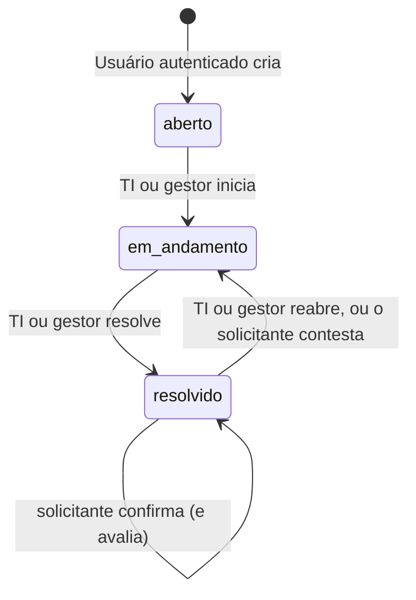
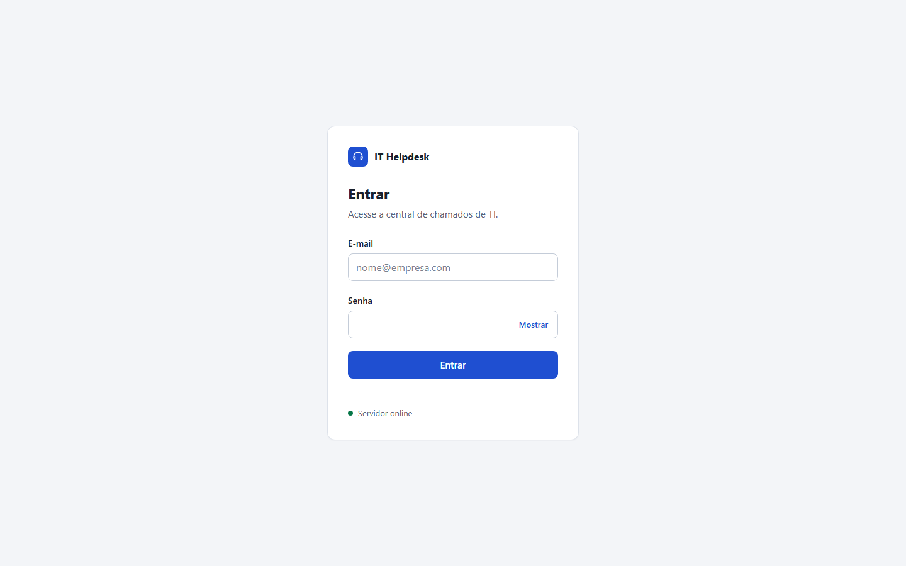
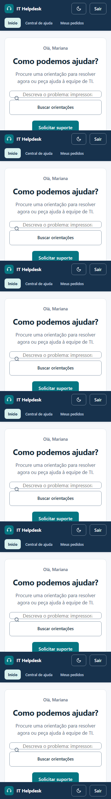
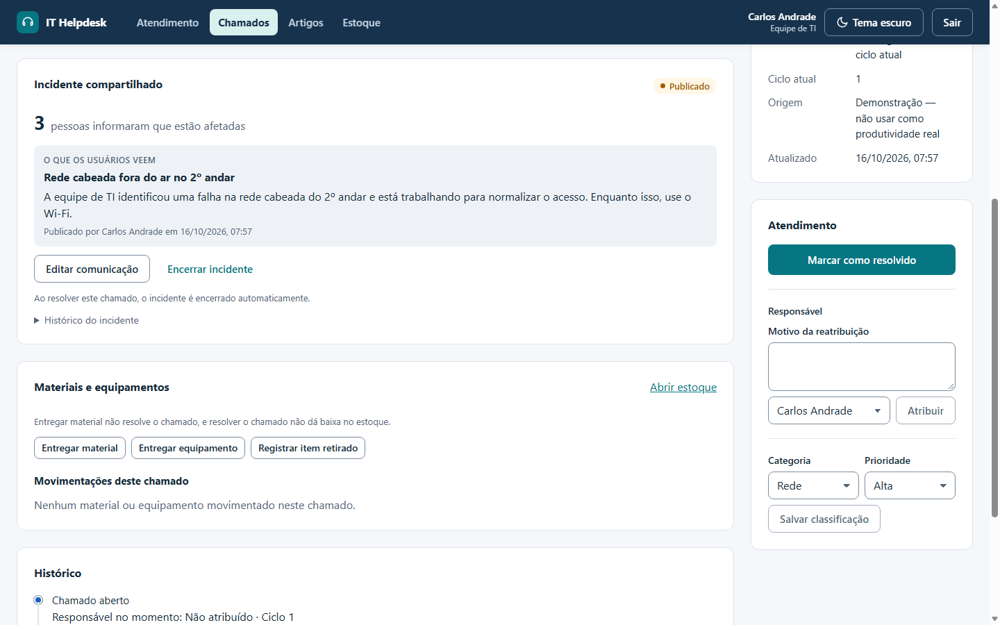
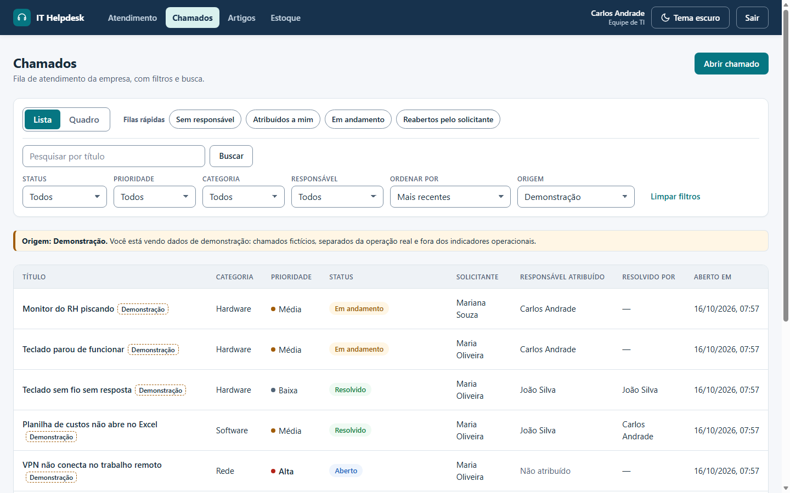

# Fluxos, ciclo de vida e API

[Voltar ao README](../README.md) · [Permissões](01-produto-e-regras.md#permissões-implementadas) · [Demonstração](05-demonstracao.md)

## Como usar, por perfil

### Solicitante

1. **Buscar uma solução.** A página **Início** pergunta **Como podemos ajudar?**: digite o problema na busca e clique em **Buscar orientações**, ou escolha um dos cinco cartões de assunto, que levam direto ao pedido guiado. A **Central de ajuda** mostra as orientações publicadas; abra uma e responda **Isso resolveu meu problema.** ou **Ainda preciso de ajuda.**
2. **Ver se é um problema conhecido.** Em **Problemas conhecidos**, se o problema também está afetando você, clique em **Também estou com esse problema**. Nada mais é necessário: a TI vê que mais uma pessoa foi atingida. Se passar, clique em **Não estou mais com esse problema**.
3. **Solicitar suporte.** Clique em **Solicitar suporte**, o único botão principal da página, (ou em **Ainda preciso de ajuda.**, que já traz o assunto e o artigo lido). Responda **Com o que você precisa de ajuda?**; aparecem os problemas conhecidos e as orientações daquele assunto, que não impedem o envio.
4. **Dizer onde é (opcional).** Em **Onde está o problema?**, o departamento e a sala começam pelo seu local de trabalho; troque se o problema for em outro lugar. Se você tiver equipamentos com patrimônio, pode indicar qual está com problema.
5. **Responder às perguntas.** Em **Conte um pouco mais**, responda o que souber; todas são opcionais e podem ser limpas. Se trocar de assunto e voltar, as respostas continuam lá. Preencha **Assunto**, **O que aconteceu?** e **Prioridade sugerida** e clique em **Enviar solicitação**.
6. **Acompanhar.** A página do pedido abre com a confirmação. Em Início, **Meus pedidos** resume quantos estão aguardando, em atendimento e resolvidos e lista os mais recentes. A situação aparece como **Aguardando atendimento**, **Em atendimento** ou **Resolvido**; enquanto ninguém iniciou o atendimento, **Editar chamado** corrige o texto. Todos os pedidos ficam em **Meus pedidos**.
7. **Confirmar ou contestar a solução.** Quando a TI resolve, o pedido mostra **Seu problema foi resolvido?** (e a marca **Confirme se resolveu** na lista). **Sim, foi resolvido.** encerra; **Não, o problema continua.** pede o que continua acontecendo e devolve o pedido à TI.
8. **Avaliar (opcional).** Depois de confirmar, escolha de 1 a 5 estrelas e, se quiser, escreva um comentário. **Agora não** pula a avaliação.
9. **Ver o material entregue.** Se a TI entregou algo no seu atendimento, o pedido mostra **Material entregue**: o quê, quanto, quando e por quem.

### Suporte TI

1. **Começar pelo que precisa de ação.** A página **Atendimento** abre com quatro cartões (alta prioridade sem responsável, reabertos pelo solicitante, sem movimentação há 3 dias, sem responsável), que levam à fila filtrada. Abaixo: **Meus atendimentos** e **Sem responsável**, ambos em ordem de atendimento (alta, média e baixa prioridade; dentro de cada uma, o mais antigo primeiro), **Incidentes ativos** e, por último, a situação da fila. **Ver fila de chamados** e **Ver quadro** ficam no topo. A página começa nos dados operacionais; no modo demonstração, **Origem dos dados** troca a origem e, sem chamados operacionais, **Ver dados de demonstração** os mostra.
2. **Lista ou Quadro.** Em **Chamados**, alterne entre **Lista** e **Quadro**. Um painel reúne a forma de exibição, as **Filas rápidas** (**Sem responsável**, em ordem de atendimento; **Atribuídos a mim**; **Em andamento**; **Reabertos pelo solicitante**), a busca e os filtros, que valem para os dois. **Ordenar por** oferece Mais recentes (padrão), Prioridade e antiguidade, e Mais antigos. **Origem** começa em Operacionais; Demonstração, Legado e Todas as origens mostram uma faixa de aviso e uma etiqueta em cada registro não operacional. No celular, os filtros ficam atrás do botão **Filtros**, que mostra quantos estão ativos. Marcas: **Incidente · N pessoas afetadas** e **Reaberto pelo solicitante**.
3. **Atribuir e atender.** No quadro, use **Assumir**, **Iniciar atendimento** e **Resolver** nos cartões. No chamado, o bloco **Atendimento** permite escolher o responsável e **Atribuir**, ajustar categoria/prioridade com **Salvar classificação**, iniciar e resolver. Pedem motivo: reatribuição e prioridade durante o atendimento, resolução de chamado de outro responsável e reabertura.
4. **Ler o pedido e corrigir a categoria.** **Informações do pedido** mostra o assunto escolhido, as respostas e o artigo consultado. Se a categoria estiver errada, corrija em **Salvar classificação**; a correção fica no histórico.
5. **Publicar incidentes.** Em **Incidente compartilhado**, use **Publicar como incidente**, escreva título e mensagem para os usuários (sem dados do chamado) e clique em **Publicar incidente**. **Editar comunicação** atualiza o texto; resolver o chamado encerra o incidente; **Encerrar incidente** encerra antes; **Republicar** vale depois de reabrir o chamado.
6. **Gerenciar artigos.** Em **Artigos** (`/help/manage`), as abas **Publicados**, **Rascunhos**, **Arquivados** e **Todos** mostram quantos há em cada situação; cada linha tem **Editar** e, se publicado, **Ver**. **Novo artigo** abre o editor com pré-visualização. Escolha **Rascunho**, **Publicado** ou **Arquivado**; só os publicados aparecem para os solicitantes. A lista mostra quantas pessoas disseram que cada artigo ajudou ou não.
7. **Entregar material sem sair do chamado.** No chamado, **Materiais e equipamentos** tem **Entregar material** (escolha o material; o formulário mostra quantas unidades há, e o solicitante e o local do chamado já vêm preenchidos), **Entregar equipamento** (um patrimônio disponível) e **Registrar item retirado** (o equipamento ou a peça com defeito). **Só reservar agora** separa o material para entregar depois. A entrega não resolve o chamado.
8. **Estoque.** O menu **Estoque** abre o módulo: **Visão geral** (abaixo do mínimo, em manutenção, movimentações recentes), **Materiais** (busca, tipo, saldo e mínimo; cadastro com características por tipo; entrada, entrega e devolução), **Equipamentos** (patrimônio, responsável, local e situação; transferir, manutenção, defeito, devolução), **Movimentações** e **Departamentos e salas** (consulta).
9. **Resolver.** Ao marcar como resolvido, o solicitante recebe a pergunta **Seu problema foi resolvido?**. Uma contestação volta para a fila em atendimento, com o motivo no histórico.

### Gestor

1. **Consultar indicadores.** O login abre a **Visão gerencial**, com seções na ordem: Situação atual, Precisa de atenção, Equipe, Incidentes, Qualidade e Demanda e tendências. Na barra do topo, escolha o **Período** e a **Origem dos dados** (só no modo demonstração; começa sempre em operacional); ao lado aparece de onde vêm os números, e uma faixa fixa avisa quando a origem não é operacional. **Mais filtros: equipe, solicitante e classificação** refina por analista, solicitante, categoria, prioridade e status.
2. **Identificar alertas.** **Precisa de atenção** reúne alta prioridade sem responsável, pendências antigas e sem movimentação; cada alerta abre a fila correspondente. Se alguém tem mais pendências do que a média da equipe, aparece **Carga desigual**, um aviso operacional de redistribuição, não de desempenho.
3. **Acompanhar analistas.** **Equipe de suporte** e **Carga por responsável e prioridade** mostram a distribuição atual; **Ver chamados** abre a fila do analista.
4. **Consultar incidentes.** **Incidentes compartilhados** mostra ativos, pessoas afetadas, novas adesões em 30 dias, encerrados e os incidentes com mais afetados.
5. **Ver a qualidade do atendimento.** **Qualidade do atendimento** mostra, para as resoluções do período, quantas foram confirmadas, contestadas ou ficaram sem resposta, a taxa de resposta e a nota média. Use como sinal; não é avaliação individual.
6. **Acompanhar o estoque.** A seção **Estoque e equipamentos** da Visão gerencial mostra o que repor, os equipamentos em manutenção ou com defeito, as unidades entregues e as movimentações ligadas a chamados no período, os materiais mais entregues, as entregas por departamento e os defeitos por modelo.
7. **Estrutura e exceções.** Em **Estoque → Departamentos e salas**, o gestor cadastra e desativa departamentos e salas e define onde cada pessoa trabalha. Ajuste de inventário, descarte, estorno e baixa de patrimônio são exclusivos da gestão e pedem motivo.
8. **Operar chamados.** Pelo grupo **Operação** do menu (**Atendimento**, **Chamados** em Lista ou Quadro, **Artigos** e **Estoque**), o gestor opera como a TI: assume, atribui, classifica, resolve, reabre, publica incidentes, gerencia artigos e movimenta o estoque. O texto de chamados de outras pessoas continua restrito ao autor.

**Sair e trocar de perfil:** depois de **Sair**, quem entra em seguida vai para a página inicial do próprio perfil, nunca para a página em que a pessoa anterior estava. Quem abre uma URL protegida sem sessão volta a ela depois do login, se o perfil puder abri-la (`/manager` só gestor; `/help/manage` só TI e gestor); se a sessão expirou, só a mesma pessoa volta à página. O backend continua validando o acesso a cada requisição.

Filtros na lista ficam na URL e sobrevivem a recarregamentos e ao botão Voltar do navegador. Ao abrir um chamado pela lista, o link explícito do detalhe restaura a URL dessa fila, incluindo filtros e página. Acesso direto ao detalhe usa `/tickets` como fallback.

## Visão gerencial

Menu **Visão gerencial** (`/manager`) separado do grupo **Operação** (Atendimento, Chamados e Artigos). Login normal do gestor abre a visão gerencial; uma rota protegida anteriormente consultada pode ser restaurada. TI e solicitante recebem 403 no endpoint gerencial, mesmo em requisições diretas, e são redirecionados ao próprio dashboard ao tentar a página.

`GET /dashboard/manager` aceita `period=today|week|month|year` (padrão `month`), `dataOrigin=operational|demo|legacy` (padrão `operational`), `analystId`, `requesterId`, `category`, `priority` e `status`. IDs devem ser ObjectId; campos desconhecidos/valores inválidos retornam 400. Limites, timezone e instante da consulta retornam em `range` e `asOf`.

Resposta contém `current`, `period`, `alerts`, `workload`, `distributions`, `team`, `requesters`, `trends`, `demand` (horas, dias da semana e `categories`, as criações do período por assunto), `coverage` e opções públicas de filtro. A interface mantém filtros gerenciais na URL. Links de equipe e alertas abrem pendências atuais de qualquer data de criação. Links de solicitantes e criações incluem os limites exatos do período consultado. Cartões de backlog usam `pending=true`; nenhuma resolução é inferida do responsável atual.

Consulte [definições dos indicadores](04-metricas-decisoes-e-limites.md#visão-gerencial-exclusiva).

## Estados permitidos

TI e gestor mudam status. O solicitante só responde à resolução do próprio chamado, por rotas próprias: confirmar mantém o status; contestar reabre em novo ciclo, com motivo. Não há transição direta de aberto para resolvido nem retorno ao estado aberto. Transição inválida retorna 409.

Ao passar para `em_andamento`, inclusive ao reabrir, o operador autenticado assume automaticamente se o chamado estiver sem responsável; uma atribuição existente é preservada. Enquanto não resolvido, TI e gestor podem atribuir ou trocar o responsável, reclassificar categoria e prioridade. A API atual não remove o responsável.

Título/descrição seguem a regra de dono e estado aberto. Não é permitido usar a edição genérica para mudar status, responsável, solicitante ou histórico.

## Histórico e concorrência

O servidor gera autor, data e descrição de cada evento. Criação, edição, mudança de status, reabertura e atribuição são registradas. Atualização sem mudança de valor não cria evento de edição; iniciar um chamado sem responsável cria eventos de status e atribuição.

`saveChanges` grava estado, revisão, eventos e projeções de resolução na mesma atualização atômica. A condição usa `expectedRevision`, enviada a partir da leitura efetiva do frontend. Uma alteração concorrente ou tela antiga retorna 409 sem gravar estado ou evento parcial. O frontend recarrega e informa o conflito.

Resolução por outro responsável exige `reason`; reabertura também. `resolvedAt`/`resolvedBy` descrevem apenas a resolução do ciclo atual e são limpos na reabertura. Todas as resoluções anteriores permanecem em eventos próprios. Datas/autores legados ausentes não são preenchidos automaticamente.

Fonte: [ticket.service.ts](../backend/src/services/ticket.service.ts).

## Referência HTTP

Base local: `http://localhost:3000/api`. Rotas autenticadas exigem `Authorization: Bearer <token>`. Respostas são JSON.

| Método | Rota | Contrato e acesso |
|---|---|---|
| GET | `/health` | Público; `{ status: "ok" }` |
| POST | `/auth/login` | Público com rate limit; `{ email, password }` → `{ token, user }` |
| GET | `/auth/me` | Usuário autenticado → `{ user }` |
| POST | `/tickets` | `{ title, description, category, priority? }`; qualquer perfil autenticado |
| GET | `/tickets` | Escopo autorizado; filtros e paginação → `{ tickets, pagination }` |
| GET | `/tickets/:id` | Dono, TI ou gestor → `{ ticket }` com histórico; o dono solicitante recebe o [formato reduzido](01-produto-e-regras.md#permissões-implementadas) |
| PATCH | `/tickets/:id` | Texto próprio aberto; categoria/prioridade TI/gestor; `expectedRevision` obrigatório e não resolvido |
| PATCH | `/tickets/:id/status` | TI/gestor; `{ status, expectedRevision, reason? }`, conforme transições |
| PATCH | `/tickets/:id/assignee` | TI/gestor; `{ assigneeId, expectedRevision, reason? }`, destino operador ativo e chamado não resolvido |
| GET | `/users/it-staff` | TI ou gestor; lista operadores ativos atribuíveis (TI/gestor) |
| GET | `/dashboard/summary` | Escopo autorizado; `dataOrigin?` → `{ summary }` |
| GET | `/dashboard/manager` | Somente gestor; filtros gerenciais → `{ dashboard }` |
| GET / POST | `/tickets/:id/incident` | TI/gestor; consulta (`{ incident }` ou `null`) ou publica `{ title, publicMessage }` → 201 |
| GET | `/tickets/intake-questions` | Qualquer perfil; catálogo de perguntas por categoria → `{ questions }` |
| POST | `/tickets/:id/resolution/confirm` | Só o dono; `{ cycleId }`; repetir não cria outro evento |
| POST | `/tickets/:id/resolution/contest` | Só o dono; `{ cycleId, reason }` (5–1000); reabre em novo ciclo |
| POST | `/tickets/:id/resolution/rating` | Só o dono, depois de confirmar; `{ cycleId, rating (1–5), comment? (até 500) }` |

Lista aceita `dataOrigin` (`operational`/`demo`/`legacy`; veja a [política de origem](04-metricas-decisoes-e-limites.md#origem-dos-dados)), `sort` (`newest`, padrão; `oldest`; `priority` = alta, média e baixa, e o mais antigo primeiro dentro de cada uma, com páginas estáveis), `status`, `priority`, `category`, `assignee` (`none`/`me`), `search` por título, `page` (padrão 1) e `limit` (padrão 10, máximo 50). Pesquisa tem limite de 100 caracteres. O frontend oferece filtro de responsável para TI e gestor. IDs inválidos retornam 400. `assigneeId` permite consultar responsável específico para TI/gestor; `requesterId` filtra solicitante sem ampliar o escopo autorizado. Solicitante não pode consultar outros IDs. `pending=true` restringe a abertos/em andamento; combinado com status resolvido retorna fila vazia.

Erros têm `message`; validações também podem incluir `errors` por campo e `formErrors`. Códigos: 400 entrada inválida; 401 autenticação inválida/ausente/expirada; 403 sem permissão; 404 recurso ausente ou chamado alheio ao solicitante; 409 conflito de alteração/estado; 413 corpo acima de 100 KB; 429 limite de login; 500 falha inesperada sem stack na resposta.

### Incidentes compartilhados

Rotas em `/api/incidents`, todas autenticadas. Regras e motivos em [produto e regras](01-produto-e-regras.md#incidentes-compartilhados).

| Método | Rota | Acesso e contrato |
|---|---|---|
| GET | `/incidents` | Todos os perfis; incidentes ativos no formato público → `{ incidents }` |
| GET | `/incidents/following` | Incidentes em que o usuário está como afetado, ativos ou encerrados |
| GET | `/incidents/:id` | Formato público; encerrado só para quem participou ou para a equipe, senão 404 |
| GET / PUT / DELETE | `/incidents/:id/participation` | Própria participação: consultar, entrar (corpo `{}`) ou sair; incidente encerrado → 409 |
| GET | `/incidents/manage` | TI/gestor; `status?`, `dataOrigin?` → visão da equipe com chamado, responsável e histórico |
| GET | `/incidents/indicators` | TI/gestor; `dataOrigin?` → `{ active, closed, affectedInActive, newParticipations30Days, top }` |
| PATCH | `/incidents/:id` | TI/gestor; `{ title?, publicMessage?, expectedRevision }`, somente ativo |
| POST | `/incidents/:id/close` | TI/gestor; `{ resolutionMessage, expectedRevision }` |
| POST | `/incidents/:id/republish` | TI/gestor; `{ title, publicMessage, expectedRevision }`, somente encerrado e com chamado não resolvido |

Entrar duas vezes devolve 200 com a mesma contagem. O corpo de participação não aceita `userId`: enviar campos extras retorna 400. A lista de chamados inclui `incident: { id, status, affectedCount }` apenas para TI/gestor. Publicar em chamado resolvido, publicar de novo no mesmo chamado ou usar uma revisão antiga retorna 409.

### Base de conhecimento

Rotas em `/api/articles`, todas autenticadas. Regras em [produto e regras](01-produto-e-regras.md#base-de-conhecimento).

| Método | Rota | Acesso e contrato |
|---|---|---|
| GET | `/articles` | Todos; só publicados; `q?` (até 100), `category?`, `page`, `limit` (até 20) → `{ articles, pagination }`, sem o corpo |
| GET | `/articles/:id` | Publicado para todos; rascunho/arquivado só para TI/gestor, senão 404 → `{ article }` com corpo e `myFeedback` |
| PUT | `/articles/:id/feedback` | Todos; `{ helpful: boolean }`; uma resposta por pessoa, substituível; só publicados |
| GET | `/articles/manage` | TI/gestor; mesmos filtros e `status?` → artigos com situação, autoria e totais de "ajudou" |
| POST | `/articles` | TI/gestor; `{ title, summary, category, body, status? }` (padrão `draft`) → 201 |
| PATCH | `/articles/:id` | TI/gestor; campos opcionais e `expectedRevision`; revisão antiga → 409 |

### Criação com o formulário guiado

`POST /tickets` aceita `intake?: { answers: [{ key, answer }], articleId? }`, `location?: { departmentId?, roomId? }` (departamento e sala ativos; a sala precisa ser do departamento) e `affectedAssetId?` (o solicitante só indica equipamentos que estão com ele). O chamado devolve `location` (ids e nomes do momento) e `affectedAsset`. As respostas são validadas contra o catálogo da categoria enviada; `articleId` precisa ser de um artigo publicado. O chamado devolve `intake` (assunto, respostas com o texto da pergunta e artigo) ou `null`. A lista e o detalhe também trazem, para o solicitante, `awaitingConfirmation` e `resolutionFeedback`; para a equipe, `contested` e `resolutionFeedback` com comentário.

### Estrutura da empresa

Rotas em `/api/organization`, autenticadas.

| Método | Rota | Acesso e contrato |
|---|---|---|
| GET | `/organization` | Todos; departamentos ativos com salas e `myLocation` (local de quem pergunta); `includeInactive=true` só para a gestão |
| POST / PATCH | `/organization/departments`, `/organization/departments/:id` | Gestão (`org:manage`); `{ name, code?, description?, active? }`; nome ou código repetido → 409 |
| POST / PATCH | `/organization/rooms`, `/organization/rooms/:id` | Gestão; `{ departmentId, name, building?, floor? }`; a sala nunca muda de departamento |
| GET | `/organization/people` | TI e gestão; nome, papel, função, departamento e sala, sem e-mail |
| PATCH | `/organization/people/:id` | Gestão; `{ departmentId, roomId, jobTitle? }` |

### Estoque e patrimônio

Rotas em `/api/inventory`. Leitura exige `inventory:read` (TI e gestão); operações, `inventory:operate`; ajuste, descarte, estorno e baixa, `inventory:adjust` (gestão); indicadores, `inventory:insights` (gestão). Toda operação que muda saldo ou equipamento exige `operationId` (chave de idempotência escolhida pelo cliente, 8–100 caracteres): a primeira requisição responde 201; a repetição com o mesmo conteúdo responde 200 com a mesma movimentação e `replayed: true`; a mesma chave com outro conteúdo ou autor responde 409 `OPERATION_KEY_REUSED`.

| Método | Rota | Contrato |
|---|---|---|
| GET | `/inventory/product-types` | Tipos e características aceitas por tipo |
| GET / POST | `/inventory/products` | Lista com `q`, `type`, `tracking`, `status`, `belowMinimum`, paginação; cadastro com `tracking` fixo |
| GET / PATCH | `/inventory/products/:id` | Detalhe com saldo e reservas abertas; edição do cadastro com `expectedRevision` |
| POST | `/inventory/products/:id/receipts` | `{ operationId, quantity, reason? }` |
| POST | `/inventory/products/:id/reservations` | `{ operationId, quantity, ticketId, recipientId?, departmentId?, roomId? }` |
| POST | `/inventory/products/:id/reservations/:reservationId/cancel` | `{ operationId, reason? }` |
| POST | `/inventory/products/:id/issues` | Entrega: `{ operationId, quantity, reservationId?, ticketId?, recipientId?, departmentId?, roomId?, reason? }` |
| POST | `/inventory/products/:id/returns` | `{ operationId, quantity, condition: good \| defective, ... }` |
| POST | `/inventory/products/:id/adjustments` · `/discards` · `/reversals` | Gestão, com `reason`; ajuste usa `delta`, estorno usa `movementId` |
| GET / POST | `/inventory/assets` | Lista com `q`, `status`, `departmentId`, `holderId`; cadastro com `assetTag`, `serialNumber?`, `status` (disponível ou em uso com local) |
| GET | `/inventory/assets/mine` | Qualquer perfil: só os equipamentos da própria pessoa (patrimônio e nome) |
| GET | `/inventory/assets/:id` | Equipamento e histórico |
| POST | `/inventory/assets/:id/:action` | `reserve`, `cancel-reservation`, `assign`, `transfer`, `return`, `maintenance`, `defective`, `retire` (gestão) |
| GET | `/inventory/movements`, `/inventory/movements/:id` | Livro-razão com `type`, `productId`, `assetId`, `ticketId`, `departmentId`, `from`, `to`, paginação |
| GET | `/inventory/insights` | Gestão; `period` e `dataOrigin` como a visão gerencial |
| GET | `/tickets/:id/materials` | Dono ou equipe: a equipe recebe as movimentações e reservas do chamado; o dono recebe só as entregas, resumidas |

Regras de negócio respondem 409 com `code`: `INSUFFICIENT_STOCK`, `NEGATIVE_BALANCE`, `BELOW_RESERVED`, `RESERVATION_CLOSED`, `ALREADY_REVERSED`, `NOT_REVERSIBLE`, `INVALID_TRANSITION`, `ASSET_TAG_TAKEN`, `SERIAL_TAKEN`, `PRODUCT_INACTIVE`, `STOCK_BUSY` (a interface mostra cada uma em português). `TRACKING_MISMATCH` responde 400. Movimentações não têm rota de edição nem de exclusão.

### Quadro (Kanban)

O quadro não tem rota própria: cada coluna chama `GET /tickets` com os filtros da URL, o `status` da coluna e `limit=20`, e "Carregar mais" pede a página seguinte. O contador mostra cartões carregados e total filtrado. As ações dos cartões chamam as mesmas rotas de status e atribuição, com a revisão do cartão: conflito retorna 409 e o quadro recarrega. Com filtro de status, só a coluna correspondente aparece, como na lista. Não há arrastar e soltar: um botão por ação mantém justificativa, validação de transição e uso por teclado sem um segundo mecanismo.

### Filtros dos alertas e do período de criação

`GET /api/tickets` aceita `attention=high_unassigned|oldest|inactive|contested`, `ageDays` (1–365, padrão 7) e `inactivityDays` (1–90, padrão 3). Os predicados são os mesmos da visão gerencial; `oldest` ordena a fila por abertura crescente. `contested` traz os chamados em andamento cujo ciclo atual começou com a contestação do solicitante (Reabertos pelo solicitante). `sort=newest|oldest|priority` (padrão `newest`) ordena qualquer fila; outro valor retorna 400. Combinam-se com origem, classificação, solicitante, responsável e paginação, sem ampliar a autorização do usuário.

`createdFrom` e `createdTo` aceitam datas ISO com horário UTC; início inclusivo e fim exclusivo. Os links de volume por solicitante incluem o intervalo exato retornado pela API. Carga atual e alertas não recebem esse intervalo, pois consideram pendências de qualquer data de abertura. Links de detalhe preservam a URL da fila ao retornar.

`GET /api/dashboard/manager` também aceita os dois limiares de dias. Origens `demo`/`legacy` retornam 403 se `DEMO_MODE` estiver desabilitado ou `NODE_ENV=production`; a origem padrão é operacional.

## Capturas por perfil

Imagens reais da aplicação, em 15/10/2026, obtidas num [ambiente isolado](05-demonstracao.md#capturas-reproduzíveis) com banco temporário e apenas os [cenários de demonstração](05-demonstracao.md#cenários-de-demonstração). Viewport desktop de 1440 × 900 e celular de 390 × 844. As páginas iniciais são capturas da página inteira; as demais mostram o trecho indicado.

Solicitante: login, Início, pedido e problema conhecido

O login autentica os três perfis; não há cadastro público.

A solicitante busca uma orientação, escolhe um assunto ou pede suporte; vê os problemas que a TI já publicou e os próprios pedidos, sem indicadores da equipe.

Depois de **Também estou com esse problema**, o cartão confirma o acompanhamento e oferece **Não estou mais com esse problema**.

O formulário mostra os problemas conhecidos antes dos campos, sem bloquear o envio. A captura é anterior ao envio.

Atendimento da TI, listagem e incidente

Sem chamados operacionais, a página passou para a origem Demonstração e avisa isso na barra de origem. O incidente aparece identificado como demonstração; todas as contagens seguem a origem escolhida.

No chamado principal, a equipe vê quantas pessoas estão afetadas e o texto exatamente como os usuários o recebem.

A lista mostra os cenários fictícios da origem Demonstração. Solicitante, responsável atribuído e autor da resolução têm colunas próprias. Registros legados sem evidência estruturada, consultados em outras filas, continuam identificados como tal.

A jornada do gestor está nas [capturas dos indicadores](04-metricas-decisoes-e-limites.md#evidências-visuais). O [detalhe com histórico](06-integridade-e-auditoria.md#evidência-visual-da-autoria) demonstra autoria diferente da atribuição.
