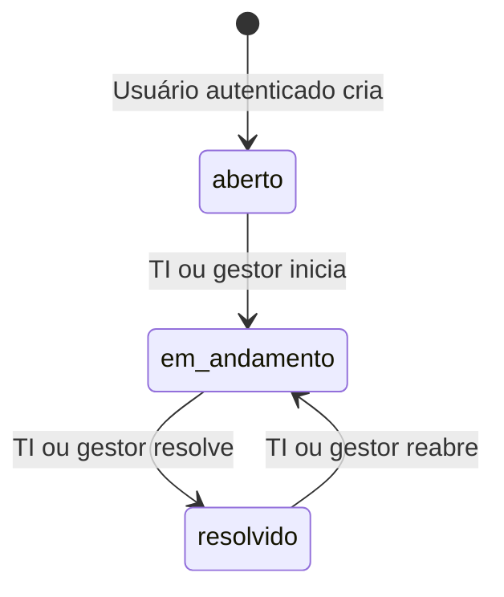

# Fluxos, ciclo de vida e API

[Voltar ao README](../README.md) · [Permissões](01-produto-e-regras.md#permissões-implementadas) · [Demonstração](05-demonstracao.md)

## Jornadas implementadas

- **Solicitante:** login → dashboard próprio → abrir chamado → lista com confirmação → detalhe e histórico. Pode editar seu texto enquanto aberto; acompanha a atualização feita pela TI.
- **TI:** login → dashboard global/fila pessoal → lista filtrada → detalhe → atribuição, triagem e status. O responsável precisa ser TI ou gestor ativo, mas o técnico autenticado não precisa ser o responsável atual para operar.
- **Gestor:** login → visão gerencial → operação de chamados → lista e detalhe de qualquer chamado. Recebe controles de atendimento e pode assumir, atribuir, triar, iniciar, resolver e reabrir. Pode abrir e editar o texto de seus próprios chamados abertos.

Filtros na lista ficam na URL e sobrevivem a recarregamentos e ao botão Voltar do navegador. Ao abrir um chamado pela lista, o link explícito do detalhe restaura a URL dessa fila, incluindo filtros e página. Acesso direto ao detalhe usa `/tickets` como fallback. A confirmação de criação guarda o título no estado da navegação e aparece na lista.

## Visão gerencial

Menu **Visão gerencial** (`/manager`) separado de **Operação de chamados** (`/tickets`). Login normal do gestor abre a visão gerencial; uma rota protegida anteriormente consultada pode ser restaurada. TI e solicitante recebem 403 no endpoint gerencial, mesmo em requisições diretas, e são redirecionados ao próprio dashboard ao tentar a página.

`GET /dashboard/manager` aceita `period=today|week|month|year` (padrão `month`), `dataOrigin=operational|demo|legacy` (padrão `operational`), `analystId`, `requesterId`, `category`, `priority` e `status`. IDs devem ser ObjectId; campos desconhecidos/valores inválidos retornam 400. Limites, timezone e instante da consulta retornam em `range` e `asOf`.

Resposta contém `current`, `period`, `alerts`, `workload`, `distributions`, `team`, `requesters`, `trends`, `demand`, `coverage` e opções públicas de filtro. A interface mantém filtros gerenciais na URL. Links de equipe e alertas abrem pendências atuais de qualquer data de criação. Links de solicitantes e criações incluem os limites exatos do período consultado. Cartões de backlog usam `pending=true`; nenhuma resolução é inferida do responsável atual.

Consulte [definições dos indicadores](04-metricas-decisoes-e-limites.md#visão-gerencial-exclusiva).

## Estados permitidos

TI e gestor mudam status. Não há transição direta de aberto para resolvido nem retorno ao estado aberto. Transição inválida retorna 409.

Ao passar para `em_andamento`, inclusive ao reabrir, o operador autenticado assume automaticamente se o chamado estiver sem responsável; uma atribuição existente é preservada. Enquanto não resolvido, TI e gestor podem atribuir ou trocar o responsável, reclassificar categoria e prioridade. A API atual não remove o responsável.

Título/descrição seguem a regra de dono e estado aberto. Não é permitido usar a edição genérica para mudar status, responsável, solicitante ou histórico.

## Histórico e concorrência

O servidor gera autor, data e descrição de cada evento. Criação, edição, mudança de status, reabertura e atribuição são registradas. Atualização sem mudança de valor não cria evento de edição; iniciar um chamado sem responsável cria eventos de status e atribuição.

`saveChanges` grava estado, revisão, eventos e projeções de resolução na mesma atualização atômica. A condição usa `expectedRevision`, enviada a partir da leitura efetiva do frontend. Uma alteração concorrente ou tela antiga retorna 409 sem gravar estado ou evento parcial. O frontend recarrega e informa o conflito.

Resolução por outro responsável exige `reason`; reabertura também. `resolvedAt`/`resolvedBy` descrevem apenas a resolução do ciclo atual e são limpos na reabertura. Todas as resoluções anteriores permanecem em eventos próprios. Datas/autores legados ausentes não são preenchidos automaticamente.

Fonte: [ticket.service.ts](../backend/src/services/ticket.service.ts).

## Referência HTTP

Base local: `http://localhost:3000/api`. Rotas autenticadas exigem `Authorization: Bearer <token>`. Respostas são JSON.

| Método | Rota | Contrato e acesso |
|---|---|---|
| GET | `/health` | Público; `{ status: "ok" }` |
| POST | `/auth/login` | Público com rate limit; `{ email, password }` → `{ token, user }` |
| GET | `/auth/me` | Usuário autenticado → `{ user }` |
| POST | `/tickets` | `{ title, description, category, priority? }`; qualquer perfil autenticado |
| GET | `/tickets` | Escopo autorizado; filtros e paginação → `{ tickets, pagination }` |
| GET | `/tickets/:id` | Dono, TI ou gestor → `{ ticket }` com histórico |
| PATCH | `/tickets/:id` | Texto próprio aberto; categoria/prioridade TI/gestor; `expectedRevision` obrigatório e não resolvido |
| PATCH | `/tickets/:id/status` | TI/gestor; `{ status, expectedRevision, reason? }`, conforme transições |
| PATCH | `/tickets/:id/assignee` | TI/gestor; `{ assigneeId, expectedRevision, reason? }`, destino operador ativo e chamado não resolvido |
| GET | `/users/it-staff` | TI ou gestor; lista operadores ativos atribuíveis (TI/gestor) |
| GET | `/dashboard/summary` | Escopo autorizado; `dataOrigin?` → `{ summary }` |
| GET | `/dashboard/manager` | Somente gestor; filtros gerenciais → `{ dashboard }` |

Lista aceita `dataOrigin` (`operational`/`demo`/`legacy`), `status`, `priority`, `category`, `assignee` (`none`/`me`), `search` por título, `page` (padrão 1) e `limit` (padrão 10, máximo 50). Pesquisa tem limite de 100 caracteres. O frontend oferece filtro de responsável para TI e gestor. IDs inválidos retornam 400. `assigneeId` permite consultar responsável específico para TI/gestor; `requesterId` filtra solicitante sem ampliar o escopo autorizado. Solicitante não pode consultar outros IDs. `pending=true` restringe a abertos/em andamento; combinado com status resolvido retorna fila vazia.

Erros têm `message`; validações também podem incluir `errors` por campo e `formErrors`. Códigos: 400 entrada inválida; 401 autenticação inválida/ausente/expirada; 403 sem permissão; 404 recurso ausente ou chamado alheio ao solicitante; 409 conflito de alteração/estado; 413 corpo acima de 100 KB; 429 limite de login; 500 falha inesperada sem stack na resposta.

### Filtros dos alertas e do período de criação

`GET /api/tickets` aceita `attention=high_unassigned|oldest|inactive`, `ageDays` (1–365, padrão 7) e `inactivityDays` (1–90, padrão 3). Os predicados são os mesmos da visão gerencial; `oldest` ordena a fila por abertura crescente. Combinam-se com origem, classificação, solicitante, responsável e paginação, sem ampliar a autorização do usuário.

`createdFrom` e `createdTo` aceitam datas ISO com horário UTC; início inclusivo e fim exclusivo. Os links de volume por solicitante incluem o intervalo exato retornado pela API. Carga atual e alertas não recebem esse intervalo, pois consideram pendências de qualquer data de abertura. Links de detalhe preservam a URL da fila ao retornar.

`GET /api/dashboard/manager` também aceita os dois limiares de dias. Origens `demo`/`legacy` retornam 403 se `DEMO_MODE` estiver desabilitado ou `NODE_ENV=production`; a origem padrão é operacional.

## Capturas por perfil

Imagens reais do ambiente demonstrativo, em 10/10/2026, com viewport desktop de 1440 × 900. As capturas não criaram nem alteraram chamados. Registros de testes manuais anteriores permanecem preservados; os números refletem aquele momento, não uma instalação nova.

Login e abertura pelo solicitante

O login autentica os três perfis; não há cadastro público.

O solicitante acompanha apenas seus pedidos, inclusive os tratados por outros operadores.

A captura mostra o formulário antes do envio; não representa um chamado criado pela automação.

Atendimento da TI e listagem

O dashboard operacional da TI combina contagens globais e fila pessoal.

A lista foi filtrada pelo título do conjunto gerencial fictício. As três identidades têm colunas próprias. Registros legados sem evidência estruturada, consultados em outras filas, continuam identificados como tal.

A jornada do gestor está nas [capturas dos indicadores](04-metricas-decisoes-e-limites.md#evidências-visuais). O [detalhe com histórico](06-integridade-e-auditoria.md#evidência-visual-da-autoria) demonstra autoria diferente da atribuição.
