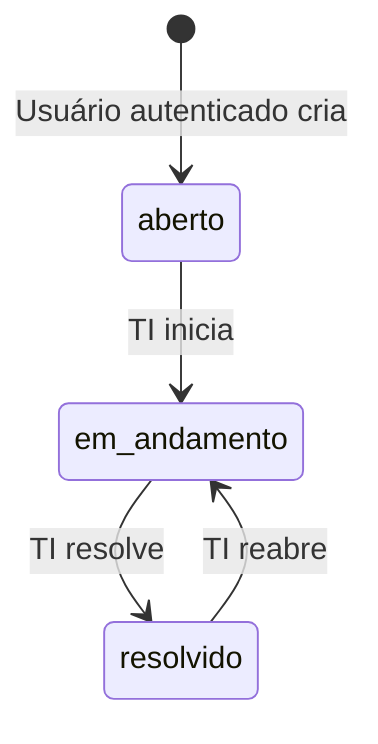

# Fluxos, ciclo de vida e API

[Voltar ao README](../README.md) · [Permissões](01-produto-e-regras.md#permissões-implementadas) · [Demonstração](05-demonstracao.md)

## Jornadas implementadas

- **Solicitante:** login → dashboard próprio → abrir chamado → lista com confirmação → detalhe e histórico. Pode editar seu texto enquanto aberto; acompanha a atualização feita pela TI.
- **TI:** login → dashboard global/fila pessoal → lista filtrada → detalhe → atribuição, triagem e status. O responsável precisa ser TI, mas o técnico autenticado não precisa ser o responsável atual para operar.
- **Gestor:** login → dashboard global → lista e detalhe de qualquer chamado. Não recebe controles de atendimento. Pode abrir e editar o texto de seus próprios chamados abertos.

Filtros na lista ficam na URL e sobrevivem a recarregamentos e ao botão Voltar do navegador. O link explícito do detalhe aponta para `/tickets`, portanto não restaura a fila anterior. A confirmação de criação guarda o título no estado da navegação e aparece na lista.

## Estados permitidos

Somente TI muda status. Não há transição direta de aberto para resolvido nem retorno ao estado aberto. Transição inválida retorna 409.

Ao passar para `em_andamento`, inclusive ao reabrir, a TI autenticada assume automaticamente se o chamado estiver sem responsável; uma atribuição existente é preservada. Enquanto não resolvido, a TI pode atribuir ou trocar o responsável, reclassificar categoria e prioridade. A API atual não remove o responsável.

Título/descrição seguem a regra de dono e estado aberto. Não é permitido usar a edição genérica para mudar status, responsável, solicitante ou histórico.

## Histórico e concorrência

O servidor gera autor, data e descrição de cada evento. Criação, edição, mudança de status, reabertura e atribuição são registradas. Atualização sem mudança de valor não cria evento de edição; iniciar um chamado sem responsável cria eventos de status e atribuição.

`saveChanges` grava alteração e eventos na mesma atualização atômica, condicionada ao `updatedAt` lido pelo service. Se outra escrita alterar o documento entre leitura e atualização, responde 409; a interface informa o conflito e recarrega o chamado.

Esse bloqueio protege a janela de leitura/escrita no servidor. O contrato não envia a versão vista na tela; uma mudança anterior à leitura do novo request não é necessariamente detectada como envio de tela desatualizada. Não há promessa de bloqueio exclusivo durante toda a sessão do usuário.

Fonte: [ticket.service.ts](../backend/src/services/ticket.service.ts).

## Referência HTTP

Base local: `http://localhost:3000/api`. Rotas autenticadas exigem `Authorization: Bearer <token>`. Respostas são JSON.

| Método | Rota | Contrato e acesso |
|---|---|---|
| GET | `/health` | Público; `{ status: "ok" }` |
| POST | `/auth/login` | Público com rate limit; `{ email, password }` → `{ token, user }` |
| GET | `/auth/me` | Usuário autenticado → `{ user }` |
| POST | `/tickets` | `{ title, description, category, priority? }`; qualquer perfil autenticado |
| GET | `/tickets` | Escopo autorizado; filtros e paginação → `{ tickets, pagination }` |
| GET | `/tickets/:id` | Dono, TI ou gestor → `{ ticket }` com histórico |
| PATCH | `/tickets/:id` | Texto próprio aberto; categoria/prioridade só TI e não resolvido |
| PATCH | `/tickets/:id/status` | TI; `{ status }`, conforme transições |
| PATCH | `/tickets/:id/assignee` | TI; `{ assigneeId }`, destino TI e chamado não resolvido |
| GET | `/users/it-staff` | TI ou gestor; lista somente usuários atribuíveis da TI |
| GET | `/dashboard/summary` | Escopo autorizado; sem parâmetros → `{ summary }` |

Lista aceita `status`, `priority`, `category`, `assignee` (`none`/`me`), `search` por título, `page` (padrão 1) e `limit` (padrão 10, máximo 50). Pesquisa tem limite de 100 caracteres. O frontend oferece filtro de responsável somente para TI. IDs inválidos retornam 400.

Erros têm `message`; validações também podem incluir `errors` por campo e `formErrors`. Códigos: 400 entrada inválida; 401 autenticação inválida/ausente/expirada; 403 sem permissão; 404 recurso ausente ou chamado alheio ao solicitante; 409 conflito de alteração/estado; 413 corpo acima de 100 KB; 429 limite de login; 500 falha inesperada sem stack na resposta.
