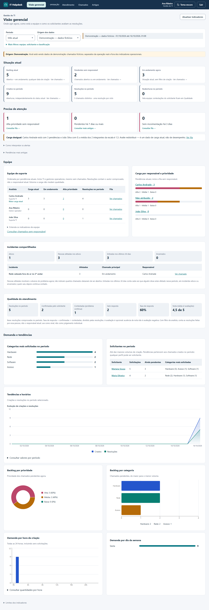
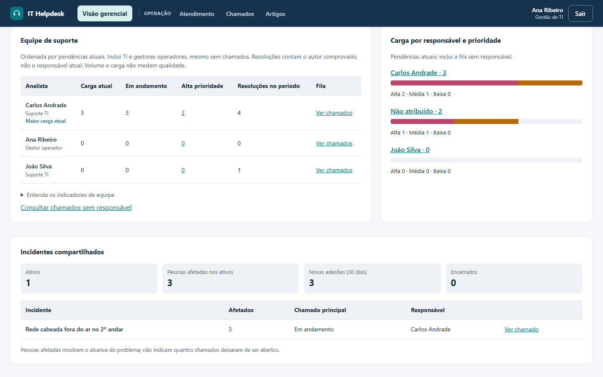
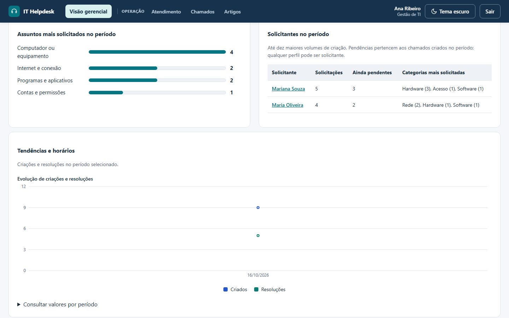
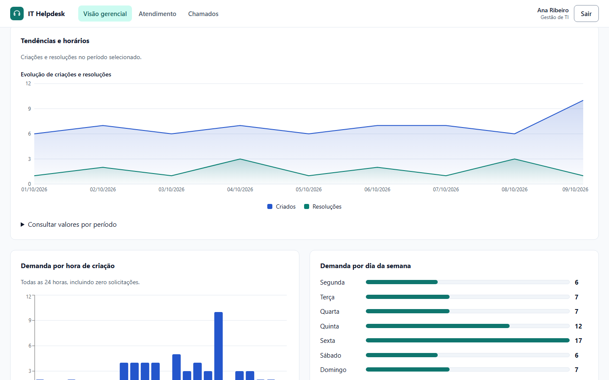
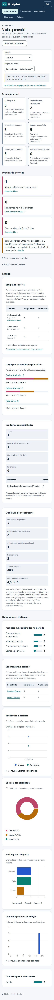

# Métricas, decisões técnicas e limites

[Voltar ao README](../README.md) · [Arquitetura e dados](02-arquitetura-e-dados.md)

## Dashboard básico

O solicitante consulta só seus documentos; TI e gestor consultam todos. O resumo aceita filtro de origem (`operational`, `demo`, `legacy`), sem filtro por período. Na página Atendimento, a origem é sempre operacional ao abrir; demonstração e legado ficam separados. No modo demonstração, se a origem operacional não tem nenhum chamado e a demonstração tem, a página oferece **Ver dados de demonstração**, sem trocar sozinha. A página Início do solicitante não tem seletor: fora do modo demonstração conta só dados operacionais, e no modo demonstração conta todas as origens, igual à lista **Meus pedidos**. Valores representam o estado atual dos chamados, não produtividade, qualidade ou desempenho histórico.

| Indicador / pergunta | Definição e campos | Filtros e limitações |
|---|---|---|
| Total: qual o volume registrado? | Contagem de documentos | Escopo autorizado, todos os status; sem período |
| Abertos, em andamento, resolvidos: qual a situação atual? | Contagem por `status` | Resolvidos = atualmente resolvidos, não resoluções de um período |
| Pendentes por prioridade: quais pendências exigem atenção? | Agrupamento por `priority` | Apenas `aberto`/`em_andamento`; classificação atual |
| Pendentes por categoria: onde as pendências se concentram? | Agrupamento por `category` | Apenas `aberto`/`em_andamento`; não é distribuição de todos os chamados |
| Sem responsável: quantos documentos não estão atribuídos? | `assignee = null` | Todos os status; só no workload TI; pode incluir resolvidos |
| Em atendimento comigo: quanto está sob minha responsabilidade? | `assignee = usuário atual` e `status = em_andamento` | Só TI; não inclui abertos atribuídos nem identifica quem resolveu. Continua na API; a página Atendimento usa as filas descritas abaixo |
| Recentes: quais foram criados por último? | Até 5 documentos por `createdAt desc`, depois `_id desc` | Escopo autorizado; recente significa criado, não atualizado. Continua na API; a página Atendimento não exibe mais essa lista |

As contagens usam `$facet` após o filtro de autorização. Lista e dashboard compartilham `buildTicketFilter`, então adotam as mesmas definições de escopo e filtro. Agregação, recentes e contagem da lista são consultas separadas: alterações simultâneas podem produzir diferenças entre momentos de leitura.

Cartões de status abrem a lista com o filtro correspondente.

### Página Atendimento (TI)

A página é organizada pelo que pede ação, não pelo resumo. Os quatro cartões de **Precisa de ação** são o `pagination.total` da própria fila que abrem, com a origem escolhida, por isso o número e a lista sempre coincidem:

| Cartão | Fila aberta |
|---|---|
| Alta prioridade sem responsável | `attention=high_unassigned&pending=true` |
| Reabertos pelo solicitante | `attention=contested`: em andamento, com o ciclo atual iniciado por contestação do solicitante |
| Sem movimentação há 3 dias | `attention=inactive&pending=true`, mesma definição da visão gerencial |
| Sem responsável | `assignee=none&pending=true` |

**Meus atendimentos** (só para quem pode ser responsável) lista até cinco pendências atribuídas à pessoa, e **Sem responsável** até cinco pendências sem responsável, ambas em ordem de atendimento (`sort=priority`): alta, média e baixa prioridade, e o mais antigo primeiro dentro de cada uma. A ordem não altera a prioridade de nenhum chamado; a fila "mais antigos primeiro" continua disponível em **Ordenar por** e no alerta gerencial. Depois vêm os incidentes ativos e, por último, a situação da fila (total, abertos, em andamento, resolvidos) do resumo acima.

Fonte: [dashboard.service.ts](../backend/src/services/dashboard.service.ts).

## Origem dos dados

Uma única política, em [data-origin.ts](../backend/src/services/data-origin.ts), vale para a lista, o quadro, o resumo, a visão gerencial e os incidentes. Assim filtros e indicadores usam a mesma definição.

| Origem | O que é | Como um registro a recebe |
|---|---|---|
| Operacional | Trabalho real | Chamado aberto por uma conta real |
| Demonstração | Dados fictícios de apresentação | Chamado aberto por uma das contas fictícias reservadas (as do seed: `ti@`, `solicitante@`, `gestor@`, `demo.ti2@`, `demo.solicitante2@helpdesk.local`) |
| Legado | Registro antigo sem origem comprovada | Documento anterior à classificação; mantido como está |

- A origem vem de **quem abriu** o chamado, nunca da ausência de dados operacionais. Em um ambiente que só tem as contas fictícias, todo chamado aberto pela interface é de demonstração. Com contas reais, é operacional.
- **Fora do modo demonstração** (`DEMO_MODE=false`) **e sempre em produção** (`NODE_ENV=production`), a API entrega só dados operacionais: pedir Demonstração ou Legado retorna 403, e incidentes fictícios não aparecem como problemas conhecidos.
- **No modo demonstração local**, cada origem é consultada quando pedida; sem filtro, a API devolve todas as origens, e a interface só faz isso quando a pessoa escolhe **Todas as origens**.
- **Na interface da equipe**, Lista, Quadro, Atendimento e Visão gerencial começam em operacional. Outra origem é sempre escolha explícita, com faixa fixa de aviso; em Todas as origens, cada chamado de demonstração ou legado tem etiqueta na linha da lista e no cartão do quadro. Nenhuma tela troca de origem sozinha.
- O solicitante vê os próprios pedidos, sem seletor de origem.
- Registros legados não são migrados por nenhuma consulta: continuam legado, rastreáveis.

Testes: `data-origin.test.ts` (criação, modo normal, produção, modo demonstração e incidentes) e o E2E (fila operacional por padrão, Todas as origens com etiqueta e aviso).

## Visão gerencial exclusiva

Somente gestor acessa `/manager` e `GET /api/dashboard/manager`. O painel separa indicadores de período e de situação atual; não constitui avaliação definitiva de qualidade da equipe.

### Períodos, origem e filtros

`today`: desde 00h local de hoje; `week`: desde 00h de seis dias atrás, incluindo hoje; `month`: desde o primeiro dia do mês; `year`: desde 1º de janeiro. Todos usam intervalo `[início, instante da consulta)`, com `APP_TIMEZONE` (IANA, padrão `America/Fortaleza`). Ano agrupa tendências por mês; demais períodos, por dia. Não há intervalo personalizado.

Origem padrão `operational`, sempre; a página não troca de origem sozinha e, sem dados operacionais, apenas oferece os de demonstração. `demo` mantém dados fictícios separados; `legacy` inclui documentos sem origem ou classificados explicitamente como legado. Selecionar legado não inventa eventos: somente ações v2 comprovadas podem integrar produtividade, mesmo nesse conjunto. Simulações não sustentam avaliação operacional.

Solicitante filtra `requester`; categoria, prioridade e status filtram o **estado atual** do chamado em todas as consultas. Não reconstituem classificação histórica. Analista tem dois sentidos explícitos: responsável atual nas contagens de estado/criação/ranking e autor autenticado nos indicadores de eventos. Por isso, resolver chamado de outro pode produzir resoluções maiores que sua carga atual. Combinar filtros pode excluir um chamado hoje resolvido ou reclassificado de uma série; a tela informa essa semântica.

### Definições

- **Criados no período:** documentos com `createdAt` no intervalo, de qualquer status; também chamado volume de aberturas. Não representa apenas status aberto.
- **Resoluções no período:** eventos v2 `resolved` válidos, agrupados por ID do chamado e `cycleId`, com data no intervalo. **Chamados distintos resolvidos** conta IDs únicos; duas resoluções em dois ciclos somam duas ações e um chamado distinto.
- **Em andamento agora:** documentos com status `em_andamento`; não depende da data de criação.
- **Backlog atual:** abertos + em andamento, sob filtros atuais. Não é backlog reconstruído de meses anteriores.
- **Pendentes sem responsável:** backlog com `assignee=null` ou ausente. Difere do cartão básico TI, que inclui todos os status sem responsável. O link gerencial acrescenta `pending=true` à fila.
- **Distribuições por prioridade/categoria:** classificação atual do backlog, sem corte por criação. Prioridades aparecem em pizza com ordem Alta/Média/Baixa, quantidades e percentuais. Categorias aparecem em barras horizontais por volume decrescente, com quantidades na legenda. Total zero apresenta estado vazio.
- **Atribuídos agora por operador:** documentos de todos os status com seu `assignee`. **Pendentes** exclui resolvidos; **em andamento** é um subconjunto das pendências.
- **Resoluções por operador:** ações comprovadas pelo `actorId`, nunca pelo responsável atual ou `resolvedBy` isolado. Um gestor que resolve aparece como gestor operador.
- **Participação:** chamados distintos com ao menos uma ação v2 válida do operador no período. Várias ações no mesmo chamado contam uma participação por autor; o mesmo chamado pode ter participação de vários operadores, portanto não somar como total de chamados únicos da equipe.
- **Reaberturas por operador:** eventos v2 `reopened`, uma vez por chamado e novo ciclo, executados pelo próprio autor no período. Não atribuem falha/culpa ao resolvedor anterior ou responsável atual.
- **Solicitantes:** até dez maiores volumes de criação no período, com empate por ID estável. Categorias são agrupadas nos mesmos documentos; a tela mostra as três mais frequentes. Pendências pertencem a esse conjunto criado no período. Usuários TI/gestor também podem abrir solicitações.
- **Tendências:** criações por `createdAt` e resoluções por data do evento; gráfico de área adaptado do shadcn/ui com Recharts e tabela exibem **todos os dias do período** (meses, no ano), no fuso `APP_TIMEZONE`, do início do período até o instante da consulta, inclusive em viradas de mês, de ano e de horário de verão. Dia sem criação ou resolução aparece com zero: é ausência de registros, não um valor inventado. As duas áreas são independentes, sem soma/empilhamento de criações e resoluções. "Hoje" tem um único ponto. Período sem nenhum evento não desenha o gráfico e diz isso.
- **Categorias mais solicitadas no período:** `demand.categories`, criações do período agrupadas pela categoria atual, da maior para a menor, com os mesmos nomes técnicos dos filtros e dos demais gráficos da gestão (o solicitante vê sempre o nome do assunto). Diferente de "Backlog por categoria", que conta só as pendências atuais de qualquer data.
- **Demanda horária/semanal:** criações no período agrupadas por hora local (0–23) e dia ISO da semana (segunda–domingo), sem extrair horário de mensagens ou `updatedAt`. As 24 horas são retornadas: zero indica nenhuma criação naquela hora no conjunto consultado, sem simulação de dados.

A página segue a ordem das decisões: **Situação atual**, **Precisa de atenção**, **Equipe**, **Incidentes**, **Qualidade** e **Demanda e tendências**. Período e origem ficam numa barra compacta que informa de onde vêm os números; os filtros de equipe, solicitante e classificação ficam em "Mais filtros". A origem começa em operacional. Se a origem escolhida não tem chamados com os filtros atuais, um aviso explica que os zeros indicam ausência de registros, não desempenho da equipe; no modo demonstração, se houver dados de demonstração, o mesmo aviso oferece **Ver dados de demonstração**.

Equipe inclui TI, gestores operadores e referências históricas/atribuídas pertinentes. Operadores sem chamados aparecem com zero; removidos usam ID/snapshot disponível, sem inventar identidade. A ordem por pendências auxilia triagem, sem premiar baixo volume de resolução ou penalizar alta carga. Links da equipe consultam a atribuição atual, sem restringir data de criação. Links dos solicitantes e do card de criações preservam `createdFrom` inclusivo e `createdTo` exclusivo, correspondentes ao período consultado.

### Alertas, idade e movimentação

- Alta prioridade sem responsável: chamado aberto/em andamento, prioridade `alta` e responsável nulo. Link `attention=high_unassigned`.
- Idade: dias corridos desde `createdAt`, independente de alterações posteriores. Alerta de pendências com pelo menos `ageDays` (padrão 7, intervalo 1–365); link `attention=oldest`, ordenado do mais antigo para o mais recente. A lista de cinco pendências mais antigas usa qualquer idade.
- Inatividade: desde o maior `occurredAt` de uma ação operacional v2 consistente (`updated`, `assigned`, `status_changed`, `resolved` ou `reopened`) realizada por TI/gestor. Criação e edição do solicitante não provam atendimento; eventos legados, inválidos, futuros ou com origem divergente não provam movimentação. `updatedAt` nunca substitui esse cálculo.
- `inactivityDays` padrão 3 (1–90); link `attention=inactive`. Pendências sem ação comprovada ficam em `unknownActivity`, separadas do alerta. Não presumimos inatividade desde a abertura.
- Carga por prioridade/responsável conta somente pendências atuais, incluindo responsável nulo. Alta/Média/Baixa mantêm cores e ordem. Maior carga atual indica apenas o maior número de pendências na equipe filtrada; empates recebem a mesma indicação, sem ranking de qualidade.
- **Carga desigual:** calculada pela API (`workloadBalance`, regra em [workload-balance.ts](../backend/src/services/workload-balance.ts)).
  - **Quem compõe a escala:** analistas de TI ativos, inclusive quem está sem chamados (um analista disponível sem atribuições faz parte do desequilíbrio); gestores entram só enquanto têm pendências atribuídas, isto é, quando atuam na operação. Contas inativas ou removidas ficam fora da comparação, embora suas pendências continuem na tabela.
  - **Carga:** pendências atuais (abertos e em andamento) atribuídas à pessoa, com os filtros da página. Os sem responsável têm alerta próprio.
  - **Quando alerta:** com pelo menos dois integrantes, quando a diferença entre o mais e o menos carregado é de no mínimo 3 chamados **e** de no mínimo metade da média. Exemplos: 16 e 14 (diferença 2) não alertam; 20 e 10 alertam; 3 e 0 alertam; 30 e 25 não alertam. Diferenças pequenas ou proporcionais são variação normal.
  - O aviso nomeia o mais e o menos carregado e a média da escala, e abre a fila de quem tem a maior carga (num empate, a fila de pendências). É um sinal operacional para redistribuir, sobre o estado atual; não avalia desempenho nem usa número de resoluções.

Alertas respeitam origem, equipe, solicitante e classificação. Dias não representam SLA, atraso contratual ou duração útil de atendimento. A API da fila reaplica os mesmos predicados e a autorização. Consultas separadas podem divergir durante uma atualização concorrente.

O controle de origem requer `DEMO_MODE=true` e ambiente diferente de produção na API; os seletores da interface requerem também `VITE_DEMO_MODE=true`. A configuração normal usa dados operacionais. Origem demonstrativa fica identificada como fictícia e não entra em produtividade operacional.

### Evidência e cobertura

A agregação exige schema v2, ID de evento, autor ObjectId, papel TI/gestor no snapshot, data válida não futura e consistência entre `author`/`actorId`, `type`/`eventType`, `at`/`occurredAt` e origem do documento/evento. Resolução deve registrar transição de em andamento para resolvido; reabertura, de resolvido para em andamento.

Resoluções repetidas no mesmo chamado/ciclo contam uma vez. Se há autores contraditórios no ciclo, nenhuma recebe crédito. A data mínima comprovada define o ciclo para agregação; duplicatas não deslocam a mesma resolução para outro período. Reabertura preserva eventos de resoluções anteriores, mesmo que `resolvedAt`/`resolvedBy` atuais sejam limpos.

`coverage.resolvedWithoutStructuredHistory` conta chamados **atualmente resolvidos** sem evidência válida do ciclo atual, sob filtros de carga. `coverage.conflictingResolutionCycles` informa ciclos de resolução com autores contraditórios cuja primeira data válida está no período, sob os demais filtros de documento; é um alerta de integridade, não uma contagem atribuída ao analista selecionado. Esses conjuntos podem se sobrepor. Eventos legados de texto não entram em produtividade; criação e situação atual continuam consultáveis quando seus campos existem.

Fontes: [manager.service.ts](../backend/src/services/manager.service.ts), [contrato HTTP](03-fluxos-e-api.md#visão-gerencial) e [auditoria](06-integridade-e-auditoria.md). Estado, eventos e usuários são lidos em consultas separadas; uma atualização simultânea pode aparecer na próxima consulta.

### Ainda não calculado

SLA, tempo médio/corrido/útil de atendimento, duração completa por ciclo e evolução histórica de backlog exigem definições adicionais e cobertura confiável. `updatedAt` não é data de resolução. Não há ranking de qualidade, pontuação de desempenho ou dados artificiais para preencher gráficos.

## Incidentes compartilhados

O bloco **Incidentes compartilhados** da visão gerencial respeita a origem selecionada; a lista **Incidentes ativos** da página Atendimento mostra todas as origens, como a fila, e identifica os de demonstração.

- **Ativos / Encerrados:** incidentes por status atual.
- **Pessoas afetadas nos ativos:** soma, nos incidentes ativos, das participações do ciclo atual sem saída. Uma pessoa em dois incidentes conta duas vezes.
- **Entradas nos últimos 30 dias** (antes "Novas adesões"): participações criadas nos últimos 30 dias, em incidentes ativos ou encerrados, inclusive de quem saiu depois; é um histórico de entradas, por isso uma saída não reduz o número. Sair e voltar no mesmo ciclo não conta de novo. A tela explica isso ao lado do número.
- **Mais afetados:** até cinco incidentes ativos, do maior para o menor número de afetados.

Esses números mostram o alcance de um problema. Não medem chamados evitados: não há como saber se a pessoa abriria um chamado sem o incidente. Também não medem tempo de resolução. Fonte: [incident.service.ts](../backend/src/services/incident.service.ts).

## Qualidade do atendimento

Seção da visão gerencial, com os mesmos filtros e período da página.

- **Base (denominador):** resoluções comprovadas no período, as mesmas de "Resoluções no período" (evento v2 de resolução, uma por chamado e ciclo). Com filtro de analista, são as resoluções feitas por essa pessoa, nunca pelo responsável atual.
- **Confirmadas / Contestadas:** resoluções da base em que o dono do chamado respondeu "sim" ou "o problema continua". Só contam eventos escritos pelo próprio solicitante do chamado.
- **Sem resposta:** base − confirmadas − contestadas. Não é insatisfação.
- **Taxa de resposta:** (confirmadas + contestadas) ÷ base; "—" sem base.
- **Nota média:** média das avaliações de 1 a 5 dessas resoluções, com o número de avaliações ao lado; "—" sem avaliações. A avaliação é opcional e vem só depois de confirmar.

"Reaberturas no período" continua contando só reaberturas feitas pela equipe; contestações aparecem aqui. Os números não identificam analistas individualmente na tela e não devem servir como avaliação de desempenho isolada: a nota reflete a experiência de quem respondeu, não toda a equipe.

## Estoque e equipamentos

Seção da visão gerencial e endpoint `GET /inventory/insights` (só gestão), com [inventory-insights.service.ts](../backend/src/services/inventory-insights.service.ts). Respondem a decisões concretas: o que repor, quais modelos dão mais defeito, quais setores consomem mais e o que está fora de uso.

- **Abaixo do mínimo:** materiais ativos com disponível (no almoxarifado − reservado) menor que o mínimo; para materiais por patrimônio, equipamentos disponíveis menor que o mínimo. Sem mínimo definido, nunca aparece.
- **Unidades disponíveis** soma unidades; **tipos de material** conta itens do catálogo. Os dois nunca se misturam.
- **Equipamentos em manutenção / com defeito:** situação atual dos equipamentos com patrimônio.
- **Unidades entregues no período:** soma das entregas por quantidade e das entregas de equipamentos, por data do servidor, no período e fuso da visão gerencial. Uma entrega estornada não conta.
- **Materiais mais entregues** e **entregas por departamento:** as mesmas entregas, agrupadas por material e pelo departamento registrado na entrega (não pelo departamento atual da pessoa).
- **Defeitos registrados por modelo:** devoluções com defeito e equipamentos registrados como defeituosos no período.
- **Movimentações ligadas a chamados:** movimentações do período com chamado informado.

O saldo do almoxarifado é físico: é um só, sem origem. O consumo do período segue a origem escolhida na visão gerencial: movimentações feitas pelas contas fictícias reservadas são de demonstração e só aparecem quando essa origem é escolhida (e nunca fora do modo demonstração). Consumir mais não é chamado de desperdício: depende do tamanho e da atividade de cada setor.

## Notificações por e-mail

O solicitante recebe e-mails sobre o próprio pedido:

| Evento (do histórico do chamado ou do livro-razão) | E-mail | Pode ser desligado |
|---|---|---|
| `created` | Recebemos seu pedido | Sim |
| `status_changed` de Aberto para Em andamento | Seu pedido está em atendimento | Sim |
| `resolved` | Seu pedido foi resolvido: confirme se deu certo | Não: pede a confirmação |
| `reopened` feito pela equipe | Seu pedido foi reaberto | Sim |
| Entrega (`issue` ou `asset_assign`) ligada ao pedido | Material entregue no seu pedido | Sim |

Não geram e-mail: edição, triagem, atribuição, avaliação e as ações do próprio solicitante (contestar uma resolução, confirmar), exceto o recibo de abertura.

**Regras de envio**
- **Destinatário:** é sempre o solicitante gravado no chamado, com o e-mail confirmado da conta. Sem confirmação, com o aviso desligado, com a entrega estornada antes do envio ou com um endereço fora das regras, o aviso fica registrado como "não enviado", com o motivo.
- **Conteúdo:** o e-mail traz nome, referência (os 6 últimos caracteres do id, como no quadro), assunto, o que mudou, data e hora no `APP_TIMEZONE` e o link para a página do pedido, que exige login. Justificativas da equipe, anotações e dados de outras pessoas não entram. Na entrega, o número de patrimônio aparece só se a pessoa foi quem recebeu, como na página do pedido.
- **Confirmação de e-mail:** o token tem 256 bits, vale por 24 horas e serve uma única vez; só o hash fica no banco. A troca de e-mail exige a senha atual, e o login muda apenas depois da confirmação pela nova caixa. As contas de demonstração mantêm o e-mail documentado.

**Fila (outbox) sem transações**

O chamado e a fila são duas gravações separadas, porque o MongoDB local não tem transações entre documentos:
1. O serviço salva o chamado ou a movimentação, com as regras de sempre.
2. Em seguida, grava uma linha por evento e destinatário. A chave `ticket-event:<eventId>:<destinatário>` (ou `stock-movement:...`) é única, então repetir a gravação não duplica nada.
3. Se essa gravação falhar, o erro vai para o log e a requisição continua normalmente.
4. Uma reconciliação a cada 5 minutos, e na partida da API, refaz as linhas que faltarem a partir do histórico dos chamados e do livro-razão. Ela olha as últimas 24 horas e nunca antes do momento em que o e-mail foi ligado pela primeira vez, para não enviar o histórico antigo.

**Processamento**
- O processador roda dentro da API, a cada 5 segundos.
- Ele pega cada linha de forma atômica (`findOneAndUpdate`) e a trava por 60 segundos. Dois processos nunca enviam a mesma linha.
- Uma trava vencida é retomada, o que cobre a queda da API no meio de um envio.
- Só quem ainda tem a trava registra o resultado.
- Falhas temporárias (rede, tempo esgotado, 429, 5xx) voltam para a fila com espera crescente (30 s, 2 min, 10 min, 30 min, mais até 20% de variação), até 5 tentativas. Depois disso, a linha fica como falha.
- Pedidos que o provedor recusa como inválidos não são repetidos.

**Provedores**
- **Mailpit:** a caixa local do Compose, usada pela API HTTP de envio, sem biblioteca SMTP. Tudo fica no computador. O Mailpit não tem chave de idempotência: se a API cair entre o envio e o registro, a mensagem pode aparecer duas vezes.
- **Resend:** usa o SDK oficial, com a chave da linha como `Idempotency-Key`. O Resend descarta repetições por 24 horas.
- **Gmail (opcional):** usa o SMTP do Gmail com o Nodemailer, por TLS na porta 465, com uma conta configurada uma vez pelo dono e uma senha de app, as duas só no `.env`. O e-mail sai como `GMAIL_USER`. Respostas SMTP 4xx e falhas de rede são repetidas; respostas 5xx e login recusado, não. O SMTP não tem chave de idempotência: cada aviso mantém o mesmo Message-ID em todas as tentativas, mas uma queda entre o envio e o registro ainda pode repetir a mensagem.
- **Proteções do Resend e do Gmail:** fora de produção, eles só enviam para a `EMAIL_RECIPIENT_ALLOWLIST`. Domínios reservados (`.local`, `.test`, `.example`, `.invalid`, `example.com`) nunca saem por eles.

**Limites**
- E-mails só para o solicitante, sem avisos para a equipe nem sobre incidentes.
- O processador e a reconciliação ficam na mesma instância da API. Várias instâncias funcionam, porque a trava é no banco, mas o intervalo de 5 segundos é o atraso mínimo.
- O histórico de avisos na página da conta mostra os 10 últimos.
- Não há descadastro por link no e-mail: as preferências ficam em **Minha conta**.

## Decisões presentes no código

As justificativas abaixo explicam efeitos e tradeoffs da arquitetura existente, sem afirmar quais alternativas o autor considerou pessoalmente.

- **SPA React/Vite:** navegação interna sem necessidade atual de SSR; execução de frontend e API separadas. Não há renderização no servidor.
- **JWT Bearer no localStorage:** integração simples; assinatura verifica autenticidade, não criptografa o conteúdo. XSS pode expor o token. Logout limpa a sessão local, sem revogar uma cópia já emitida.
- **Usuário consultado a cada requisição:** papel atualizado e rejeição de usuário removido/desativado, com custo de uma consulta por ID.
- **Permissões centralizadas no backend:** revisão objetiva do RBAC; a cópia do frontend precisa ser mantida coerente e não concede acesso por si só.
- **Zod e endpoints por ação:** entrada validada e restrição dos campos de escrita. Edição, status e atribuição têm contratos separados.
- **Histórico embutido e escrita atômica:** evento e alteração do chamado são gravados juntos. Crescimento do histórico aumenta o documento; o porte atual não motivou coleção separada.
- **Revisão numérica:** toda mutação exige a revisão consultada pelo frontend; conflitos retornam 409. Eventos e projeções são gravados atomicamente com incremento de revisão.
- **Filtro compartilhado e facet:** reaproveita escopo e concentra contagens. Não garante snapshot único entre todas as consultas.
- **Busca literal com regex escapada:** evita tratar entrada como expressão regular; sem índice de texto, volumes altos podem exigir outra estratégia.
- **bcryptjs e node:test:** hash em JavaScript e testes sem biblioteca de testes adicional. Integração exige MongoDB real.
- **Gráficos shadcn/ui adaptados com Recharts:** contêiner e tooltip usam tokens CSS existentes, sem introduzir Tailwind ou reconstruir o frontend. Gráfico gerencial é carregado sob demanda; barras ordenam categorias e pizza mantém a ordem semântica de prioridades.
- **CSS próprio e Docker só no banco:** preserva a identidade visual e reduz dependências, com manutenção manual de componentes e processos separados.
- **Paleta corporativa em tokens CSS:** fundo #F5F7FA, superfícies brancas, navegação azul-marinho #17324D, texto #172B3A, texto secundário #526477, bordas #DCE4EA e destaque suave #D9F1EE, definidos uma vez em `:root`, com variante escura equivalente em `:root[data-theme="dark"]`. O tema claro é o padrão, independentemente do sistema; o botão **Tema escuro** do cabeçalho (`aria-pressed`) liga o escuro e guarda a escolha no navegador, aplicada por um script em `index.html` antes da primeira pintura, sem piscar. O primário pedido, #087F8C, mede 4,42:1 como texto sobre o fundo, abaixo do AA; foi escurecido para #067682 (4,99:1 sobre o fundo, 5,36:1 com texto branco). Outros pares medidos: texto 13,56:1, texto secundário 5,67:1, links da navegação 8,51:1; no escuro, texto 14,73:1 e primário 8,03:1. Bordas de campos ficam acima de 3:1 nos dois temas; o E2E confere o contraste dos botões em cada execução. Situação nunca depende só de cor: selos têm texto e o status do incidente tem ponto e rótulo.
- **Assistente com recuperação no backend:** as permissões são decididas pelo backend antes de qualquer texto chegar ao modelo, que recebe só trechos curtos já autorizados e não acessa o banco. O provedor é substituível (`AssistantProvider`): o Worker do Cloudflare para IA real, ou o modo demonstrativo, que também é a resposta quando o serviço falha. O custo é não haver busca semântica: a relevância vem de palavras da pergunta.
- **IA real só no plano gratuito, publicada desligada:** o Worker sobe com `DEMO_ENABLED` em `"false"` e só liga numa janela de testes. Cada pessoa usa uma chave própria com validade. O limite por chave da Cloudflare é aproximado (contado por local); o teto firme é a cota diária gratuita, que falha em vez de cobrar. Cada resposta diz se veio da IA ou do modo demonstrativo, e por quê.
- **Gemini direto no backend, como alternativa:** a mesma recuperação autorizada e a mesma checagem de citações servem aos dois provedores; só muda quem gera o texto (`AI_PROVIDER`). A chave fica no backend. Sem novas tentativas automáticas, para não gastar cota. O custo é a privacidade do nível gratuito: o Google pode usar e revisar as perguntas, por isso só dados fictícios.
- **E-mail em fila, não na requisição:** o chamado é salvo e respondido sem esperar o provedor; a fila no MongoDB sobrevive a reinícios e dispensa Redis ou um serviço de filas. O custo é um atraso de alguns segundos e duas gravações não atômicas, cobertas pela reconciliação a partir do histórico.
- **Destinatário e conteúdo decididos no backend:** o endereço vem da conta confirmada do dono do pedido, e o texto é montado campo a campo, como o formato público do chamado; nenhuma rota recebe destinatário nem texto do e-mail.
- **Containers por perfil:** o cabeçalho e a página usam o mesmo container, definido em tokens: `--container-wide` (1480 px) para TI e gestão, que trabalham com filas, quadro e tabelas; `--container-portal` (1280 px) para o solicitante; `--container-reading` (760 px) para texto corrido, como os artigos. Assim, marca, menu e título começam na mesma linha em qualquer largura. O formulário de suporte usa duas colunas a partir de 960 px. Conjuntos fixos de cartões (os cinco assuntos, as quatro ações da mesa de atendimento, os cinco números do estoque na visão gerencial) têm o número de colunas definido por faixa de largura, para não sobrar um cartão sozinho numa linha; listas de tamanho variável continuam fluidas.
- **Incidentes em coleções próprias:** a revisão do chamado não é usada para participações, então cliques de muitas pessoas não geram 409 no atendimento. O custo é não ter transação entre chamado e incidente, compensado pela reconciliação na leitura.
- **Respostas do solicitante no histórico do chamado:** confirmar, avaliar e contestar são eventos do próprio chamado, escritos pelo mesmo `saveChanges` das outras ações. Herdam revisão, ciclo, autor e data do servidor, sem uma coleção paralela com regras próprias. Contestar é uma rota específica, não uma permissão geral de status.
- **Respostas do formulário guiado em campo próprio:** `intake` guarda as respostas com o texto da pergunta, sem misturar com a descrição. Permite exibir para a TI, evoluir para filtros no futuro e manter chamados antigos válidos sem migração.
- **Catálogo de perguntas no backend:** uma única definição valida a API e alimenta o formulário (`GET /tickets/intake-questions`), evitando duas versões da mesma regra.
- **Busca de artigos por campo normalizado:** expressão regular escapada sobre título, resumo e corpo sem acentos, todas as palavras obrigatórias. Atende o volume de demonstração sem serviço externo; não ordena por relevância.
- **Quadro sem arrastar e soltar:** cada mudança é um botão que chama a rota existente. Assim a justificativa obrigatória, a validação de transição, a revisão (409) e o uso por teclado são os mesmos da página do chamado.
- **Livro-razão de estoque sem transações:** cada movimentação é um documento único, gravado de forma atômica, e ocupa a próxima posição da sequência do seu produto ou equipamento (índice único). Isso serializa as operações sobre o mesmo item e impede saldo negativo sem depender de réplica do MongoDB; o saldo no produto é uma projeção reparável. O custo é uma leitura a mais por operação e novas tentativas em disputa.
- **Chave de idempotência escolhida pelo cliente:** a interface gera a chave ao abrir o formulário e a mantém até a resposta confirmar; uma resposta perdida seguida de novo envio não retira outra unidade. A chave fica vinculada ao autor e ao conteúdo.
- **Quantidade e patrimônio como modos fixos:** um produto é contado ou identificado, nunca os dois. Assim um mesmo item não é baixado duas vezes por caminhos diferentes.
- **Local como snapshot:** chamados, equipamentos e movimentações guardam id e nome do departamento e da sala no momento, para o histórico não mudar quando a estrutura muda.
- **Entrega e resolução separadas:** nenhuma das duas dispara a outra; cada uma tem o seu autor.
- **Formato público explícito:** o backend monta o objeto público do incidente e o chamado entregue ao solicitante campo a campo, em vez de remover campos privados. Um campo novo no modelo não vaza para o solicitante por esquecimento.

## Segurança e limites operacionais

Senhas são armazenadas como hash e não retornadas pela API. JWT exige segredo de ao menos 32 caracteres e fixa HS256. Login usa mensagem genérica e comparação com hash fictício para reduzir diferenças entre usuário inexistente e senha incorreta; isso não é garantia absoluta contra inferências por tempo.

Login limita 10 tentativas por IP a cada 15 minutos, incluindo sucessos. O contador é em memória: reinício o limpa, instâncias não o compartilham e usuários atrás do mesmo IP dividem o limite. Proxy reverso requer configuração apropriada de IP/trust proxy.

CORS restringe origens configuradas; autenticação/autorização continuam responsáveis pelo acesso. Express não anuncia `X-Powered-By`, limita JSON a 100 KB e responde erros sem stack trace.

MongoDB local roda sem autenticação, publicado somente em loopback. Produção exige configuração própria de banco e segredos. `.env` e variantes são ignorados pelo Git; `.env.example` tem apenas configuração e credenciais demonstrativas.

O estoque não tem compras, fornecedores, custos, notas fiscais nem código de barras; reservas são entregues ou canceladas por inteiro; o local informado na abertura do chamado não é editado depois; uma entrega feita a partir de uma reserva é corrigida com devolução, não com estorno. O assistente é só consultivo, escolhe as fontes por palavras da pergunta (sem busca semântica) e usa os indicadores operacionais. Não há cadastro público, recuperação de senha, administração de perfis na interface, comentários, anexos ou notificações push. Com o e-mail ligado, o solicitante recebe os avisos do próprio pedido, inclusive o que pede a confirmação da resolução (veja [notificações por e-mail](#notificações-por-e-mail)); sem ele, vê tudo ao abrir o sistema. Incidentes não avisam ninguém ativamente. A busca de artigos não ordena por relevância e artigos não têm imagens ou anexos. O catálogo de perguntas do pedido não é editável pela interface. Dashboards não atualizam em tempo real; a visão gerencial possui botão de atualização e filtros por período. Não há SLA ou ranking de qualidade da equipe. A escolha de tema fica no navegador, não na conta do usuário.

O timeout de um E2E antigo permanece sem causa determinada; os scripts/registros daquela execução não estão disponíveis. O E2E atual é reproduzível e registra diagnóstico em falhas, mas uma execução aprovada não prova ausência de intermitência. Requisições do cliente de produção não possuem timeout explícito.

## Evidências visuais

Capturas reais em 15/10/2026, com origem **Demonstração — dados fictícios**, mês atual e fuso America/Fortaleza, num [ambiente isolado](05-demonstracao.md#capturas-reproduzíveis) com cinco contas e os nove [cenários de demonstração](05-demonstracao.md#cenários-de-demonstração), criados no momento da captura (por isso as tendências têm um único dia). Os indicadores têm populações diferentes: nem todo chamado foi criado no período e uma reabertura permite mais de uma resolução por chamado. Não use esses números como avaliação operacional.

Visão geral, equipe e carga

Os alertas levam às filas correspondentes; as contagens distinguem período e situação atual. Carlos tem três pendências e a média da equipe é uma: o aviso de carga desigual aparece, sem julgar desempenho. As cinco resoluções do período tiveram duas confirmações, uma contestação e duas sem resposta.

Carlos tem quatro resoluções comprovadas, uma delas num chamado atribuído ao João; João tem uma. A gestora aparece como operadora com zero; a fila sem responsável continua separada.

Solicitantes e gráficos

O link do solicitante preserva o período de criação; TI também pode ser solicitante.

Área representa séries independentes; pizza e categorias descrevem o backlog atual; horários representam criações. Legendas e tabelas oferecem leitura além das cores.

Gestor no celular — página completa, viewport 390 × 844

A captura mostra a página inteira no celular, incluindo alertas, indicadores e gráficos. A viewport é 390 × 844; a imagem tem a altura total da página. As tabelas mantêm sua rolagem horizontal interna, conforme a interface real, sem overflow horizontal da página.

