# Checklist de demonstração e entrega

[Voltar ao README](../README.md) · [Fluxos e API](03-fluxos-e-api.md) · [Métricas e limites](04-metricas-decisoes-e-limites.md)

Evidências para acompanhar o roteiro: [login e operação por perfil](03-fluxos-e-api.md#capturas-por-perfil), [gestão, carga e gráficos](04-metricas-decisoes-e-limites.md#evidências-visuais) e [autoria no histórico](06-integridade-e-auditoria.md#evidência-visual-da-autoria).

## Preparação

- [ ] Docker Desktop iniciado (quando o MongoDB roda pelo Compose); API em `http://localhost:3000`; frontend em `http://localhost:5173`. Habilitar as configurações locais `DEMO_MODE=true` e `VITE_DEMO_MODE=true`, reiniciar os serviços e selecionar origem Demonstração para os exemplos.
- [ ] `.env` configurado conforme README, com JWT_SECRET preenchido e origens CORS corretas.
- [ ] `npm run seed` executado em backend; opcionalmente `npm run seed:demo` para exemplos, `npm run seed:incidents` para o incidente de demonstração, `npm run seed:articles` para os artigos de ajuda, `npm run seed:scenarios` para os [cenários de demonstração](#cenários-de-demonstração) e `npm run seed:inventory` para o [estoque da empresa fictícia](#roteiro-do-estoque--cerca-de-4-minutos).
- [ ] Credenciais dos três perfis disponíveis. Seed não muda senha/papel de um usuário existente.
- [ ] Executar os comandos de testes, typecheck, lint e builds do README.
- [ ] Deixar tempo para ensaiar e demonstrar persistência; evitar `docker compose down -v`, que apaga o volume.
- [ ] Não exibir JWT_SECRET, tokens, hashes ou credenciais reais em capturas ou terminal.

As caixas representam ações para a apresentação, não uma alegação de que todas já foram realizadas manualmente. Dados do seed são exemplos identificados como demonstração.

## Roteiro da história central — cerca de 8 minutos

**O solicitante procura ajuda, escolhe um assunto, encontra uma orientação ou um incidente, abre um pedido quando necessário; a TI atende pela lista ou pelo quadro; o solicitante confirma se funcionou; o gestor acompanha a equipe e a qualidade.**

Pré-requisitos: modo demonstração ligado e, em `backend`, `npm run seed`, `npm run seed:demo`, `npm run seed:incidents` e `npm run seed:articles`.

1. **Encontrar ajuda (Mariana).** Em Início, buscar "impressora" e abrir **O que fazer quando a impressora não responde**. Clicar em **Ainda preciso de ajuda.**: o pedido abre com **Computador ou equipamento** marcado e a orientação como contexto, removível.
2. **Escolher o assunto.** Trocar para **Internet e conexão**: aparecem o problema conhecido de Wi-Fi e a orientação de rede. Responder **Wi-Fi**, **Está instável ou lenta** e, em "Outras pessoas também estão com esse problema?", **Sim**: o formulário sugere acompanhar o incidente. Clicar em **Também estou com esse problema** mostra o caminho sem pedido.
3. **Abrir um pedido mesmo assim.** Voltar para **Computador ou equipamento** (as respostas continuam), preencher e enviar. A página do pedido mostra **Informações do pedido** com as respostas.
4. **Atender pelo quadro (Carlos).** Em Atendimento, **Ver quadro**. Encontrar o pedido em Abertos, **Assumir** e **Iniciar atendimento**; abrir o detalhe e corrigir a categoria se preciso. Voltar ao quadro e **Resolver**. Num chamado de outro responsável, mostrar que **Resolver** pede justificativa.
5. **Confirmar ou contestar (Mariana).** O pedido tem **Confirme se resolveu**. Responder **Não, o problema continua.** com um motivo: volta para Carlos com **Reaberto pelo solicitante**. Carlos resolve de novo; Mariana responde **Sim, foi resolvido.** e dá 4 estrelas.
6. **Acompanhar (Ana).** Na Visão gerencial, origem **Demonstração** (as contas do seed geram dados de demonstração, separados dos operacionais): ver **Qualidade do atendimento** e **Incidentes compartilhados**; abrir um alerta para chegar à fila.
7. **Base de conhecimento (Carlos ou Ana).** Em **Artigos** (página de gestão, separada da Central de ajuda), usar as abas Publicados, Rascunhos e Arquivados, abrir um artigo com **Editar**, editar o resumo e ver a pré-visualização; mudar para **Arquivado** e confirmar, como Mariana, que ele some da busca.

Os pedidos criados nesta demonstração ficam no banco local como dados de demonstração. Nenhum passo apaga dados.

## Roteiro sugerido — cerca de 6 minutos

Use as três contas do README; o roteiro não depende de senhas adicionais. Na etapa 4, para demonstrar autoria diferente da atribuição, o Carlos (TI) pode atribuir à Ana (gestora), iniciar e resolver com a justificativa “Concluí o diagnóstico e validei o funcionamento com o solicitante”. A atribuição continua da Ana; a resolução pertence ao Carlos. Não confundir contas fictícias com usuários reais.

1. **Login e dashboard:** mostrar uma tentativa incorreta e depois entrar como solicitante. Explicar que o dashboard e a lista mostram só seus chamados. Não repetir muitas tentativas: o login tem limite por IP.
2. **Abertura:** clicar em **Solicitar suporte** e enviar o formulário vazio para mostrar validação. Criar “Projetor da sala 3 sem imagem”, descrição suficiente, tipo Hardware e prioridade sugerida Alta. A escolha de prioridade existe nesta versão; impacto ainda é uma proposta.
3. **Acompanhamento:** mostrar a confirmação na página do pedido, editar o texto enquanto aberto e consultar o evento no histórico. Anotar/copiar a URL do chamado para a demonstração de isolamento.
4. **Atendimento TI:** sair e entrar como TI. Localizar o chamado ainda aberto e sem responsável; escolher o usuário TI no seletor e salvar a atribuição. Ajustar categoria/prioridade, informar motivo da prioridade e salvar a classificação, iniciar atendimento e resolver. Mostrar os eventos. Opcionalmente, iniciar outro chamado sem responsável para mostrar a atribuição automática; reabertura também é opcional e exige motivo. Para resolução por outro responsável, informar justificativa e conferir as duas identidades.
5. **Retorno ao solicitante:** sair e entrar como solicitante. Mostrar o mesmo chamado atualizado e sem controles de triagem/status. Para isolamento, tentar a URL de um chamado aberto pela TI ou por outro solicitante: deve aparecer como não encontrado.
6. **Gestor:** entrar como gestor em Visão gerencial, selecionar Demonstração e comparar períodos. Mostrar os três alertas e abrir uma fila; comparar carga por prioridade e volume por solicitante, explicando que carga é atual e volume respeita o período de criação. Diferenciar carga atual de resoluções comprovadas por autor; mostrar operadores com zero, pendências sem responsável, solicitantes e horários. Abrir a fila de um operador, consultar histórico e retornar aos filtros. Mostrar que eventos legados não ganham autoria presumida. O grupo **Operação** do menu (Atendimento, Chamados, Artigos) mantém o atendimento completo; a edição de texto segue restrita aos próprios chamados abertos.
7. **Incidente compartilhado:** ver o roteiro na seção seguinte.
8. **Persistência:** recarregar a página e relogar, mostrando que o chamado e histórico permanecem. Para evidenciar MongoDB diretamente, usar a consulta abaixo; opcionalmente reiniciar apenas a API em ambiente de demonstração e repetir a consulta pela interface.

Com o banco padrão do `.env.example` e Docker Compose, na raiz do projeto, consulte o chamado criado mais recentemente e confira seu título:

```bash
docker compose exec mongo mongosh it-helpdesk --quiet --eval 'db.tickets.find({}, {title: 1, status: 1, requester: 1, assignee: 1, history: 1}).sort({createdAt: -1}).limit(1).toArray()'
```

Se o banco tiver outro nome ou for externo, consultar o banco definido em MONGODB_URI com a ferramenta disponível. Não imprimir a URI se tiver credenciais. A consulta é de leitura; não remove documentos.

## Roteiro do incidente compartilhado — cerca de 3 minutos

Com `npm run seed:demo` executado, rode em `backend`:

```bash
npm run seed:incidents
```

O script publica o incidente **Instabilidade na rede Wi-Fi** a partir do chamado de demonstração "Wi-Fi instável na sala de reuniões", usando as mesmas regras da aplicação. Se as contas adicionais `demo.solicitante2@helpdesk.local` e `demo.ti2@helpdesk.local` existirem, elas entram como afetadas; a Mariana fica de fora de propósito, para o clique ao vivo. Rodar de novo não duplica nada. Se o chamado estiver resolvido, o script avisa e não publica.

1. **Solicitante:** entrar como Mariana. Em Início, o cartão **Problemas conhecidos** mostra o incidente e o número de afetados. Clicar em **Também estou com esse problema**: o número sobe em um e o cartão confirma o acompanhamento. Recarregar a página e clicar de novo não aumenta a contagem. Abrir **Solicitar suporte** para mostrar o mesmo aviso antes do formulário.
2. **TI:** entrar como Carlos. Em Atendimento, **Incidentes ativos** traz o incidente com o novo total. Abrir o chamado: o bloco **Incidente compartilhado** mostra o texto público e os afetados. **Editar comunicação** altera a mensagem; o histórico do incidente registra quem alterou.
3. **Gestor:** entrar como Ana, selecionar origem **Demonstração** e mostrar o bloco **Incidentes compartilhados**: ativos, afetados e o incidente com link para o chamado.
4. **Encerramento:** como TI ou gestor, resolver o chamado principal (o gestor informa a justificativa, pois o responsável é o Carlos). O incidente é encerrado automaticamente. Como Mariana, o problema sai de Problemas conhecidos e aparece em **Problemas que você acompanhou** como resolvido.

Para repetir a demonstração, reabra o chamado (com motivo) e use **Republicar** no bloco do incidente: começa um novo ciclo e as pessoas confirmam de novo. Para começar um incidente do zero, publique a partir de outro chamado não resolvido com **Publicar como incidente**.

## Roteiro do estoque — cerca de 4 minutos

Com `npm run seed`, `npm run seed:scenarios` e `npm run seed:inventory` executados, em `backend`. O seed já deixa pronto o caso da Maria Oliveira (Financeiro, sala 203): chamado "Teclado parou de funcionar" com um K120 entregue e o teclado antigo registrado como defeituoso. O roteiro abaixo repete o caso ao vivo com as contas públicas.

1. **Solicitante (Mariana).** **Solicitar suporte** → **Computador ou equipamento**. Em **Onde está o problema?**, o RH e a sala 105 já vêm preenchidos (o local de trabalho dela); troque se quiser mostrar outro setor. Título "Teclado com teclas falhando". Enviar: o pedido mostra o local.
2. **TI (Carlos).** Abrir o chamado. Em **Materiais e equipamentos** → **Entregar material**, escolher "Teclado Logitech K120": a lista mostra quantos há disponíveis; Mariana e o local já estão preenchidos. Tentar 50 unidades mostra o aviso de saldo insuficiente; registrar 1. A movimentação aparece no chamado com quem registrou, quem recebeu e onde. O chamado continua em aberto.
3. **Troca.** **Registrar item retirado** → **Periférico sem patrimônio** → K120, "teclas sem resposta": o antigo fica separado como defeituoso.
4. **Estoque.** Clicar no nome do teclado: o disponível caiu exatamente uma unidade e o histórico mostra a entrega com o link para o chamado. **Equipamentos** mostra os patrimônios por setor; em PAT-0003 (Comercial), **Transferir** para outro departamento.
5. **Solicitante.** No pedido, **Material entregue** mostra o teclado, sem nenhuma informação de estoque. O menu dela não tem Estoque.
6. **Gestor (Ana).** Na Visão gerencial, com origem **Demonstração** (as contas do seed geram dados de demonstração), a seção **Estoque e equipamentos** mostra o headset para repor, o monitor em manutenção, os materiais mais entregues e as entregas por departamento.

Recarregar qualquer página mantém os dados: tudo está no banco.

## Cenários de demonstração

`npm run seed:scenarios`, em `backend` depois de `npm run seed`, cria pedidos fictícios com títulos específicos, para apresentações e capturas sem textos genéricos. Cada etapa passa pelos mesmos serviços da aplicação (validação, revisão, auditoria e ciclos), agindo como as contas demonstrativas; por isso os pedidos ficam com origem **Demonstração** e o histórico é o que de fato aconteceu com eles, no momento em que o script rodou. Nenhum registro existente é alterado e nenhuma data é retroativa.

| Cenário | Solicitante | Situação criada |
|---|---|---|
| Impressora do setor administrativo sem conexão | Mariana | Em atendimento com Carlos |
| Erro ao iniciar o aplicativo de notas fiscais | Mariana | Resolvido, aguardando a confirmação da Mariana |
| Solicitação de acesso ao sistema interno de compras | Mariana | Aberto, sem responsável |
| Monitor da estação 12 sem imagem | Mariana | Resolvido, confirmado e avaliado com 5 |
| Notebook desligando sozinho durante reuniões | Mariana | Contestado: reaberto pelo solicitante, ciclo 2 |
| Rede cabeada sem conexão no 2º andar | Maria | Em atendimento, publicado como incidente "Rede cabeada fora do ar no 2º andar", com dois afetados |
| VPN não conecta no trabalho remoto | Maria | Aberto, alta prioridade, sem responsável |
| Planilha de custos não abre no Excel | Maria | Atribuído ao João e resolvido pelo Carlos, com justificativa |
| Teclado sem fio sem resposta | Maria | Resolvido pelo João, confirmado e avaliado com 4 |

Os quatro últimos usam as contas adicionais `demo.solicitante2@helpdesk.local` e `demo.ti2@helpdesk.local` e são pulados, com aviso, se elas não existirem. Um cenário cujo título já existe para o mesmo solicitante é mantido como está; rodar de novo não duplica nada. Como as datas são reais, os gráficos de tendência mostram apenas o dia em que o script rodou.

## Limpeza do banco local

Testes manuais pela interface deixaram cinco chamados com títulos sem sentido ("teste", "sdfdsfds"...) no banco local de desenvolvimento `it-helpdesk`. Todos são de demonstração (abertos pelas contas fictícias em 09 e 10/10/2026) e não estão ligados a incidentes; o banco local não tem dados operacionais. Com a política de origem, eles só aparecem quando alguém escolhe Demonstração ou Todas as origens.

Eles **não foram apagados**. A remoção, se aprovada, usa um script com travas: só o banco local `it-helpdesk`, fora de produção e com `LOCAL_DEMO_SEED=1`; só os IDs informados, nunca um padrão; cada chamado precisa ser de demonstração, aberto por conta fictícia reservada e sem incidente, senão nada é removido. Sem `--apply` apenas lista; com `--apply`, grava antes um backup JSON em `backend/backups/` (ignorado pelo Git).

```bash
# Em backend: simulação (não altera nada)
LOCAL_DEMO_SEED=1 npx tsx src/scripts/remove-dev-test-tickets.ts <id> [<id>...]
```

No banco local avaliado, os cinco IDs são `6ac9715c1a2d1fec7dee10c3`, `6ac971801a2d1fec7dee10c4`, `6ac9767c1a2d1fec7dee10c6`, `6ac983aec424536aff8ecc00` e `6ac98fbcc424536aff8ecc01`; em outro banco, confira os IDs antes. Cenários novos de demonstração continuam sendo criados pelos serviços reais (`npm run seed:scenarios`).

## O que os testes verificam

| Validação | Evidência disponível |
|---|---|
| Login, token e sessão | `auth.test.ts`; E2E testa senha incorreta, login/logout e restauração após reload |
| Criação e persistência | `tickets.test.ts` cria e consulta no MongoDB real; E2E edita um chamado pela UI e confirma na API |
| Isolamento e RBAC | `tickets.test.ts`, `permissions.test.ts` e `ticket-privacy.test.ts` (campos exatos e ausência de dados restritos nas respostas do solicitante); E2E compara acesso/listas dos três perfis e operações do gestor |
| Triagem, atribuição, resolução e reabertura | `tickets.test.ts`, incluindo eventos e transições |
| Dashboard | `dashboard.test.ts`, `permissions.test.ts` e `manager.test.ts`; períodos/fuso, ranking, autor real, ciclos, origens e acesso exclusivo; E2E verifica filtros e três reloads do básico por perfil |
| Rate limit e hardening | `security.test.ts`, incluindo 429, isolamento de outras rotas, ausência de X-Powered-By e limite JSON |
| Incidentes compartilhados | `incidents.test.ts` (27 testes): permissões, formato público, participação idempotente e simultânea, concorrência, encerramento, reconciliação (inclusive com falha de gravação simulada e reabertura antes da leitura), corridas entre publicação/republicação e resolução, reabertura e republicação; E2E: TI publica pela UI, marca na fila, solicitante entra/sai/volta com contagem exata, gestor vê o impacto, resolução encerra para todos |
| Base de conhecimento | `articles.test.ts` (11 testes): permissões, validação e campos aceitos, revisão, rascunhos e arquivados ocultos, busca sem acento por título/conteúdo, categoria, paginação, caracteres literais, texto guardado sem interpretação e votos únicos e substituíveis sem identidade; E2E: TI publica pelo editor, solicitante busca, lê (marcação exibida como texto, nunca executada), vota e não vê rascunho |
| Classificação orientada | `intake.test.ts` (11 testes): catálogo, nenhuma pergunta de senha, respostas guardadas fora da descrição, descarte de vazias, rejeição de pergunta/opção de outro assunto, prioridade intocada, artigo só se publicado, chamados antigos, correção de categoria auditada e filtro, incidente com assunto; E2E: "Ainda preciso de ajuda" leva assunto e artigo, respostas sobrevivem à troca de assunto, pedido guarda descrição e respostas |
| Confirmação de resolução | `resolution.test.ts` (10 testes): só o dono responde, validação, confirmação repetida/simultânea, avaliação única, contestação com motivo e novo ciclo, contestação simultânea, ciclo antigo, reabertura pela TI antes da resposta, indicadores de qualidade; E2E: contestação, marca na fila, nova resolução, confirmação e avaliação |
| Kanban e fila | E2E: colunas e totais iguais aos da lista, filtros preservados entre Lista e Quadro, iniciar atendimento por teclado, resolução de outro responsável com justificativa, conflito 409 com cartão antigo, 390 px com filtros recolhidos; `resolution.test.ts`: filas "reabertos pelo solicitante" e "mais antigos primeiro" |
| Cenários de demonstração | `demo-scenarios.test.ts`: cria só os cenários cujas contas existem, percorre o fluxo real (confirmação, avaliação, contestação, resolução por outro responsável, incidente com afetados), não altera chamados existentes e é idempotente |
| Origem dos dados | `data-origin.test.ts`: origem pela conta que abriu (nunca pela falta de dados operacionais), só operacional com o modo demo desligado e em produção (403 para outras origens), cada origem só quando pedida no modo demo, legado nunca migrado, incidentes fictícios fora dos problemas conhecidos; `audit.test.ts` nos dois modos; E2E: fila operacional por padrão, Todas as origens com etiqueta e aviso |
| Acesso direto à API | `access-matrix.test.ts`: todas as rotas autenticadas respondem 401 sem token ou com token forjado; solicitante recebe 403 em todas as rotas da equipe e da gestão; TI recebe 403 nos indicadores do gestor; chamado alheio é 404 para ler, editar e responder a resolução; identidade sempre do token |
| Carga desigual e tendências | `workload-balance.test.ts` (8 testes): escala operacional, 16 e 14 sem alerta, analista disponível com zero, gestor só com pendências, inativos fora, equipes de tamanhos diferentes; `manager.test.ts`: calendário completo do período com zeros, viradas de mês e ano e horário de verão |
| Estrutura da empresa | `organization.test.ts`: só a gestão cadastra; nomes únicos sem acento; sala de um departamento só; desativação sem exclusão; ninguém define o próprio departamento; lista de pessoas sem contato |
| Catálogo e estoque | `inventory-stock.test.ts`: tipos, características e SKU validados; tipo e controle fixos; entrada, reserva, entrega da reserva, cancelamento, devolução boa e com defeito; saldo nunca negativo; 10 retiradas simultâneas do último mouse resultam em 1 entrega; requisição repetida (inclusive simultânea) não retira outra unidade; ajuste, descarte e estorno só com permissão e motivo; sequência contínua; projeção reparada pelo livro-razão; histórico não editável |
| Patrimônio | `inventory-assets.test.ts`: patrimônio e série únicos; cadastro repetido não duplica; transições permitidas; transferência guarda origem e destino; reserva por chamado; entregas simultâneas do mesmo equipamento resultam em uma; baixa só da gestão e final |
| Estoque nos chamados | `inventory-tickets.test.ts`: local validado e guardado como era; equipamento só do próprio solicitante; entrega retira exatamente uma unidade, registra quem entregou e quem recebeu e não altera o chamado; resolver não move estoque; troca com patrimônio e com periférico; solicitante vê só as entregas do próprio pedido |
| Indicadores de estoque | `inventory-insights.test.ts` e `demo-inventory.test.ts`: só a gestão; abaixo do mínimo; unidades separadas de tipos; consumo operacional sem estornos; demonstração só quando escolhida; seed idempotente que recusa contas reais |
| Troca de perfil | E2E: Solicitante → Sair → TI, TI → Sair → Gestor e Gestor → Sair → Solicitante caem na página inicial do próprio perfil; URL protegida volta após o login; recarregar mantém a página; destino que o perfil não abre cai na página inicial; sessão inválida de outra pessoa não decide o destino; nenhuma resposta 5xx em toda a execução |
| Privacidade das respostas | `ticket-privacy.test.ts`: chaves exatas e ausência de dados restritos em todas as respostas do solicitante; a equipe mantém o contrato operacional |
| Mobile e layout | E2E verifica dashboard gerencial em desktop/390 px (inclusive com tabela de incidentes), Início do solicitante em 390 px (busca com altura e ícone preservados) e em 1650 px (alinhado ao cabeçalho), formulário de suporte em duas colunas a 1650 px e em uma coluna, na ordem de leitura, a 768 px, as quatro ações da mesa de atendimento em 2 + 2 a 768 px, texto visível no botão **Solicitar suporte** com o mouse sobre ele, anel de foco visível na barra de navegação do tema escuro, tema claro como padrão mesmo com o sistema em escuro, botão de tema (liga, sobrevive ao recarregamento, desliga), contraste de texto dos botões nos dois temas; não substitui auditoria completa de acessibilidade/responsividade |

O E2E não automatiza toda a abertura e resolução pela UI. A integração cobre essas regras na API; o roteiro acima orienta a conferência visual manual.

## Registro da verificação documental

Em **16/10/2026**, após a revisão de layout responsivo, as seguintes verificações foram aprovadas:
- containers por perfil alinhados ao cabeçalho;
- formulário de suporte em duas colunas;
- grades de conjuntos fixos sem cartão isolado;
- texto do botão principal visível com o mouse sobre ele;
- busca da página Início com a altura preservada no celular;
- anel de foco do teclado visível na barra de navegação do tema escuro (era 1,5:1, agora 13:1);
- **256 testes backend**, aprovados com `DEMO_MODE=true` e com `DEMO_MODE=false`;
- **186 verificações E2E**, entre elas sete de geometria, estado e foco;
- typecheck, lint sem warnings, builds, `docs:check` e `git diff --check`.

O contraste dos botões (primário, secundário, ghost e da barra, como `<button>` e como link) foi medido nos dois temas, nos estados normal, hover, focus e active: o texto fica entre 4,76:1 e 18,4:1, e o anel de foco não fica abaixo de 5,36:1.

O E2E falhou 4 vezes em 8 execuções, sempre com a mesma assinatura: o sistema ocultou duas vezes seguidas a página headless e, em seguida, o navegador cancelou as requisições à API. Os pontos de falha variaram:
- ao recarregar o painel do gestor (2 vezes);
- ao recarregar a página Início do solicitante;
- na tela de login.

Todas as verificações que chegaram a rodar passaram. É o mesmo padrão registrado abaixo, e a causa não está comprovada. Uma varredura com o navegador nas resoluções 390 × 844, 768 × 1024, 1024 × 768, 1440 × 900, 1650 × 954 e 1920 × 1080 percorreu as páginas dos três perfis e não encontrou:
- rolagem horizontal;
- texto cortado;
- campos estreitos;
- conjuntos fixos de cartões com um cartão isolado na última linha.

Das 31 capturas, foram refeitas apenas as 10 de telas que mudaram:
- solicitante: as duas do formulário, as duas da página Início, o problema conhecido na página Início, a Central de ajuda, o artigo e a confirmação de resolução;
- gestor: as duas da página completa no tablet e no celular, por causa da grade do estoque.

Em **16/10/2026**, com o módulo de estoque e patrimônio: **256 testes backend**, aprovados com `DEMO_MODE=true` e com `DEMO_MODE=false`, e **179 verificações E2E**; typecheck, lint sem warnings, builds, `docs:check` (sete arquivos Markdown e 31 capturas) e `git diff --check` aprovados. Na última série, o E2E passou em 5 de 6 execuções seguidas; na que falhou, o sistema ocultou a janela do navegador headless 16 vezes (contra 3 ou 4 nas demais) e a página recarregada não iniciou a tempo, o mesmo efeito descrito em [solução de problemas](#solução-de-problemas). Duas instabilidades causadas pelo próprio teste foram corrigidas antes: verificações depois de recarregar que podiam ler a página antiga, e o Vite de teste recarregando ao descobrir dependências de uma página carregada sob demanda.

Em **16/10/2026**, após as correções da auditoria no navegador (política de origem, navegação ao trocar de perfil, carga desigual, calendário do gráfico de evolução, ordem de atendimento, histórico legível, vocabulário de categorias, nomes acessíveis, tabelas e cabeçalho no celular e matriz de acesso): **215 testes backend**, aprovados com `DEMO_MODE=true` e com `DEMO_MODE=false`, e **159 verificações E2E** aprovadas; o E2E passou cinco vezes seguidas. Typecheck, lint sem warnings, builds dos dois projetos, `docs:check` (sete arquivos Markdown e 25 capturas) e `git diff --check` aprovados. Uma execução isolada do E2E falhou ao abrir a lista do gestor (sessão ausente na página carregada); não se repetiu em sete execuções seguintes e a causa não foi determinada.

Em **15/10/2026**, após a revisão de UX/UI por perfil (portal do solicitante, mesa de atendimento da TI, ordem da visão gerencial, gestão de artigos, nova paleta, filtros recolhidos no celular, capturas em ambiente isolado e, em 16/10, tema claro por padrão com botão de tema escuro): **195 testes backend** e **147 verificações E2E** aprovados; typecheck, lint sem warnings, builds dos dois projetos e `git diff --check` aprovados. O verificador documental aprovou sete arquivos Markdown e 25 capturas PNG, com viewport e tema conferidos.

Antes dessa revisão, na mesma data, após base de conhecimento, classificação orientada, confirmação de resolução e quadro: **188 testes backend** e **141 verificações E2E** aprovados; typecheck, lint sem warnings e builds dos dois projetos aprovados. O verificador documental aprovou sete arquivos Markdown e 19 capturas PNG.

Na mesma data, antes desses complementos: 156 testes backend e 115 verificações E2E aprovados; typecheck, lint sem warnings e builds dos dois projetos aprovados. O verificador documental aprovou sete arquivos Markdown, 14 capturas PNG e as 15 variáveis dos exemplos, preservando as seis credenciais públicas. Os quatro diagramas Mermaid foram revisados manualmente contra a implementação; o diagrama de coleções inclui as duas coleções de incidentes.

Em **10/10/2026**, na etapa anterior: 124 testes backend e 104 verificações E2E aprovados.

A primeira tentativa E2E terminou com `Browser debugging connection closed` antes de qualquer verificação e sem requisições registradas. A repetição com permissão para executar o navegador fora do sandbox passou integralmente. Isso aponta para infraestrutura de execução; os registros não determinam a causa exata do encerramento nem provam ausência de intermitência. O teste e o código de produto não foram alterados para contornar a falha.

As capturas autenticaram os três perfis e consultaram páginas iniciais, lista e histórico sem alterar chamados ou usuários; a única escrita foi entrar e sair do incidente de demonstração com a conta da Mariana. O banco local manteve cinco usuários e 64 chamados, todos identificados como demonstração, e um incidente de demonstração ativo. Esses resultados são um registro desta execução, não substituem rodar os comandos na máquina do avaliador.

## Teste rápido da visão gerencial

1. Entrar com gestor e selecionar **Origem dos dados → Demonstração**. A instalação nova começa com os três perfis e exemplos do seed básico. O conjunto ampliado é opcional e exige as duas contas adicionais preexistentes. Nas capturas de 10/10/2026 havia cinco usuários e 64 chamados fictícios; esse total não é requisito nem garantia do seed.
2. Comparar Hoje, Últimos sete dias, Mês atual e Ano atual. Expandir filtros de equipe/classificação, selecionar um analista e depois um solicitante. Observar a definição de cada filtro na tela.
3. Conferir equipe, pendências sem responsável, ranking e horários. Resolver um chamado de outro operador requer motivo e deve creditar o autor real. Reabrir preserva sua resolução no período; outra resolução conta outro ciclo.
4. Abrir a fila do operador, entrar no detalhe e voltar: filtros da fila devem permanecer. Login TI/solicitante não mostra nem permite a visão gerencial.
5. Se os exemplos antigos não têm eventos v2 de resolução, o indicador comprovado pode ser zero. Conferir o alerta de cobertura e o histórico; não reconstruir produtividade fictícia.

## Repositório e avaliador

Verificação por leitura na API do GitHub em **09/10/2026**, durante a preparação desta entrega:

- `FIDEL7Z/it-helpdesk`: **privado**, confirmado pelo campo `private`.
- Consulta de colaborador para `ednaldotaurino`: HTTP 404; acesso ativo não confirmado.
- Lista de convites: **convite pendente encontrado para `EdnaldoTaurino`** (capitalização retornada pelo GitHub).

O convite pendente não equivale a acesso ativo. O avaliador precisa aceitá-lo. Conferir novamente em **Settings → Collaborators** antes da entrega e confirmar que a conta consegue abrir o repositório. Esta etapa não enviou nem reenviou convites e não alterou permissões.

- [ ] Confirmar aceitação do convite pelo avaliador.
- [x] Texto em primeira pessoa revisado e confirmado pelo autor.
- [x] Publicação da etapa documental anterior autorizada pelo autor.
- [ ] Integração e publicação da branch atual: dependem de nova autorização. A presente preparação não faz merge nem push.

## Solução de problemas

- **Testes ou API sem conexão com o banco:** com MongoDB pelo Compose, iniciar o Docker Desktop e executar `docker compose up -d --wait` na raiz antes de subir a API ou rodar `npm test`.
- **Porta 27017 em uso:** verificar se já há MongoDB disponível e ajustar a conexão se necessário.
- **Incidente não aparece:** executar `npm run seed:incidents` em `backend` após `npm run seed:demo`; se o chamado de Wi-Fi já estiver resolvido, reabri-lo e republicar pelo bloco do incidente.
- **Invalid environment variables:** conferir MONGODB_URI e JWT_SECRET com ao menos 32 caracteres.
- **Failed to start server:** verificar conexão com o banco; a API só aceita requisições depois de conectar.
- **EBADENGINE:** usar Node 22.22 ou superior, conforme engines dos projetos.
- **E2E lento ou com timeout de captura no Windows com a tela bloqueada:** o Windows marca a janela do Edge headless como oculta, o que pausa a renderização. O E2E desativa essa detecção, traz a página de volta quando necessário e informa no final quantas vezes isso ocorreu; as verificações não mudam. Se ainda falhar, rode com a sessão desbloqueada.
- **Erro 503 ou requisição "pendente" seguida de sucesso no navegador:** a API não produz 503 em nenhum ponto do código. Em desenvolvimento, o React (`StrictMode`) executa cada efeito duas vezes e a primeira requisição é cancelada de propósito; o DevTools mostra "canceled", e algumas ferramentas de automação exibem esse cancelamento como falha. No build de produção (`npm run build` e `npm run preview`) isso não ocorre. Em teste de 420 requisições paralelas com preflight, todas responderam 204/200; o E2E falha se qualquer resposta da API for 5xx.
- **Requisição para `sessions.bugsnag.com`:** não vem do projeto. Não há Bugsnag no código, nas dependências, nos lockfiles nem no build; navegando nos três perfis com um perfil limpo do navegador, só `localhost:5173` e `localhost:3000` são contatados. A origem provável é uma extensão ou ferramenta do navegador usado.
- **Problemas conhecidos de demonstração não aparecem:** com `DEMO_MODE=false` (ou em produção) a API esconde dados e incidentes fictícios; habilite as duas opções demo no ambiente local.
- **429 no login:** aguardar a janela do limite; reiniciar a API apenas no ambiente de demonstração se necessário.
- **CORS:** conferir origem exata, inclusive porta; preview usa 4173, desenvolvimento usa 5173 por padrão.
- **Seed demo sem usuários:** executar `npm run seed` no mesmo ambiente antes de `npm run seed:demo`.

## Seed gerencial local

O comando `npm run seed:manager`, no backend, exige `LOCAL_DEMO_SEED=1`, ambiente diferente de produção e URI MongoDB loopback com banco `it-helpdesk`. Não aceita MongoDB remoto ou outro banco; não imprime a URI. Requer duas contas solicitantes, duas TI e uma gestora, das identidades fictícias reservadas: os três perfis do README e `demo.ti2@helpdesk.local` / `demo.solicitante2@helpdesk.local`. Não cria contas nem publica senhas adicionais. As credenciais adicionais do ambiente de apresentação devem ser consultadas localmente com o responsável.

O seed cria 24 chamados novos por mês local, identificados por `[DEMO GERENCIAL v1]`, descrição fictícia e `dataOrigin=demo`. IDs derivam da versão do conjunto, mês e posição; uma execução posterior no mesmo mês preserva documentos já criados, inclusive se modificados manualmente. Colisões com registros que não pertencem ao conjunto interrompem a execução. Operações fictícias têm autores/snapshots, datas ordenadas e passadas, revisões incrementais, ciclos, responsáveis e projeções de resolução consistentes. Todas pertencem a exemplos novos; registros antigos nunca recebem autoria retroativa.

Horários variam entre 8h e 16h no mês atual e no fuso configurado. No primeiro dia, horários ainda futuros são limitados ao passado disponível; no primeiro minuto do mês o script interrompe. A versão atual não corrige/amplia exemplos já existentes no mesmo mês; um mês posterior cria um novo conjunto, sem apagar os anteriores.

Para conferir a central gerencial, habilite as duas configurações demo, entre como gestor e acesse `/manager?dataOrigin=demo`. Verifique os três alertas, a carga por prioridade, as resoluções por autor e o retorno dos links ao histórico. Inatividade sem autoria comprovada é informada separadamente; quantidade de resoluções não avalia qualidade da equipe. Selecione dados operacionais para confirmar que a demonstração não entra no indicador real.

Os testes gerenciais validam seed idempotente, preservação de documentos anteriores, integridade dos ciclos e separação de origem em banco temporário. O E2E usa outro banco isolado, sem executar o seed contra o ambiente de apresentação.

## Capturas reproduzíveis

As 31 imagens em [assets/screenshots](assets/screenshots) foram obtidas na aplicação real, sem montagem ou substituição de valores, num **ambiente isolado**: o script sobe um banco temporário próprio, a API e o frontend em portas livres, cria as cinco contas demonstrativas, os artigos de ajuda, os [cenários de demonstração](#cenários-de-demonstração) e o estoque da empresa fictícia, e apaga tudo ao final. O banco de desenvolvimento não é lido nem alterado, por isso registros de testes manuais não aparecem nas imagens.

O nome do arquivo indica viewport e tema: `-desktop` 1440 × 900, `-amplo` 1920 × 1080, `-tablet` 768 × 1024, `-mobile` 390 × 844; `-escuro` usa o tema escuro, escolhido como no botão do cabeçalho; as demais, o claro padrão. As páginas iniciais dos três perfis usam captura de página inteira (altura PNG maior que a viewport). [capture-info.json](assets/screenshots/capture-info.json) registra rota, viewport, tema, instante, dimensões, título, cabeçalho e a identidade pública do usuário autenticado, confirmada em `/auth/me`. A rota de detalhe identifica um registro fictício do banco temporário, que já não existe.

Para conferir somente a documentação, em `backend`:

```bash
npm run docs:check
```

Para refazer as capturas, basta o MongoDB no ar (Docker Desktop iniciado) e Edge ou Chrome instalado; API e frontend de desenvolvimento não são usados:

```bash
# Em backend
npm run docs:capture
```

O script usa Node, WebSocket e o navegador headless instalado, sem dependências novas. As contas temporárias recebem uma senha aleatória que existe só durante a execução; tokens, senhas e respostas de autenticação não são gravados. Dentro do banco temporário, a Mariana entra no incidente para a captura de acompanhamento; nada mais é alterado. Ao final, o script encerra o navegador, a API e o Vite, apaga o banco temporário (somente o nome gerado por ele, `it-helpdesk-docs-*`) e o perfil do navegador.

Antes de cada captura, o script confere perfil, identidade no cabeçalho e ausência de rolagem horizontal, e rejeita estados de erro, modal ou carregamento. Nas páginas iniciais compara totais e escopo com a API: no solicitante, o resumo de Meus pedidos, o problema conhecido e o botão Solicitar suporte; na TI, a troca automática para Demonstração, os cartões de ação e a fila pessoal; na gestão, os quatro gráficos. As imagens substituem as da documentação; revise-as antes de qualquer commit. Se necessário, defina `E2E_BROWSER_PATH` com o executável local.

Como os cenários são criados no momento da captura, os horários mostram esse dia e os gráficos de tendência têm um único ponto. É o retrato fiel dos dados; nenhuma data é inventada para encher os gráficos.

O README apresenta as páginas iniciais dos três perfis. As capturas das funcionalidades estão abaixo; as demais, nos documentos técnicos.

### Capturas das funcionalidades

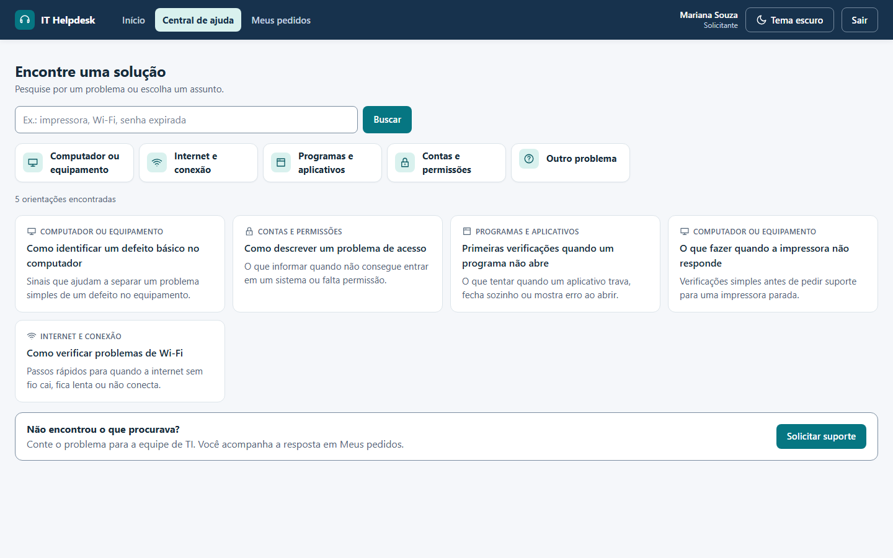

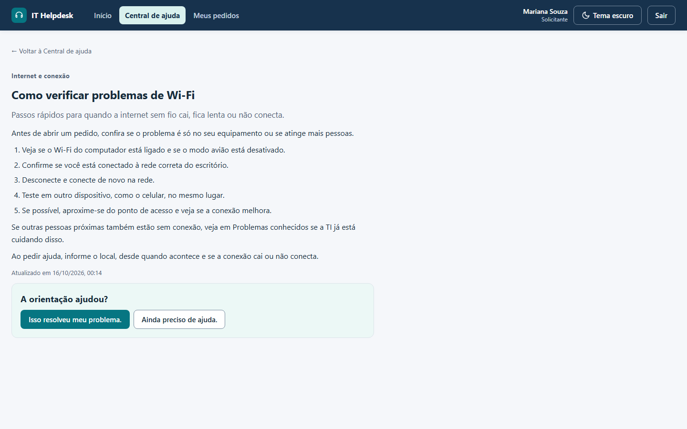

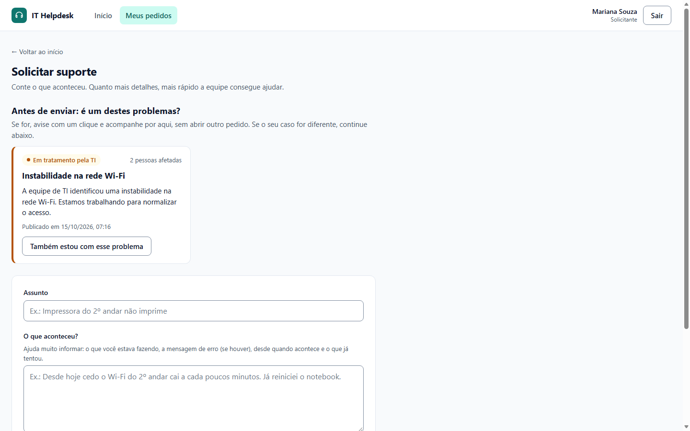

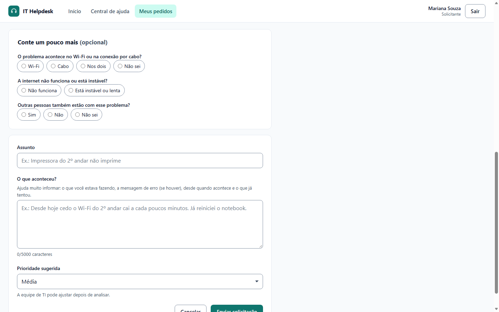

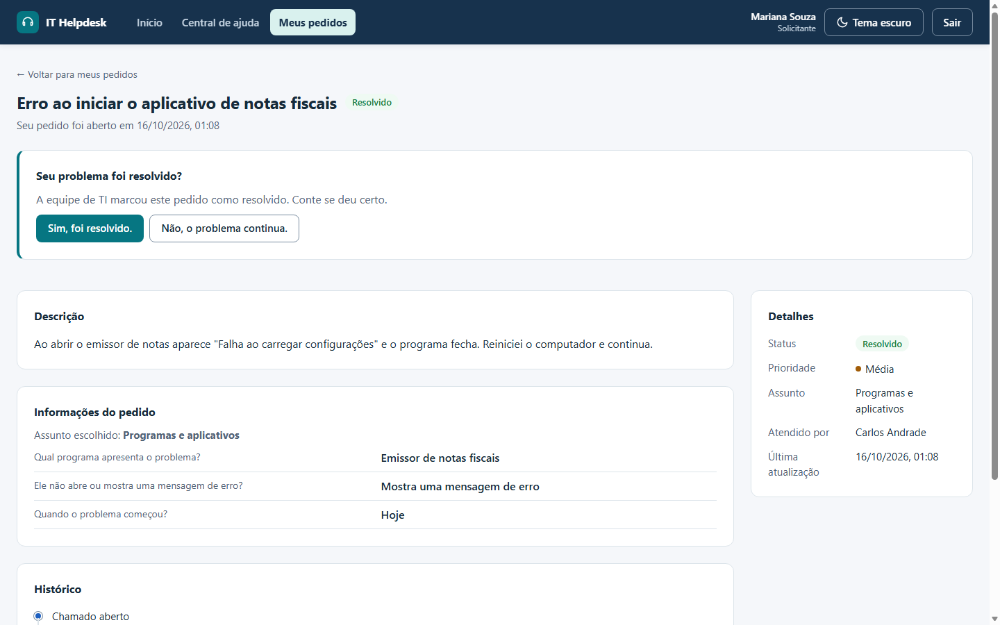

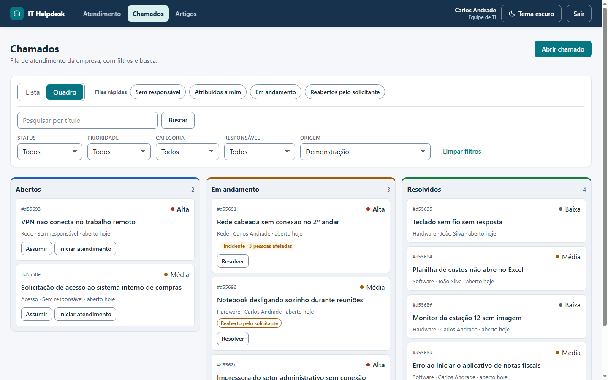

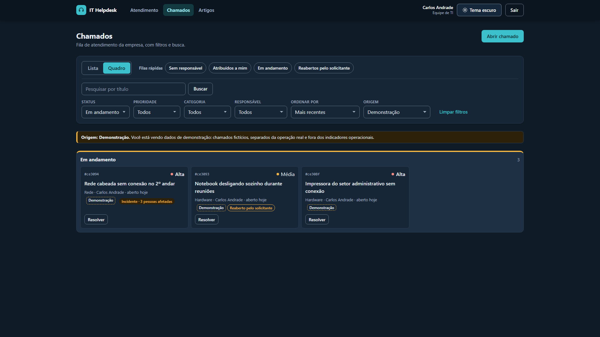

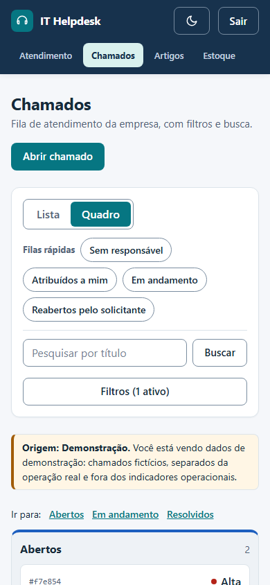

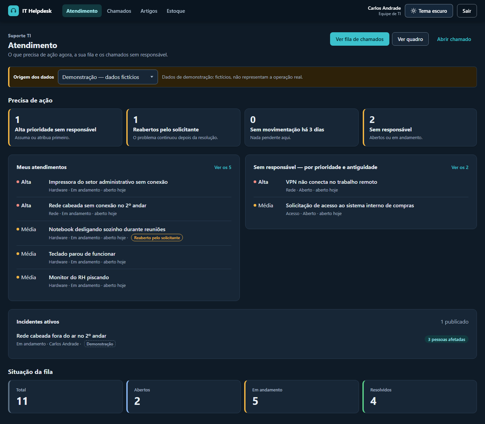

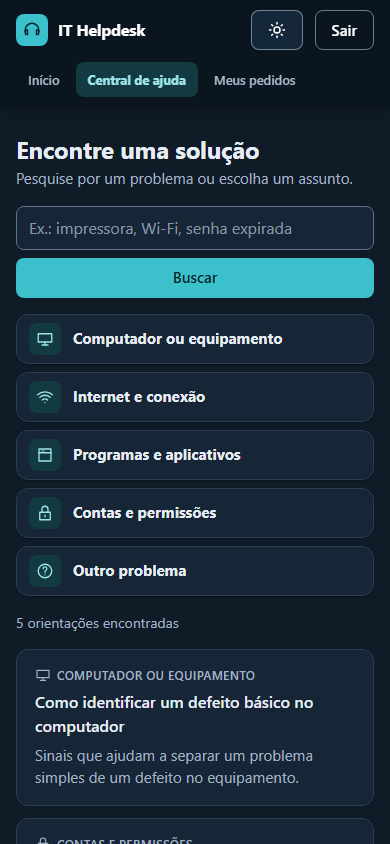

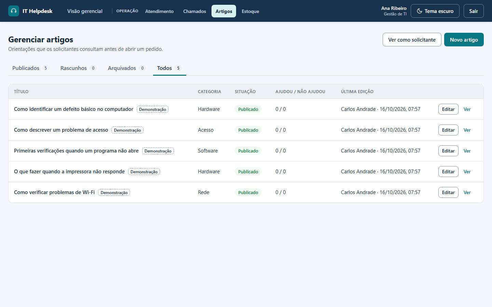

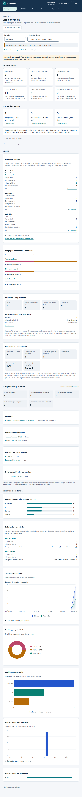

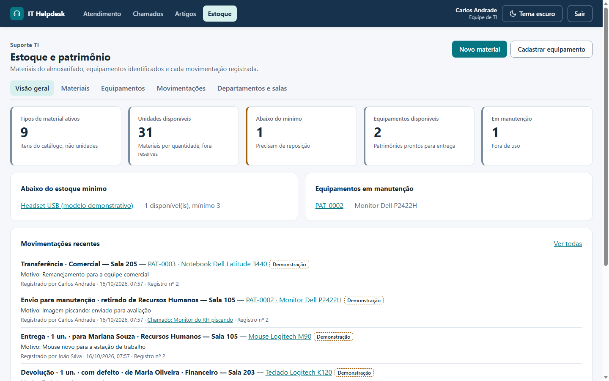

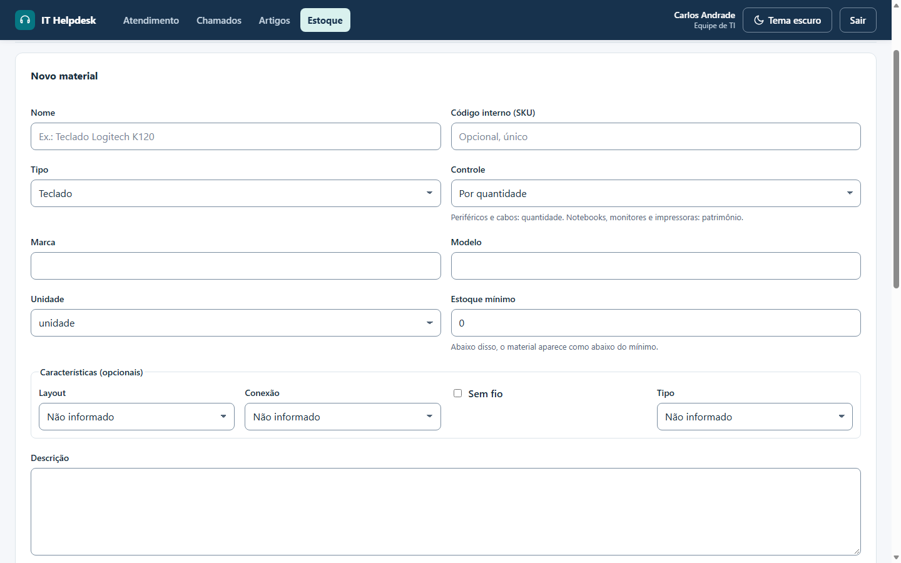

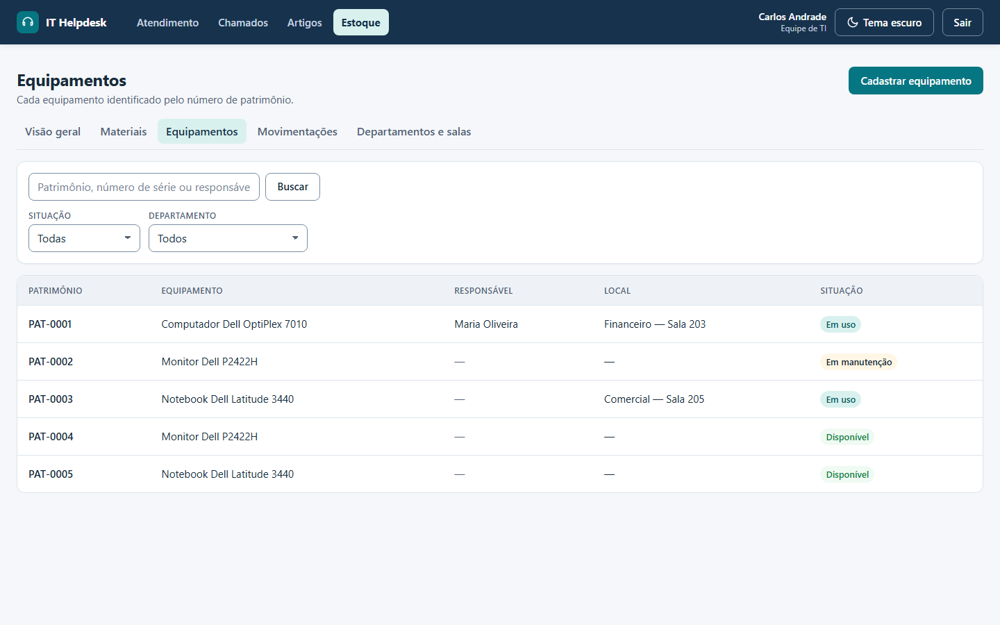

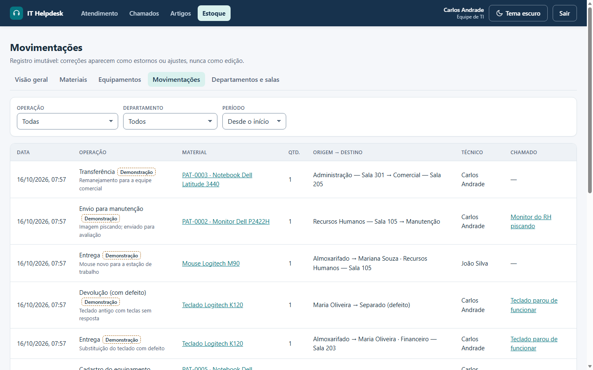

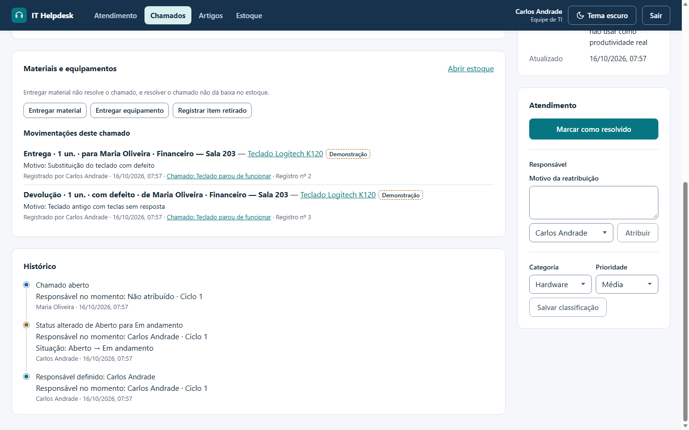

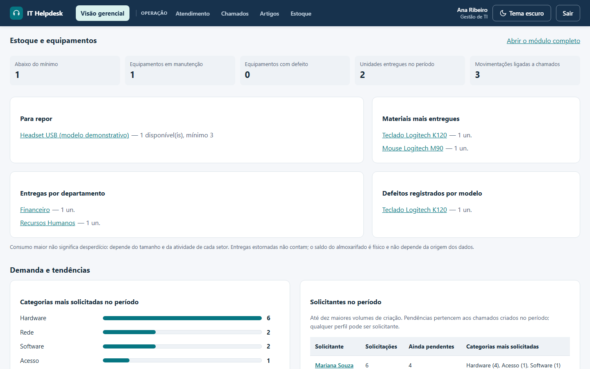

A confirmação de resolução é apenas exibida na captura, sem resposta; o formulário de pedido não é enviado.
