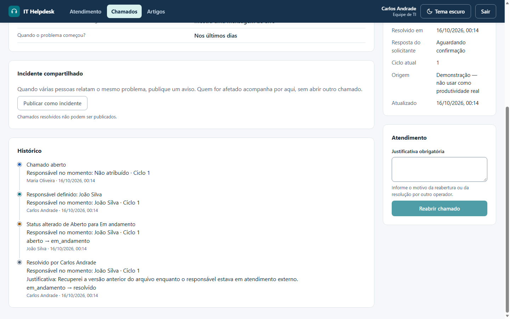

# Integridade e auditoria dos chamados

[Voltar ao README](../README.md) · [Regras](01-produto-e-regras.md) · [API](03-fluxos-e-api.md)

## Identidades e autoria

Solicitante abre o chamado; responsável é quem está atribuído; autor executa uma ação. Uma identidade não substitui a outra. TI e gestor podem operar e ser responsáveis. Resolver um chamado atribuído a outro responsável exige justificativa de 5–1000 caracteres. Reabertura, alteração de prioridade e reatribuição durante atendimento também exigem motivo.

A auditoria é da equipe: o solicitante recebe o histórico do próprio chamado sem o bloco `audit`, sem justificativas e sem IDs ou e-mails de outras pessoas (detalhes em [regras](01-produto-e-regras.md#permissões-implementadas)).

O backend valida o JWT e consulta o usuário ativo a cada requisição. Autor, snapshots e datas são gerados pelo servidor. O cliente não pode fornecer esses campos, editar o histórico nem modificar projeções de resolução.

## Eventos v2 e escrita atômica

`history[]` preserva os eventos legados e recebe novos eventos com `audit.schemaVersion = 2`. A estrutura contém:

- `eventId` e `operationId`: identificam evento e agrupam eventos da mesma escrita.
- `actorId` e `actorSnapshot`: identidade estável, nome e papel no momento da ação.
- `eventType`, `occurredAt`, `revision` e `eventIndex`: ação, data e ordem dentro da revisão.
- `from` e `to`: valores estruturados que mudaram.
- `assigneeAtEvent` e `assigneeSnapshot`: responsável no momento, separado do autor.
- `cycleId`, `reason` e `dataOrigin`: ciclo, justificativa e origem dos dados.

Os campos antigos `author`, `at`, `type` e `message` continuam presentes nos novos eventos para compatibilidade. Representam o mesmo evento, sem duplicar resoluções. A validação exige consistência entre esses campos e os campos estruturados.

Toda mutação exige `expectedRevision` da leitura efetiva do frontend. Estado, incremento de revisão, eventos e projeções são escritos em uma atualização atômica condicionada à revisão anterior. Falha de precondição retorna 409; a interface informa e recarrega. Não há retry automático de uma intenção baseada em dados antigos.

`operationId` agrupa a escrita; ainda não implementa replay idempotente de resposta HTTP. Reenviar a revisão consumida retorna conflito e não duplica o evento. Não há transação distribuída entre usuários e chamados: mudanças de usuário durante uma requisição em andamento exigem considerar a janela entre validação e escrita.

## Resolução, reabertura e ciclos

Resolução exige responsável ativo/elegível e estado em andamento. Preserva a atribuição e grava `resolvedBy` com o autor autenticado e `resolvedAt` com a data do evento de resolução.

Reabertura exige motivo, incrementa `activeCycleId` e limpa essas projeções do ciclo atual. As resoluções anteriores permanecem no histórico. Um ciclo pode ter uma resolução; novas resoluções exigem reabertura. Ciclos estruturados não reconstruem automaticamente ciclos antigos descritos apenas em texto.

Chamados legados sem esses campos não recebem autor/data de resolução presumidos. A interface direciona ao histórico quando não há projeção estruturada. Eventos sem autor/data retornam null, exibidos como não registrados; IDs existentes continuam disponíveis mesmo se o usuário tiver sido removido.

## Resposta do solicitante à resolução

A confirmação (`resolution_confirmed`), a avaliação (`resolution_rated`, com nota e comentário em `audit.to`) e a contestação (`reopened` com `from.cycleId` e `to.contestedCycle`, e o motivo em `audit.reason`) são eventos v2 do próprio chamado, com o solicitante como `actorId` e `actorSnapshot`. A identidade vem do token; o corpo não aceita usuário.

Cada resposta indica o ciclo da resolução. O servidor só aceita a resolução do ciclo atual, com o chamado ainda resolvido, e grava com a revisão lida, como as demais ações: duas respostas simultâneas não passam juntas, e uma resposta a um ciclo antigo, ou depois de a TI reabrir, recebe 409. A contestação preserva o evento de resolução, seu autor e a justificativa; `resolvedAt`/`resolvedBy` são limpos como em qualquer reabertura.

Os indicadores de atividade operacional e de reaberturas por operador consideram só ações de TI e gestor; as respostas do solicitante entram apenas na seção de qualidade.

## Artigos da base de conhecimento

Artigos guardam autor, último editor, data da primeira publicação e revisão, mas não um histórico de versões: editar substitui o texto anterior. Votos de "ajudou" não geram eventos, como as participações em incidentes.

## Eventos dos incidentes compartilhados

Cada incidente guarda seu próprio `history[]`, fora do chamado. Os eventos são `published`, `updated`, `closed` e `republished`, com `actorId`, `actorSnapshot` (nome e papel), data, revisão do incidente, ciclo e os valores `from`/`to` alterados. Editar sem mudar o texto não gera evento.

O encerramento automático registra como autor quem resolveu o chamado. Se essa gravação falhar e for concluída depois, pela reconciliação na leitura, o autor continua sendo quem resolveu; na falta dessa informação (chamado legado), fica quem publicou. A interface mostra se o incidente foi encerrado com a resolução do chamado ou manualmente.

Participações (entrar e sair) não entram no histórico. Ficam na coleção de participações, com data de entrada e de saída, suficientes para contar afetados sem registrar um evento por clique. Regras em [produto e regras](01-produto-e-regras.md#incidentes-compartilhados).

## Origem dos dados e métricas

`dataOrigin` distingue `operational`, `demo` e `legacy`. Criações pela API com contas demonstrativas reservadas são classificadas como demonstração; outras criações são operacionais. Seeds de exemplo são demonstrativos. Documentos antigos não classificados ficam como legado, sem inclusão automática no conjunto operacional.

Dashboard e lista aceitam filtro por origem. O dashboard seleciona dados operacionais inicialmente. Dados simulados servem à demonstração e não sustentam medidas de produtividade real. Para registros antigos, classificação deve ser explícita e baseada em evidência; a manutenção local autorizada classifica chamados das contas reservadas de demonstração.

A visão gerencial implementa resoluções por autor/ciclo, participação, reaberturas executadas e ranking de solicitações, usando apenas eventos estruturados consistentes para ações e informando cobertura do legado. Duração por ciclo e SLA não são calculados. [Definições e filtros](04-metricas-decisoes-e-limites.md#visão-gerencial-exclusiva). `assignee` indica atribuição; não prova autoria de resolução. `updatedAt` não é data de resolução.

## Usuários e manutenção local

`active = false` bloqueia autenticação, tokens existentes e novas atribuições. Não há tela ou endpoint de administração/desativação nesta etapa. Chamados com responsável desativado/removido precisam de reatribuição antes de iniciar ou resolver. Referências e snapshots históricos são preservados.

O script `backend/src/scripts/normalize-local-demo.ts` renomeia somente as duas contas adicionais autorizadas e classifica dados dessas contas e das contas reservadas do seed. Preserva IDs, credenciais, relacionamentos, datas e eventos; é idempotente, exige `LOCAL_DEMO_MAINTENANCE=1` e restringe a conexão ao banco local de desenvolvimento. Nunca executá-lo em produção.

Histórico embutido continua sujeito ao limite de tamanho do documento MongoDB. Datas futuras existentes bloqueiam novas alterações para revisão de integridade; eventos legados fora de ordem não são silenciosamente reorganizados. A ordem dos novos eventos é definida por revisão/índice, sem inventar timestamps.

## Verificação

`audit.test.ts` cobre resolução por terceiro, gestor, ciclos, revisão ausente/antiga, concorrência, legado incompleto, datas, snapshots, usuários desativados e separação de origens. `manager.test.ts` confere períodos/fuso, autoria, ciclos, duplicação, legado, referências removidas, filtros e isolamento de origens. `incidents.test.ts` cobre permissões, campos aceitos, publicação simultânea, formato público sem dados privados, participação repetida e simultânea, saída e retorno, edição concorrente, encerramento pela resolução (com autor), reconciliação de um encerramento perdido, reabertura, republicação e chamados legados. `resolution.test.ts` cobre quem pode responder, validação, confirmação repetida e simultânea, avaliação única, contestação com motivo e novo ciclo, contestação simultânea, ciclo antigo, reabertura pela TI antes da resposta e os indicadores de qualidade. `articles.test.ts` e `intake.test.ts` cobrem permissões, rascunhos, busca, votos, perguntas e artigo consultado. O E2E verifica justificativa e autoria no histórico/tabela, conflito de uma tela antiga, operações do gestor, três reloads por perfil, viewport de 390 px, o fluxo de incidente entre TI, solicitante e gestor, a contestação e confirmação da resolução e as ações do quadro com justificativa e conflito 409.

## Evidência visual da autoria

No exemplo fictício, Mariana Souza é a solicitante, João Silva permanece responsável atribuído e Carlos Andrade é o autor autenticado da resolução. O histórico registra a justificativa e o ciclo; a resolução não transfere silenciosamente a atribuição. Esta captura apenas consultou o registro existente.
